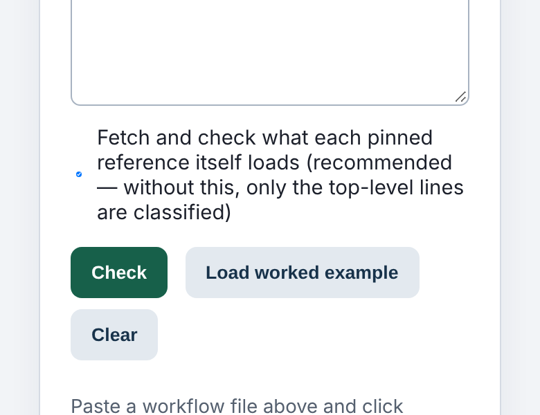
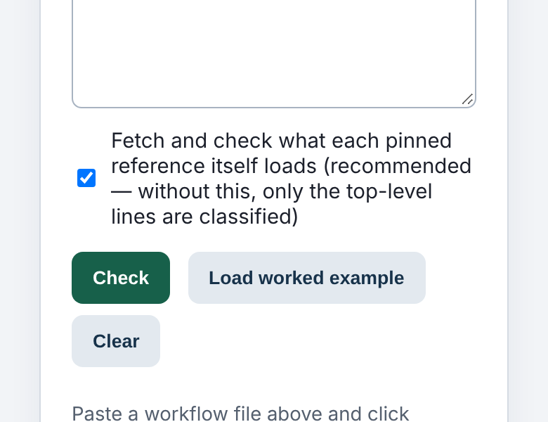
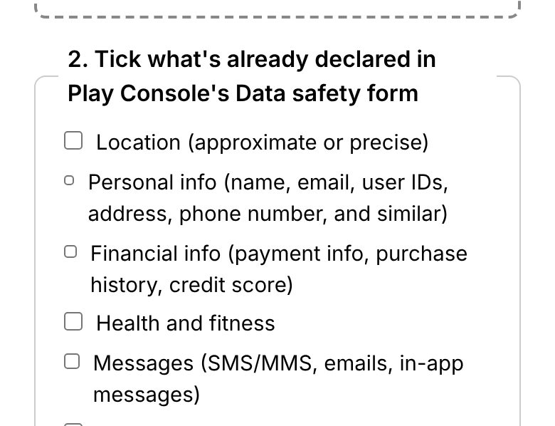
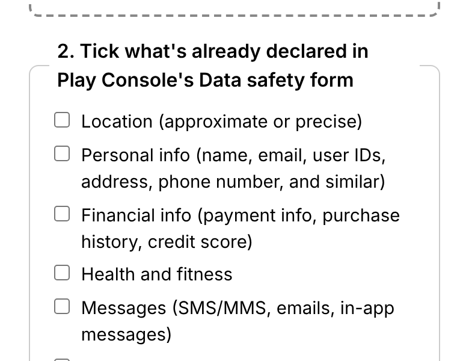

# Polish 2026-11-12: checkboxes and radios on phones stop being squashed (423 at 320 px, 172 at 390 px)

**Why this item.** I started on item 2 of "Still weakest" in
`polish-2026-11-12-wide-tablet-sweep.md`: a shared `input,select,textarea{min-width:0}` at
every width, to close the mid-width sideways class. Before shipping it I measured it in place on
a sample of pages. On android-data-safety-check at 1,040 px it squeezed the category checkboxes
from 13 px to 6 to 9 px wide. The phone-only version of that same rule has been in `reflow.mjs`
since 2026-08-29, so I measured phones next. The same squashing was already live there, on
hundreds of pages.

## What a visitor saw

A checkbox inside a flex `<label>` beside a caption that wraps. With `min-width:0` the checkbox
is a flex item with no floor, so it is the item that gives way. At 390 px:

| page | before | after |
|---|---|---|
| actions-transitive-pin-check, "Fetch and check what each pinned reference itself loads" (4 px wide) |  |  |
| android-data-safety-check, the Data safety categories (7 to 11 px wide) |  |  |

The caption also lines up again: before, every squashed row's text started at a different x.

## How it was measured

A full local build (`node platform/pages/build.mjs`, 8,984 HTML pages), served on :8793, with
Chromium and every non-localhost request blocked. Each page was loaded at 320 px and resized to
390 px, and measured 250 ms after each resize. A checkbox or radio counts as **squashed** when it
is visible and narrower than it is tall by more than half a pixel. "After" uses the built
`pf-chrome.css` and `pf-site.css` with the new rules swapped in, rather than a second 10-minute
build. Those two files are the only places `REFLOW_CSS` lands (`build.mjs` and `site-nav.mjs`).
The after pass re-ran only the pages flagged before. The change only adds a floor to these two
input types, so it cannot squash a box that was whole.

| width | squashed before | pages | after | pages |
|---|---|---|---|---|
| 320 px | 423 of 1,400 visible checkboxes and radios | 287 | 2 | 1 |
| 390 px | 172 of 1,401 | 121 | 2 | 1 |

93 pages had a box under 8 px wide at 320 px, and 65 did at 390 px. The 2 left after are a false
positive. seasonal-buy-quantity-optimizer's two radios are a full 13 px wide, and its own
`inline-flex` label stretches them taller.

Sideways scroll on the 287 pages after the change: none at 390 px. Four pages scroll at 320 px
(event-seating-chart-optimizer +19, shipping-box-size-optimizer +19, open-house-plans +16,
proposal-maker +8). They scroll by the same amount with the original CSS, so the overflow is
older than this change. See "next" below.

## What changed (`platform/pages/reflow.mjs`, inside `@media (max-width:640px)`)

1. `:where(input,select,textarea){min-width:0;max-width:100%}` became
   `:where(input:not([type=checkbox]):not([type=radio]),select,textarea){…}`. Checkboxes and
   radios never hold a track open, because their automatic minimum is their own 13 px box. That
   cleared 416 of 423 at 320 px.
2. `:where(input[type=checkbox],input[type=radio]){flex-shrink:0}`. Five ventures write their
   own `input{min-width:0}`, which outranks `:where()` and still squashed the site footer's usage
   opt-out to 11 px at 320 px. No venture sets `flex-shrink` on a checkbox, so this rule holds
   anyway. That cleared the remaining 5.

Two tests in `reflow.test.mjs` pin both rules. `node --test 'platform/pages/*.test.mjs'`: 1,560
pass, 25 skipped, and 1 failed in the full run: "an identical build produces an identical cache
name". I had written the run record into the tree during that build. The test passes when run
alone afterwards.

## Why I did not ship the all-widths `min-width:0` rule

An in-place before/after on the first 30 pages with a control, at 700, 820, 1,040 and 1,280 px,
changed no page's overflow. The settled run's first change was android-data-safety-check's
checkboxes, squeezed at 1,040 and 1,280 px. A first version of the script also reported phantom moves
(up to 220 px). Those came from measuring before the page had settled after a resize: a no-op rule
gave the same "changes". The script now polls until two readings agree, and a no-op rule gives 0.
A full-catalogue run of it at four widths took about 25 minutes per 1,000 pages here, too slow for
one session. With the checkbox exclusion it is worth re-running.

## Still weakest, and what I would do next

1. **The four pages that scroll at 320 px** (above). 320 px is the WCAG reflow width but not in
   `sideways.mjs`'s default `360,820`. Fix the four, then consider `320,820`.
2. **The mid-width input rule.** Re-measure
   `:where(input:not([type=checkbox]):not([type=radio]),select,textarea){min-width:0;max-width:100%}`
   above 640 px. The settle-polling before/after script is described above: load once, resize, poll
   until stable, add the rule as a `<style>`, poll again, and compare every control's box and the
   document's `scrollWidth`. Run it on the pages with multi-column forms first, not all 6,808 with
   a control.
3. **A check that keeps this fixed.** The squashed-box count is about 40 lines of Playwright: the
   width-less-than-height test above, over every page. It could join the nightly browser checks
   next to `sideways.mjs`, which is control-plane CI, so it goes in its own PR.
4. Carried over: the ticker's third line at 320 px; `.pager` defined twice in the writing STYLE;
   the research index's card length on phones.
