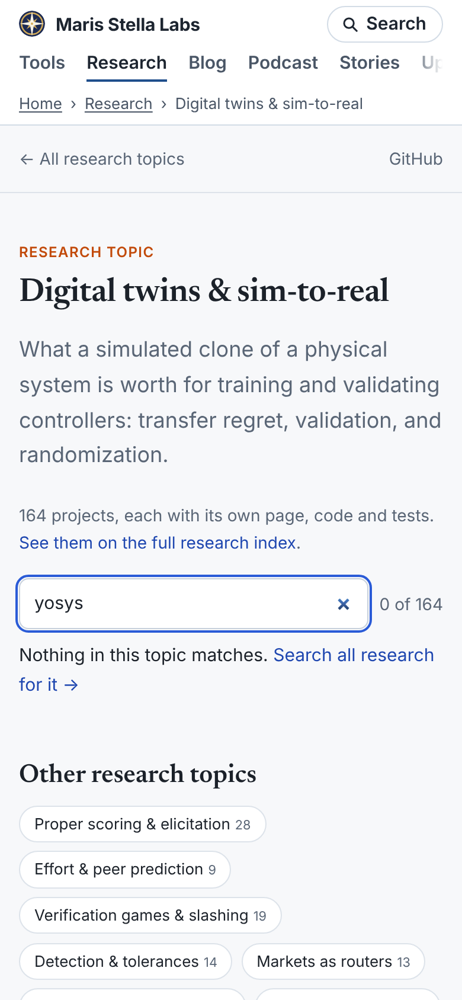
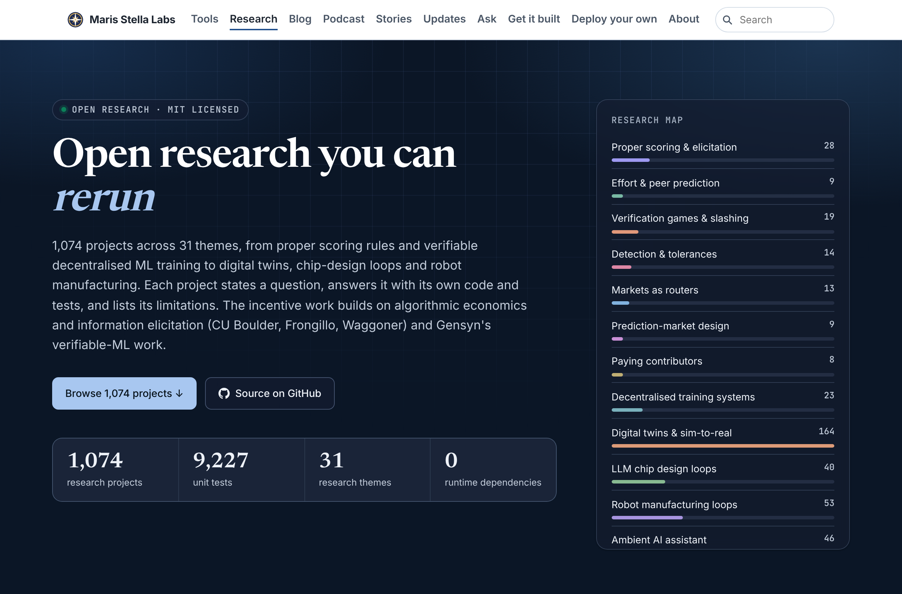

# Polish 2026-11-12: topic filter's empty state hands off to the index search

**Why this item.** I started on the same item as PR #15149 (topic pages 68,158 px on a phone) from
`polish-2026-11-12-research-index-length.md`. #15149 merged first with better numbers (twins 38,413 px),
so I rebased onto it and dropped my overlapping version. Mine removed the abstract from topic cards
instead of clamping the lede: 52,912 px, HTML 2.54 → 1.56 MB. What remains is item 3 of #15149's
"still weakest" list, plus item 3 of the index report (log headings unchecked).

## What changed

1. `research/_homepage/topic.html`: when the filter matches nothing, a `.none` note appears with
   "Search all research for it →", whose `href` is `../../index.html?q=<the words>`. The note is
   `hidden` until then. A `?q=` on the topic URL prefills the filter.
2. `research/_homepage/template.html`: the index search fills itself from `?q=` on load. It then runs
   the existing `loadAll(filter)`, which fetches `more-cards.json`.
3. Tests in `platform/ci/test_research_homepage_publish.py`:
   `test_empty_topic_filter_hands_its_words_to_the_index_search`, and `LogFormatTest`, which fails
   any `research/*/LOG.md` with no `## ` entry. The marine-colregs log dropped out silently that way.

## Checked

I rebuilt the research pages into the full local `dist` with the real site chrome and opened them in
Chromium at 390 and 1280 px:

| query | result |
|---|---|
| `lidar` on the twins page | 9 of 164; note hidden |
| `yosys` on the twins page | 0 of 164; note visible, link `../../index.html?q=yosys` |
| follow that link | the index search holds "yosys" and shows 25 cards |
| `?q=regret` on the twins page | 20 of 164 |
| page errors | none |

`test_research_homepage_publish.py`: 10 of 10 pass. `research/_homepage/build.py` prints ok.

## Still weakest

1. **Topic HTML weight**: abstracts are inside every card's `
`. Twins is ~275 KB, and all 31
   topics come to 2.54 MB. Each abstract is also on its project page. Dropping it from the topic
   cards would cut about 1 MB with no visible change while the cards are closed. But #15149 chose to
   put "Result and abstract" in one disclosure, so a later run should decide that together with item 1.
2. Carried over from #15149: titles are most of a phone card, twins is still 38,413 px, the site nav's
   cut-off row at 390 px has no fade, and the index's 32 theme sections take 19,761 px at 390 px.
