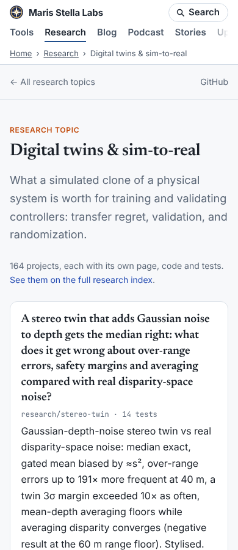
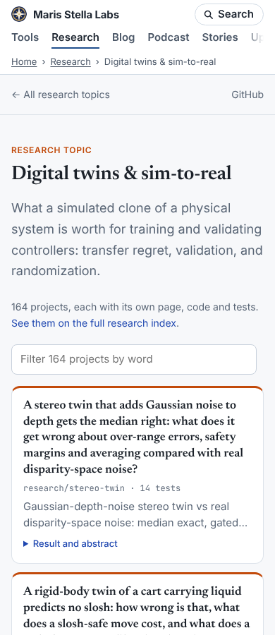
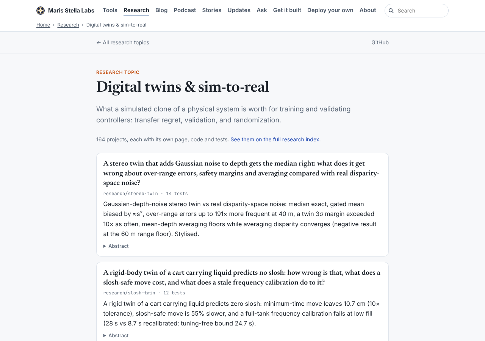
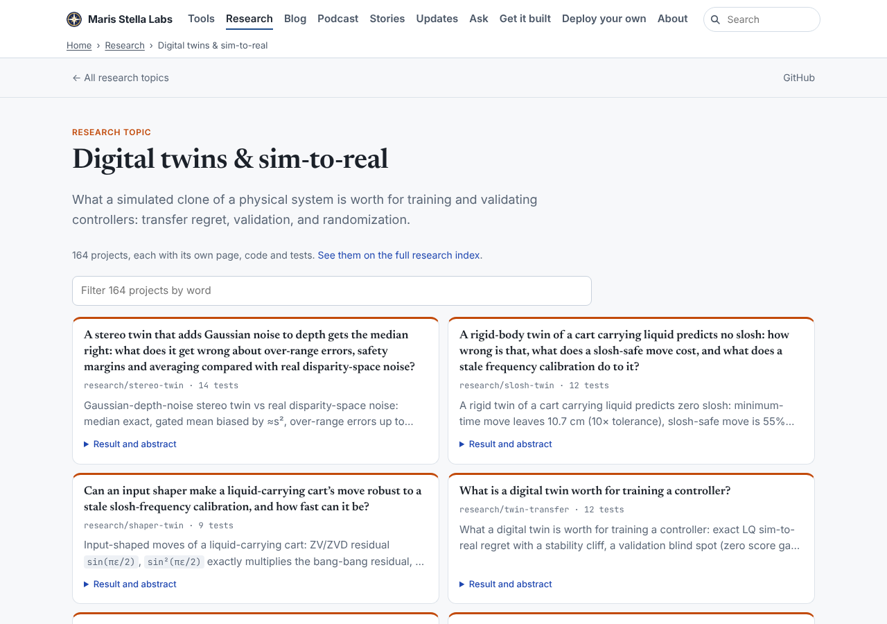

# Polish 2026-11-12: research topic pages, 68,158 px tall on a phone, now 38,413

**Why this item.** Item 2 of "still weakest" in `polish-2026-11-12-research-index-length.md`:
"Topic pages are long too: `research/topics/twins/` is 68,158 px at 390 px (145 projects, every
abstract)." Measured: 164 projects, and the abstract was already in a closed `
`. The height
was the full lede (the README bullet, median 286 characters, max 2,771) on every card, ~415 px a card.

**How it was measured.** Full local build, then `research/_homepage/build.py --out
platform/pages/dist/research --base-url https://marisstella.app/ --site-chrome <the chrome JSON
build.mjs writes to /tmp/pf-research-chrome-*/>` for before (stashed) and after. Served from
`dist/`, Chromium, third-party requests blocked, `document.documentElement.scrollHeight` 300 ms
after `load`, all 31 topic pages at 390 and 1280 px.

## What changed (`research/_homepage/topic.html`, `topic_card` in `build.py`)

1. The lede is `
`, clamped to two lines (`-webkit-line-clamp` and `line-clamp`).
   The details summary is now "Result and abstract"; `.proj:has(details[open]) .res` unclamps it.
   No text is duplicated.
2. A filter form (`.find`, `hidden` in the HTML, shown by the inline script) that hides cards whose
   text lacks any typed word, with an `aria-live` "n of N" count.
3. At ≥ 960 px: every `.wrap` 1,120 px (so the topbar lines up), prose capped at 760 px, the
   projects in a two-column grid with stretched cards; while any card is open the grid aligns to
   the top so its neighbour does not stretch into an empty box.
4. Test: `ResearchIndexLengthTest.test_topic_pages_show_every_project_compactly` in
   `platform/ci/test_research_homepage_publish.py`.

Checked in a browser: clamped result 46 px, opened 116 px; "slosh" leaves 2 of 164; clearing
restores 164; with JS off the form stays hidden and all 164 cards show.

## Numbers

| all 31 topic pages | before | after |
|---|---|---|
| sum at 390 px | 513,054 | 318,372 |
| sum at 1280 px | 309,795 | 157,911 |
| twins 390 / 1280 | 68,158 / 41,216 | 38,413 / 18,650 |
| median page at 390 | 15,101 | 9,762 |
| sideways scroll | none | none |

## Still weakest, and what I would do next

1. **Titles are now most of a phone card** (four lines at 17 px for the median ~150-character
   question). Twins is still 38,413 px. Options: a phone-only `h2` at 16 px (measure), or a
   short-title field in `project.json` used on topic cards only. The second is editorial work.
2. **The site header's nav row is cut at 390 px** ("Up…" for Updates shows at the edge in the
   screenshot). It scrolls sideways by design inside its own row, but nothing signals it; a fade
   at the right edge would.
3. **The filter is per topic.** The index has the global search (`more-cards.json`); a link from
   the topic filter's "0 of N" state to the index search with the same words would help.
4. Carried over: 32 theme sections still 19,761 px on the index at 390 px; `.pager` defined twice
   in the writing STYLE; the ticker's third line at 320 px; 190 posts with no related link.
