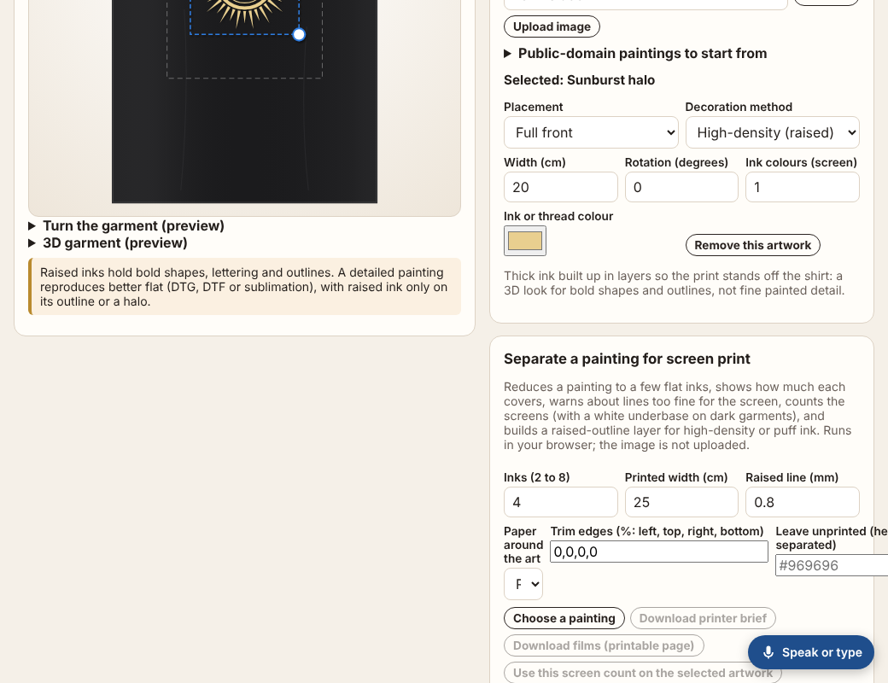
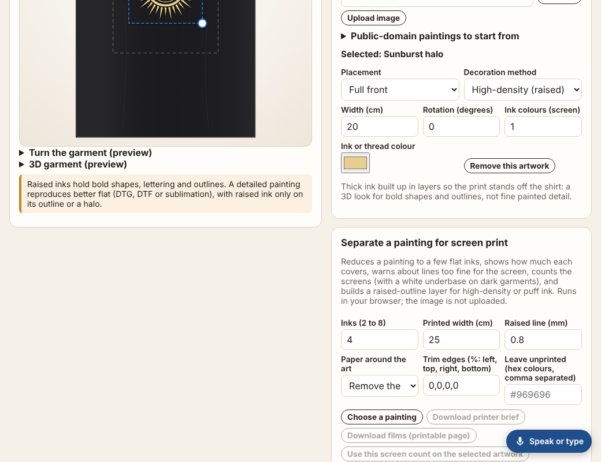
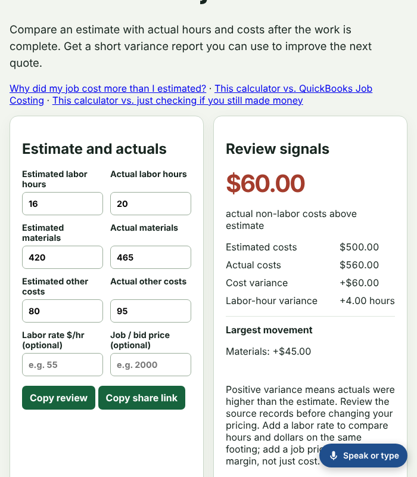

# Polish 2026-11-12: a sideways sweep at 600, 700, 1,040 and 1,100 px; three pages fixed, and the sweep stops misreading narrowing resizes

**Why this item.** Item 1 of "Still weakest" in `polish-2026-11-12-mid-width-sideways.md`:
"820 and 900 were swept; 1,000 to 1,100 only on the five pages above ... a one-off `WIDTH=1040`
sweep is worth a run." I added 600 and 700 too, because no sweep had covered the band between the
phone widths (320 to 390) and 820.

I checked item 2 of `polish-2026-11-12-topic-pages.md` first ("the site header's nav row is cut at
390 px ... a fade at the right edge would"). It is stale: `site-nav.mjs` already has the fade
(`--pfs-fade` mask, scroll-driven so it goes at the end of the row).

**How it was measured.** Full local build (`node platform/pages/build.mjs`, 8,939 pages), served on
:8793, then `WIDTH=1040,600,700,1100 node platform/pages/sideways.mjs`. Each page that sweep
flagged was checked again with fresh loads at 14 widths (320, 360, 390, 600, 700, 761, 820, 900,
960, 1,000, 1,040, 1,100, 1,180, 1,280), waiting 200 ms after `load`.

## First run: 6,230 failures, almost all false

| | page/width pairs |
|---|---|
| flagged, widest box = venture header or footer (`nav.pf-chrome-top`, `aside.pf-chrome-foot`) | 6,228 |
| flagged, anything else | 2 (clothing-design-studio at 1,040 and 1,100) |

The header overflow was exactly 1,040 − 600 = 440 px at 600 and 340 at 700. `sideways.mjs` loads
each page at the first width and resizes in place for the rest. It measures one animation frame
after the resize. But `VENTURE_CHROME_JS` (`site-nav.mjs`) re-fits the header and footer to the
window on a **60 ms debounced** `resize`, so one frame later they still have the old, wider width.
The default `360,820` only grows the window, so this never showed. A real visitor who rotates a
tablet sees a 60 ms flash at most, not a defect.

**Fix in the sweep:** when a resized width overflows, wait 150 ms and measure again. A clean page
pays nothing. Rerun of the same command: **2 pairs** (below). Each of the 6,228 was gone, and those
two had been hidden behind the false header flags.

## Three real pages, one cause

| page | before | range | cause |
|---|---|---|---|
| clothing-design-studio (index) | +161 px at 960, +124 at 1,040, +15 at 1,280 | 901 to ~1,300 px | `#sep-crop`, `#sep-knock` have no `type`, so `input[type=text]{width:100%}` missed them; at the default width they held `.row3`'s `1fr` tracks open. The paper select was squashed to "F" |
| cut-list-optimizer/compare-4x8-vs-5x5 | +112 px at 700, +51 at 761 | 641 to ~800 px | `.fields` `1fr 1fr 1fr` of default-width inputs |
| job-margin-variance | +101 px at 700, +40 at 761 | 651 to ~800 px | `.grid` and `.fields` `1fr 1fr`, inputs with no width |

It is the same rule as in the earlier report: the minimum of a `1fr` track is `auto`, so the track
never gets narrower than its content's min-content. Fixes: `minmax(0,1fr)` tracks; inputs
`min-width:0; width:100%; box-sizing:border-box`; `input:not([type])` added to the studio's width
rule. On job-margin-variance, labels that wrap to two lines had pushed their inputs out of line, so
`.fields label{align-content:space-between}` puts every input on the same baseline.

**After:** all three are at 0 px at all 14 widths. Venture suites pass (clothing-design-studio,
cut-list-optimizer, job-margin-variance; each has a new regression test). Site build tests:
1,558 pass, 0 fail, 21 skipped.

A grep for the studio's exact pattern (a page styling `input[type=text]` that also has untyped
`<input>`s) across `ventures/*/*.html` found no other page.

## Not done

- No full rerun of the sweep after the three page fixes. Each fix was measured on its own page,
  and no other page changed.
- `browser_checks.py` still runs the default `360,820`. Adding 700 and 1,040 to the default would
  cost one resize per page plus the 150 ms re-check, but only on pages that overflow. Worth doing
  now that the false flags are gone.

## Still weakest, and what I would do next

1. **Make `360,700,1040` the sweep default** (above). Time it first: with the debounce fix, a
   whole-catalogue run at four widths took several times the tool timeout here (not timed exactly).
2. **Default-width inputs in `1fr` grids** caused 6 of the 8 mid-width defects found today (3 of 5 in
   `polish-2026-11-12-mid-width-sideways.md`, and all 3 here).
   A shared `input,select,textarea{min-width:0}` in `reflow.mjs`'s injected CSS would close the
   class. Measure it first with a screenshot diff on a sample, because it changes layout on pages
   that are fine today.
3. Carried over: topic-page titles take up most of a phone card (`polish-2026-11-12-topic-pages.md`);
   `.pager` is defined twice in the writing STYLE; the ticker wraps to a third line at 320 px.
