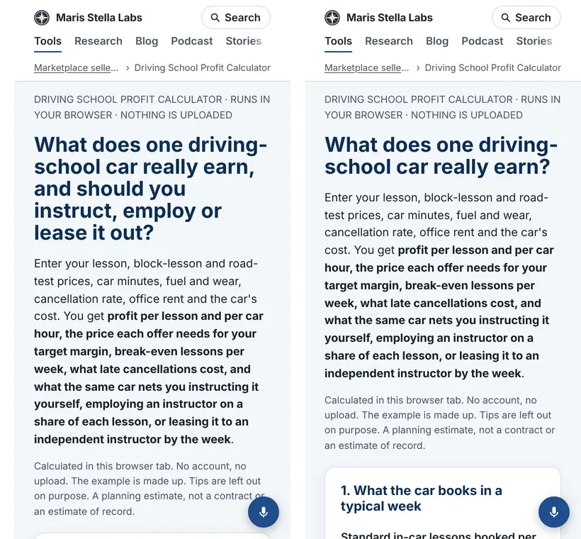

# Polish 2026-11-17: tool h1s capped at 90 characters (31 pages rewritten)

Date: 2026-11-17. Track: polish/0. Picked item 1 of "Still weakest" in
`polish-2026-11-17-h1-length.md` ("h1s of 81 to 100 characters still wrap to 5 lines at 390").
Open PRs searched (`list_pull_requests`, open, 50): none touch tool-page h1s or
`platform/pages/hero-heading.mjs`.

## What was wrong

The last run capped h1s at 100 characters. At 390 px a tool page's h1 is 28.8 px and fits about
20 characters a line, so the 31 pages between 91 and 100 characters still wrapped to 4 or 5 lines
(123 to 161 px) before the lede. On a phone the first screen was the heading and the lede, with
the form below the fold. Most were two questions or a question plus a list of outputs that the lede
under it repeats word for word ("Yearly profit, break-even occupancy and the nightly rate you need").

## What changed

- **31 h1s shortened** in `ventures/<slug>/index.html`, `llms.txt` line 1 changed to match on 30
  of them (dynamic-time-warping's `llms.txt` has its own heading and was left). Same rule as the
  last run: keep the first question, let the lede carry the rest. Every dropped clause is in that
  page's lede (checked by reading each: instruct/employ/lease, ramp-up cash, the realised FX gain
  or loss, the buy-the-card break-even, and so on). `<title>`, meta description, JSON-LD and FAQ are
  untouched, so the query words a search engine reads stay where they were.
- **`MAX_H1_CHARS` 100 → 90** in `platform/pages/hero-heading.mjs`; the existing test in
  `hero-heading.test.mjs` now enforces it. `longHeadings(undefined, 90)` is empty.
- `storage-auction-max-bid-calculator/page.test.mjs` matched the old h1's tail ("before you've
  paid for a dump run"); it now matches the claim the test is about ("can bid you past your own
  break-even."), which the worked-example assertion beside it still checks.

## Measured (Playwright, built pages, before and after, same 31 pages)

`node platform/pages/hero-heading.mjs --slugs=<the 31> --json=...` against a local build; the
"after" numbers patched the 31 built pages' h1 with the new source text, so the CSS and the rest of
each page are the deployed ones.

| page | characters | lines at 390 | h1 px at 390 | h1 px at 1,280 |
|---|---|---|---|---|
| driving-school-profit-calculator | 94 → 45 | 5 → 2 | 155 → 62 | 145 → 97 |
| training-gpu-pricing-calculator | 91 → 51 | 5 → 3 | 161 → 97 | 153 → 102 |
| storage-auction-max-bid-calculator | 93 → 59 | 5 → 3 | 158 → 95 | 150 → 100 |
| cash-flow-risk-forecaster | 98 → 60 | 5 → 3 | 155 → 93 | 145 → 97 |
| campground-site-profit-calculator | 98 → 67 | 5 → 3 | 155 → 93 | 145 → 97 |
| swim-lesson-pool-rental-profit-calculator | 97 → 56 | 5 → 3 | 155 → 93 | 145 → 97 |
| lawn-aeration-overseeding-bid-calculator | 95 → 54 | 5 → 3 | 155 → 93 | 140 → 93 |
| esthetician-studio-profit-calculator | 93 → 46 | 5 → 3 | 155 → 93 | 97 → 97 |
| surety-bond-capacity-calculator | 94 → 66 | 5 → 3 | 154 → 92 | 137 → 92 |
| coworking-space-profit-calculator | 92 → 52 | 5 → 3 | 155 → 93 | 145 → 97 |
| dental-patient-financing-fee-calculator | 95 → 48 | 4 → 2 | 123 → 62 | 92 → 46 |
| patent-maintenance-fee-planner | 91 → 73 | 5 → 4 | 160 → 128 | 144 → 144 |
| uptime-monitoring-pricing-calculator | 91 → 72 | 5 → 4 | 161 → 129 | 153 → 102 |
| mobile-mechanic-visit-pricing-calculator | 99 → 74 | 5 → 4 | 155 → 124 | 145 → 97 |
| uk-pension-annual-allowance-calculator | 99 → 76 | 5 → 4 | 155 → 124 | 145 → 97 |
| fishing-charter-trip-pricing-calculator | 100 → 71 | 5 → 4 | 155 → 124 | 145 → 97 |
| wedding-officiant-fee-calculator | 98 → 68 | 4 → 3 | 124 → 93 | 145 → 97 |
| convenience-store-gas-station-profit-calculator | 97 → 61 | 4 → 3 | 124 → 93 | 145 → 97 |
| tutor-effective-hourly-rate-calculator | 97 → 77 | 4 → 3 | 124 → 93 | 145 → 97 |
| business-insurance-policy-reader | 95 → 57 | 4 → 3 | 124 → 93 | 97 → 97 |
| golf-simulator-bay-profit-calculator | 97 → 73 | 5 → 4 | 155 → 124 | 140 → 93 |
| social-security-earnings-test-calculator | 94 → 71 | 4 → 3 | 124 → 93 | 97 → 97 |
| mini-golf-course-profit-calculator | 95 → 78 | 5 → 4 | 155 → 124 | 145 → 97 |
| dynamic-time-warping | 92 → 55 | 4 → 3 | 124 → 93 | 145 → 97 |
| farrier-visit-pricing-calculator | 93 → 68 | 4 → 3 | 124 → 93 | 97 → 97 |
| payoneer-statement-to-journal | 93 → 68 | 5 → 4 | 155 → 124 | 145 → 97 |
| mobile-oil-change-route-profit-calculator | 93 → 67 | 5 → 4 | 155 → 124 | 145 → 97 |
| cdl-school-payback-calculator | 91 → 62 | 4 → 3 | 124 → 93 | 97 → 97 |
| revolut-business-statement-to-journal | 92 → 67 | 5 → 4 | 155 → 124 | 145 → 97 |
| bridal-hair-makeup-pricing-calculator | 91 → 73 | 4 → 3 | 124 → 93 | 147 → 147 |
| house-hack-calculator | 92 → 78 | 4 → 4 | 124 → 124 | 97 → 97 |

Total h1 height on these 31 pages: **4,482 → 3,176 px at 390 (−29%)**, 4,158 → 3,053 px at 1,280
(−27%). No page's h1 got taller. Five-line h1s at 390: 18 → 0. The worst case, driving school,
went from 5 lines to 2, and the form's first step now shows on the first phone screen:

Checks: the 31 venture suites (`run_venture_tests.py <the 31>`: 31 run, 0 failed); the site-build
suite `node --test 'platform/pages/*.test.mjs'` (result in the run record's notes).

## Still weakest, and what I would do next

1. **59 h1s of 81 to 90 characters** still wrap to 4 or 5 lines at 390. Lowering `MAX_H1_CHARS`
   to 80 with the same rewrite finishes the job; `longHeadings(undefined, 80)` lists them.
   house-hack-calculator (78) stays at 4 lines because its words are long; past 80 the char count
   stops predicting lines well, so after 80 switch to the measured `MAX_H1_PX[390]`.
2. **Lower `MAX_H1_PX[390]` from 200 to 160** (carried over): no page in this batch is above 129
   after the change; the two font-driven outliers (npm-deployment-evidence 192 px,
   freelance-retainer-calculator 188 px) from the last report are still there.
3. **Odd breadcrumb category**: the driving-school page's breadcrumb reads "Marketplace seller
   tools". Worth a sweep of which category each tool lands in; a wrong crumb is the first link a
   phone reader sees.
