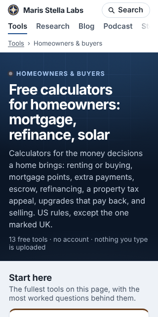

# Polish: homeowners and retirees show a tool on a 320 px phone

Date: 2026-11-18. Track: polish/0. PR #17273. Picked item 2 of "Still weakest" in
`polish-2026-11-18-small-phone-hero.md` ("Homeowners (695) and retirees (671) at 320×640: their
ledes are the longest ... A copy edit to about 40 words would clear both").

This session first built the same hero CSS fix as PR #17276, which landed while this PR waited
(this PR's draft opened at 11:08 UTC, #17276's at 11:11; #17276 merged at 11:24). The branch took main's
version and dropped its own CSS, test and post, then did this follow-up instead.

## What changed

`platform/pages/audiences.mjs`, two `intro` strings:

- homeowners, 47 → 34 words: "Calculators for the money decisions a home brings: renting or buying,
  mortgage points, extra payments, escrow, refinancing, a property tax appeal, upgrades that pay
  back, and selling. US rules, except the one marked UK."
- retirees, 50 → 35 words: "Calculators for retirement decisions: when to claim Social Security,
  RMDs and QCDs, the IRMAA and ACA subsidy cliffs, Roth conversions, a pension lump sum, and
  withdrawal order. US federal rules, except the two marked UK."

Every topic the old intros named is still there. What went: the UK tools' one-line descriptions.
The UK cards say what they cover, and the intro still says which tools are marked UK.

## Measured (`build.mjs --only=c/<page>` previews of main at af6f3fb07 + this change, Chromium)

First tool card top (`.start-grid li`), the `fold.mjs` rule (must start by height − 16):

| page | screen | before | after | lede px before → after |
|---|---|---|---|---|
| homeowners | 320×640 | 695 MISS | 623 ok | 240 → 168 |
| homeowners | 375×667 | 617 | 569 | 192 → 144 |
| homeowners | 390×844 | 667 | 615 | 210 → 158 |
| retirees | 320×640 | 671 MISS | 623 ok | 216 → 168 |
| retirees | 375×667 | 617 | 569 | 192 → 144 |
| retirees | 390×844 | 667 | 615 | 210 → 158 |

With #17276's list, the audience pages that miss at 320×640 go from 6 of 31 to 4. The four left
are the short pages: childcare, photographers, pool-hot-tub and etsy-sellers.

## Still weakest, and what I would do next

1. **The four short pages** (fewer than 8 tools, so no Start here row) keep the `starting` note
   and the jump chips above the first card. That's item 1 of
   `polish-2026-11-18-starting-under-start-here.md` and item 1 of
   `polish-2026-11-18-small-phone-hero.md`, still open. It needs a layout change in
   `renderCategoryPage`, not copy.
2. **623 against a 624 limit is a pass with no slack.** At 320 only the card's top border and
   padding show, not its title. Showing a title (about 60 px more) would need the h1 at three
   lines or one fewer lede line on most pages.
3. **The 320 px header is 106 px tall** (brand and Search, then the section tabs, then the
   breadcrumb on its own band). That's a sixth of a 640 px screen on every page of the site.
   Folding the breadcrumb into the hero's eyebrow on phones would win about 30 px everywhere.
4. **Duplicate work, again.** This PR's draft opened three minutes before #17276's, yet both took the
   same `polish_queue.py` item. Each run read the queue before either draft existed, so each saw
   "0 item(s) claimed". A run should re-run it right before it starts
   editing, not only at pick time.
