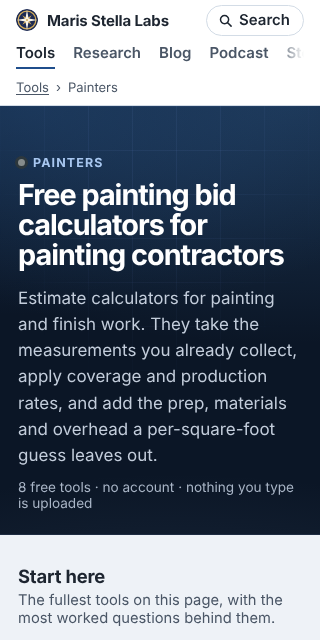
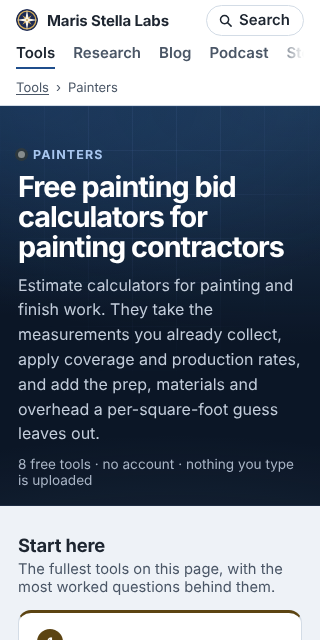

# Polish: the page hero on a 320 px phone

Date: 2026-11-18. Track: polish/0. PR #17273. Picked item 2 of "Still weakest" in
`polish-2026-11-18-starting-under-start-here.md` ("320×640 ... 24 of 31 fail, most by 17 px ...
A phone-only `padding-block` tightening in `.pf-hero`"). I opened the draft PR before the build to
claim the item (`polish_queue.py` showed it open, with no open polish PR touching it).

## What was wrong

On a 320×640 screen (iPhone SE first generation, small Androids) the shared page-hero band
(`.pf-hero`, `SITE_HERO_CSS` in `platform/pages/site-nav.mjs`) spent 72 px on padding and margin
around its text: 18 px above, 24 px below, then a 30 px gap before the next section. The lede was
set at 1.06rem (17 px). 21 of the 24 failing audience pages had their first tool card at 641 to
697 px. It needs to start by 624 px so 16 px of it shows.

Layout of `c/for-painters/` at 320 px, before: nav 0 to 106, hero 132 to 535 (eyebrow, three-line
h1, seven-line lede, two-line count line), "Start here" 565, first card 641.

## What changed

One CSS block in `SITE_HERO_CSS`, up to 400 px wide only:

```css
@media (max-width:400px){.pf-hero{padding-top:10px;padding-bottom:18px;margin-bottom:20px}
  .pf-hero h1{margin-bottom:10px}.pf-hero .lede{font-size:1rem}}
```

Every site-owned page with a hero band gets it: category and audience pages, /writing/, /stories/,
About, Compare, Guides and the rest. The dark field still begins 36 px above the eyebrow, because
`--pf-hero-pull` paints the band above the padding. A test in `site-nav.test.mjs` pins the block.




## Measured (full local build of main at d5a79af54, Chromium, every `c/for-*` page)

The first tool card's top (`.start-grid li`, else `main .card`), the same rule as `fold.mjs`.
After = the same build with `pf-site.css` regenerated from the edited `site-nav.mjs`.

| screen | before: pages failing | after: pages failing |
|---|---|---|
| 320×640 | **24 of 31** | **12 of 31** |
| 360×780 | 3 of 31 | 1 of 31 (childcare, 785 vs 764) |
| 390×844 | 0 of 31 | 0 of 31 |

At 320: painters, electricians, amazon-sellers and the other 641 px pages land at 623. hvac 592.
shopify-stores 568.

## Still weakest, and what I would do next

1. **Twelve pages still miss at 320×640, and copy is what's left.** job-changers, landlords,
   roofers and wedding-event-pros are at 636 (12 px over): a four-line h1 or an eight-line lede
   (job-changers' lede is 210 px). creators 641, ebay-sellers 626. A word or two off each h1 so it
   breaks onto three lines would clear most of them. Measure with
   `WIDTH=320 HEIGHT=640 node platform/pages/fold-check.mjs`.
2. **The five short pages** (childcare 841, photographers 829, pool-hot-tub 789, etsy-sellers
   676, plus ebay-sellers) keep the 178 px `starting` note in the hero because they have no Start
   here row. Moving it below the tool list, or just above `main`, is item 1 of
   `polish-2026-11-18-starting-under-start-here.md`, still open.
3. **The "Start here" heading and its sub-line take 76 px** before the first card. The sub-line
   ("The fullest tools on this page ...") could go on phones, but it says why these four come
   first. Copy decision; I left it.
4. **The 320 px nav is 106 px tall**: brand and Search on one row, the section tabs on a
   second, then the breadcrumb. That's a sixth of a 640 px screen on every page. The tab row
   already scrolls sideways. Worth a look before any more hero trimming.
