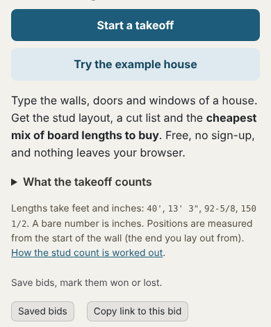
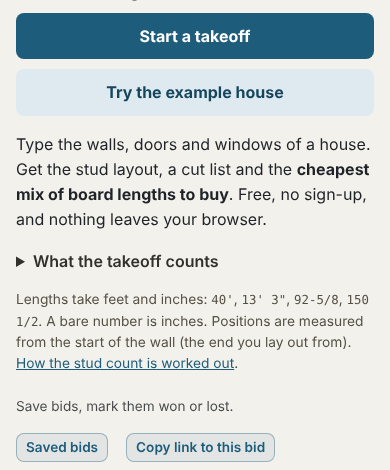
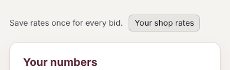
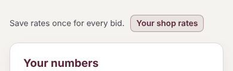

# Polish 2026-11-24: the bars take the venture's button colour

PR #18643. Polish track, prompt 0.

## What I looked at

Built the site and screenshotted the hub, wall-framing-takeoff (top
flagship), the research index, a research page, Stories and a blog post at 390
and 1280 px (`reducedMotion: 'reduce'`). Nothing scrolls sideways (scrollWidth
equals the viewport on all twelve). The weakest thing on a first screen was
item 2 of "Still weakest" in `polish-2026-11-24-last-cut-cards.md`, carried
since 10-28: the saved-bids and shop-rates bars draw grey chips ("Saved bids",
"Your shop rates", "Copy link to this bid") right beside each venture's own
coloured buttons. On the flagship they sit between a teal "Start a takeoff"
and the form.

## Survey (176 bar pages, 1280 px, before)

Every bar page has venture buttons. Sorted by its first opaque control
outside our chrome:

| Venture's buttons | Pages | Right answer |
|---|---|---|
| a dark, saturated primary (label ≥ 4.5:1 on it) | 50 | take its colour |
| near-grey or near-white only (e.g. "Copy bid link" on #eef5ec) | 112 | grey already matches |
| light tints only | 9 | grey |
| orange primary, under 4.5:1 as text on its own tint | 4 | grey |
| none opaque | 1 | grey |

(A trap: the first survey said 1 of 176 had a button, because `<body>` carries
`pf-ask-pad` and the "is this our chrome" test matched it. Test the element's
ancestors below `body`.)

## What changed

- `platform/pages/bar-tone.mjs` (`BAR_TONE_JS`, `barToneCss`), pasted into both
  bar scripts beside `BAR_ALIGN_JS` and called on reveal: picks the primary as
  above and sets `--pf-tone`, `--pf-tone-radius` and `data-pf-tone` on the bar.
  Buttons then draw label = the colour, fill 8%, border 38%, hover 15%, a
  focus ring in the colour, the venture's radius. Re-runs on a colour-scheme
  change. No match or under 4.5:1 against the bar's background: the old grey.
- `bar-tone.test.mjs`: 7 tests (wired, CSS gated on the attribute, takes
  colour and radius, grey-only stays grey, chrome button ignored, orange and
  dark page stay grey, dark mode re-test).
- `ventures/wall-framing-takeoff/bidletter.mjs`: the proposal letter gets a
  viewport meta (item 3 of `polish-2026-11-24-league-ebay-babysitting-titles.md`);
  `build-sample-pack.mjs` stops adding its own, so the sample keeps one. Test
  in `bidletter.test.mjs`.

## Measured (after, 294 visible bars on 176 pages)

| | light | dark |
|---|---|---|
| pages toned | 50 | 49 |
| min button label contrast, all bars | 4.73:1 | 4.73:1 |
| bars under 4.5:1 | 0 | 0 |

`node --test platform/pages/bar-tone.test.mjs bar-align.test.mjs`: 15 pass.
`run_venture_tests.py wall-framing-takeoff`: 1,217 pass.

Before / after (390 px):

## Still weakest, and what I would do next

1. **The 4 orange primaries** (3pl-quote-normalizer, notary-trip-quote,
   sauna-cold-plunge, translator-project-quote): could take a darkened shade
   of the colour as the label instead of staying grey.
2. **Carried:** 3,960 meta descriptions cut with "…"; og:title on einvoice
   country guides; `writing/` and `research/` mid-title ellipses; the long-title
   ventures in `polish-2026-11-24-league-ebay-babysitting-titles.md` item 1.
3. On a phone the band buttons are about 28 px tall: above WCAG 2.2's 24 px
   minimum, under the 44 px comfort size. A taller tap target would add height
   to 176 first screens; measure CLS before trying.
