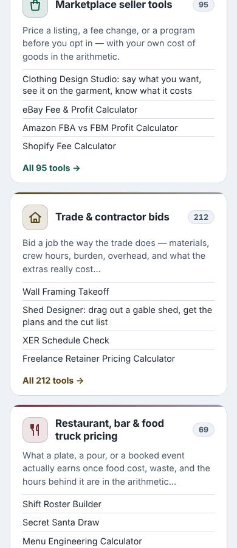
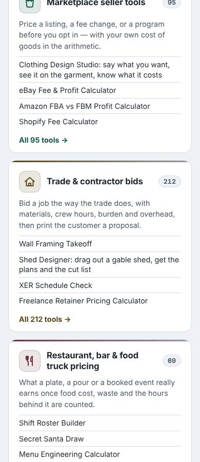

# Polish 2026-11-24: tool and category cards end on a whole sentence

PR #18587. Title work was already claimed (PR #18581), so this run looked at
the surfaces themselves instead of the long-title list.

## What I looked at

A full build of main, screenshots at 390×844 and 1280×900: hub, Wall Framing
Takeoff, research index, a research project, Stories, the blog index and a
post. Nothing scrolls sideways; all read well. The weakest thing a visitor sees
was copy, not layout: on a phone the hub's category tiles mostly ended
"…what the extras really cost…", and the featured row's sales-agent card
ended "drafts answers to…". The same applied to tool cards on every category
page.

(A trap for the next run: the hub's stat tiles count up on load, so a
screenshot without `reducedMotion: 'reduce'` shows numbers like "230 research
projects" next to a search label saying 1,081. The HTML is right.)

## What changed

- `platform/pages/build.mjs`: `cardCopy(description, ogDescription)` behind
  `readMeta`'s `description`. Order: description if ≤ 180; else the venture's
  `og:description` if it is 40 to 180 characters and ends `.`/`!`/`?`; else
  `snippetize(description, 180)` (sentence, then clause, then word).
  `fullDescription` (search, llms.txt) is unchanged.
- `card:` on 15 categories (14 that were cut, plus solo-earner, whose 167-character blurb broke the 140 rule) (≤ 140, one whole sentence, facts only from the
  blurb), used by the hub tile and the Tools index (`c/`) as
  `card ?? blurb`. `blurb` still drives the category page, its meta and
  llms.txt.
- Tests in `build.test.mjs`: `cardCopy` order and fallback; every category
  tile line ≤ 140 and ends on a sentence.
- Two posts whose `seo_title` repeated a product page's title (the build
  renamed them "E-invoicing page for Moldova" and the post headline) got their
  own: attic ventilation, Moldova e-Factura.

## Measured

- Tool cards (`readMeta` over `discoverSurfaces('ventures')`) ending "…":
  1,300 / 1,435 → 188.
- Hub category tiles ending "…": 14 / 23 → 0.
- Build warnings "reused the title": 2 → 0 (after build).
- Hub `
` copy ending "…" (14 tiles + 5 featured): 19 → 0. Hub height at
  390 px: 18,598 → 18,449.
- Category pages (`c/*/index.html`) after: 304 of 2,552 card paragraphs still
  end "…" (no before reading taken on these pages).
- After build: `build.mjs` exit 0; `check.mjs` exit 0 ("looks publishable:
  1435 products, 54 category pages, 13043 pages, no dead links").
- `node --test 'platform/pages/*.test.mjs'`: 1,937 tests, 1 failure (the new
  tile test on solo-earner; fixed with a card), then the three affected test
  groups re-run: 14 pass.

Before and after, hub at 390 px (reduced motion):

## Still weakest, and what I would do next

1. **188 tool cards** still cut: their venture has no og:description, or it
   is over 180 or not a sentence. Give each a one-sentence og:description; the
   card picks it up with no build change. List them with
   `readMeta(html).description.endsWith('…')` over `discoverSurfaces`.
2. **3,960 published pages** (1,168 product front pages) carry a meta
   description that `clampMetaDescription`/`snippetize` cut with "…". A search
   result shows that cut. Rewriting the venture source descriptions to ≤ 160
   would fix it; a baseline ratchet like `title-length.mjs` would keep it fixed.
3. The saved-bids band (`pf-jobs.css`, 237 pages) renders "Saved bids" and
   "Copy link to this bid" as grey browser-default-looking buttons beside each
   venture's own styled buttons. It is palette-neutral on purpose (many
   ventures are light-only); a currentColor outline button might sit better.
