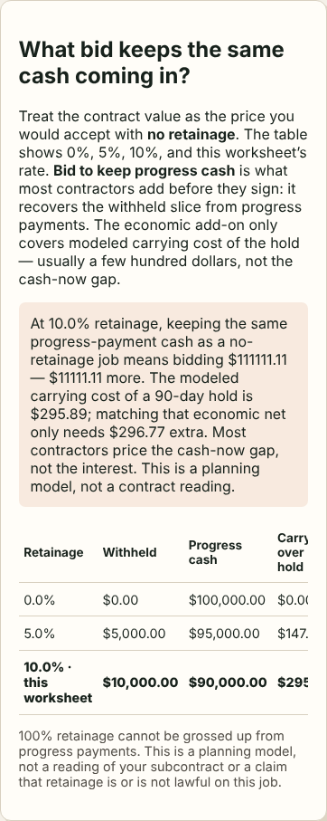

# Polish 2026-11-26: three construction front doors on a phone

Track: polish/0. Picked from item 3 of "Still weakest" in
`polish-2026-11-26-pay-application-generator-phone.md` (`<pre>` summaries in
`mechanics-lien-deadline-calculator`, `lien-waiver-checker`,
`retainage-cashflow-calculator`). These three are free front doors to the
construction pay-app bet (`portfolio/monetization/bets.md`).

## What the note got wrong

None of the three renders a `<pre>` any more (grep and the live DOM both show
none); that item was stale. Measuring the pages at 390 × 844 with the example
loaded turned up two other defects instead.

## Measured (served from each folder, Playwright, example loaded / form submitted)

| page, 390 × 844 | before | after |
|---|---|---|
| retainage-cashflow-calculator: page `scrollWidth` | **581** (whole page scrolls sideways) | 390 |
| retainage: rate table / partial-release table | widen their grid cells to 527 px | scroll inside a 321 px labelled region |
| mechanics-lien-deadline-calculator: inputs under 16 px | 8 of 8 (15 px, iOS zooms on focus) | 0 |
| lien-waiver-checker: inputs under 16 px | 10 of 10 (15 px; paste box 13 px mono) | 0 |

At 1280 × 900: no page scroll before or after. The retainage rate table
(578 px in a 432 px card) used to spill past its card on desktop too; it now
scrolls inside it. The waiver paste box stays 13 px monospace on desktop
(16 px only under 700 px). No page errors. Venture tests: 60, 29, 40 + 38 pass
(13 page tests in retainage, one new).

## What changed

- `retainage-cashflow-calculator/index.html`: each of the three results tables
  sits in `
` (keyboard-scrollable, focus ring in the page's
  accent); `main>section{min-width:0}` so a grid cell no longer grows to its
  table's min-content width; print sets the wrapper `overflow:visible`.
  `page.test.mjs` asserts every table is wrapped.
- `mechanics-lien-deadline-calculator`, `lien-waiver-checker`: input and
  select font 15 → 16 px; waiver textarea 16 px under 700 px.

## Still weakest, next

1. Retainage's 7-column rate table still needs a sideways swipe on a phone; a
   stacked card view (as in pay-app-guides) would read better.
2. A site-wide check: the fleet's per-folder phone probe (page `scrollWidth`,
   inputs under 16 px after loading the example) found two of three bet front
   doors failing; a `platform/pages/` check over every bet front door would
   stop the next one. The input-size half is static (grep the CSS).
3. Carried: two-column amount grid for pay-application-generator's phone cards;
   `sumview.mjs` shared asset if a third venture needs it; einvoice-preflight
   index FAQ has no `<section id="faq">`.
