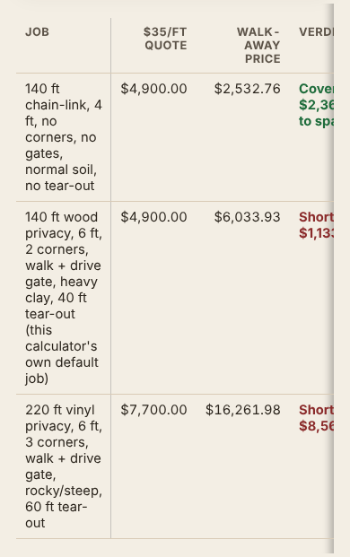
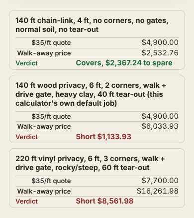
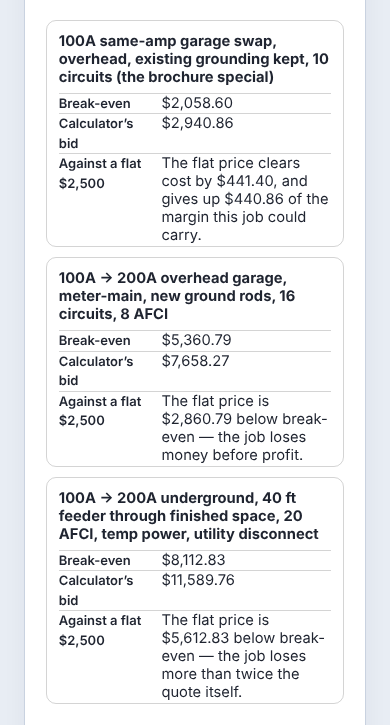

# Polish: 42 construction guide tables become phone cards

Track: polish/0. Item 1 of "Still weakest" in
`polish-2026-11-26-phone-probe.md` ("work the 126 swipes down"), aimed at the
construction bet's front doors (`portfolio/monetization/bets.md`, bet #1).

## What I measured

Built the 131 construction front-door slugs (`build.mjs --only`, 2 min) and
ran `phone-probe-check.mjs` at 390x844 on `origin/main` 13b1694de: **128**
blocks needing a sideways swipe (the last note's 126 plus two). Grouped by
where they come from:

| source of the swipe | count |
|---|---|
| a static table on a guide page or tool page, at load (`div.pf-table-scroll`) | 56 (54 pages) |
| a results table a script writes after the example (`#report` etc.) | 47 |
| bare `table` (no wrapper), `pre`, `span.eq`, `#chart` | 20 |
| other | 5 |

The biggest group was the same page shape on ~35 bid calculators: the
"vs a flat rate" guide, whose worked-example table ("$35/ft quote",
"Walk-away price", "Verdict") and comparison table ("What a flat quote does"
/ "What this calculator does instead") ran 50 to 300 px past a 298 to 354 px
box. A contractor reading it on a phone saw the job and the quote, and had to
swipe to see the verdict, which is the point of the page.

## What changed

- `class="stack"` on the 42 overflowing static tables in 42 venture pages
  (39 slugs). The build's `stack-labels.mjs` labels the cells from the header
  and the chrome's card CSS (`STACK_TABLE_CHROME_CSS`) makes each row a card
  under 600 px; desktop is unchanged.
- `platform/pages/stack-overflowing.mjs` (+ 5 tests): the chore as a script.
  It reads the built page at 390 px, finds tables in a box that overflows by
  8 px or more, matches each to the source by header text, and adds `stack`.
  It refuses a table a script fills (no body cells, or an `id` on the table
  or `<tbody>`), since build-time labels never reach those rows and an
  unlabelled card is worse than a scroller; also nested, ambiguous, headless
  and already-stacked tables. Documented in `platform/pages/README.md`.
- Left out on purpose: `certified-payroll-calculator/wh347-report.html` (it
  mirrors the WH-347 form; scrolling may be right there, with a card view
  for the report).

## Measured after

| construction front doors, 390 px, 495 pages | before | after |
|---|---|---|
| blocks needing a sideways swipe | 128 | **84** |
| ... of them static tables at load | 56 | 14 (11 script-filled, 1 header the matcher missed, 1 headless, 1 WH-347) |
| pages scrolling sideways / fields under 16 px / rows taller than screen | 0 / 0 / 0 | 0 / 0 / 0 |
| stacked cells without a label (3 pages checked) | n/a | 0 |
| fence "vs a flat price per foot" worked-example table height | 581 px, verdict off-screen | 397 px, all 4 values visible |

No page that failed after was a page I changed; the other differences
between the two runs are a few pixels on untouched pages. Venture tests for
the 39 slugs: `run_venture_tests.py`, 39 suites, 0 failed. Site build tests:
`node --test 'platform/pages/*.test.mjs'` (see the PR's run record).

No traffic or conversion claim: usage is unmeasured.

## Still weakest, next

1. The 47 script-written results tables, widest first: `fault-current-check/`
   (1,258 px over), `hvac-repair-tier-price-calculator/` (932, at load: a
   script-filled table), `contractor-wip-schedule/` `#report` (499),
   `submittal-register/` (483), `plumber-flat-rate-price-calculator/` (483).
   These need the venture's JS to write `data-label` on each cell (or a
   shared runtime labeller in the chrome for `table.stack` rows added after
   load: one fix, many tools; check `stack-labels.mjs` would not double up).
2. `certified-payroll-calculator/wh347-report.html` (1,354 and 872 px): mark
   the form mirror `data-phone-scroll-ok` and give the report a card view.
3. The 8 bare-`table` and 8 `pre` swipes (`quote-margin-check` guides,
   `continuous-beam-calculator/why-pattern-live-load-matters.html` `pre`, 462).
4. Carried: `--industry all` and `--widths 320,390`; register `phone-probe`
   in `browser_checks.CHECKS` (control plane, its own PR).
