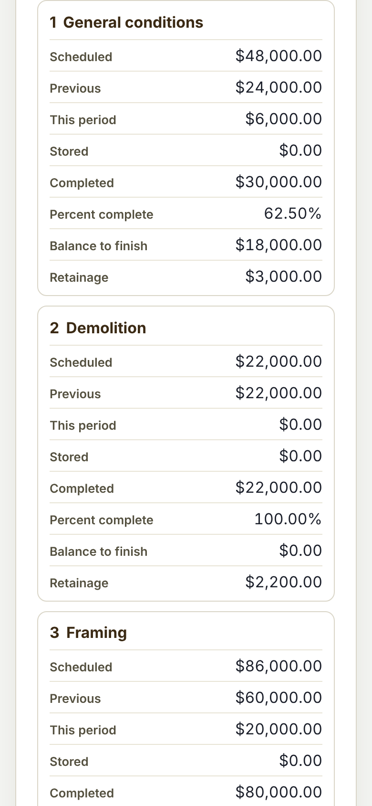
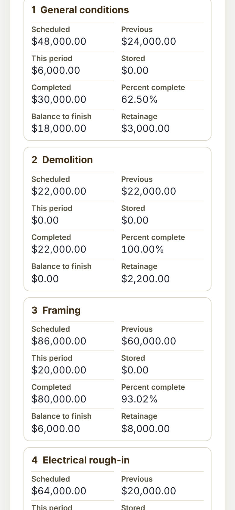

# Polish: pay application generator's phone cards, amounts two to a row (2026-11-26)

Track: polish/0. Surface: `ventures/pay-application-generator/index.html`, a
bet #1 front door (construction pay apps, `portfolio/monetization/bets.md`).
Item 1 of "Still weakest" in
`polish-2026-11-26-pay-application-generator-phone.md`.

Before choosing it I checked the other open items: the retainage note's
"unseparated `$12345.67` in other front doors' prose" is not there on the bet
front doors (every remaining `toFixed(2)` in `pay-application-generator` and
`pay-app-guides` feeds a CSV cell, which should stay unseparated), and the
"`<pre>` summaries in mechanics-lien-deadline-calculator, lien-waiver-checker,
retainage-cashflow-calculator" item is stale: `grep -c '<pre'` finds none in
any of their pages.

## Measured (served from the folder, Playwright, example loaded and worked out)

| | before (`origin/main` 19a185335) | after |
|---|---|---|
| 390 px: first card height | 310 px (8 amount rows) | 238 px (4 rows of two) |
| 390 px: results table height, 10 lines | 3,230 px | 2,511 px (−22 %) |
| 390 / 1280 px page `scrollWidth` | 390 / 1280 | 390 / 1280 |
| 320 px: cells overflowing | (not measured) | 0, `scrollWidth` 320 |
| 1280 px table | 1,004 × 664 px | unchanged |

No page errors. Not the "halved" the last note guessed: each amount now
carries its name on its own line above it, which costs height but is what
fits two columns in a 312 px card ("Balance to finish" + "$1,234,567.89" side
by side in 150 px does not).

## What changed

- `index.html`, phone CSS only: `table.stack tr` is a wrapping flex row; the
  Item and Description cells stay one heading line (Description's 60 % basis
  pushes the amounts to the next row), each amount cell is half the card,
  name above, tabular figures. The title cells opt out of tabular figures,
  which had spaced the hyphen in "rough-in".
- The post `2026-11-25-a-pay-application-template-whose-totals-cannot-drift.md`
  ("Checking the numbers from a phone") gives the new heights.

Tests: `run_venture_tests.py pay-application-generator`: 86 pass, plus the
site page checks. No traffic or conversion claim: usage is unmeasured.

## Still weakest, next

1. A `platform/pages/` phone probe over every bet front door (scrollWidth at
   390 px, inputs under 16 px, cards taller than the viewport), carried from
   two notes now: the last four polish runs each measured one page by hand.
2. `sumview.mjs` is in two ventures; a third copy should move it to
   `platform/pages/` instead.
3. Carried: einvoice-preflight index FAQ has no `<section id="faq">`; four
   pay-app pages with 6 header links.
