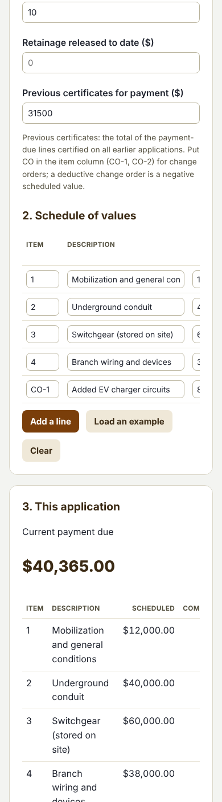
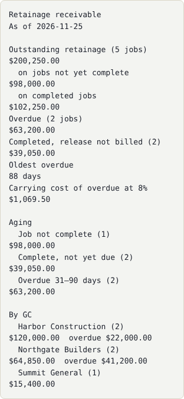
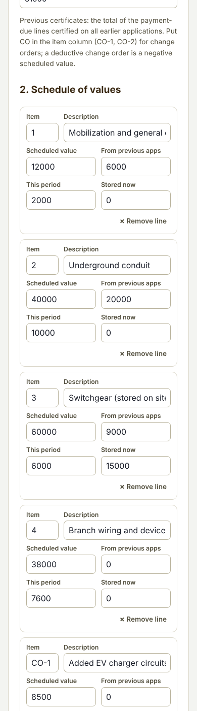
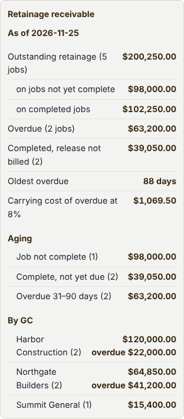

# Polish: the pay-app calculator on a phone (2026-11-26)

Track: polish/0. Surface: `ventures/pay-app-guides/`, the free front door for
paid bet #1 (pay-app billing for subcontractors, `portfolio/monetization/bets.md`).
I picked it over the last note's "Still weakest" list (einvoice FAQ sections)
because bet #1 ranks above bet #3, and its first page, the schedule-of-values
calculator, was the one page in the venture that did not stack on a phone.

## Measured (served from the folder, Playwright, 390 × 844 and 1280 × 900)

Before:

- **Line entry** (`index.html`, step 2): a fixed 820 px table inside a sideways
  scroller. At 390 px only Item and a cut-off Description showed; Scheduled value,
  From previous apps, This period and Stored now were all off to the right.
  Inputs were 14 px, which makes iOS Safari zoom the page on focus. Screen readers
  heard the field keys as labels: "thisPeriod", "scheduled".
- **Results table** (step 3): seven columns in a sideways scroller; "CO-1"
  broke over two lines.
- **Text summaries** (`<pre class="sum">`, 8 pages): padded for pasting into
  an email ("5. Total retainage held........ $7,985.00"). At 390 px the
  monospace lines wrap, so each amount lands at the start of the next line under
  its label: the retainage tracker's 20-line summary drew as 34 rows with labels
  and amounts alternating down the left edge.

## What changed

- `index.html` + `style.css`: under 600 px each schedule-of-values line is a
  card: Item and Description on top, the four amounts two by two, each with its
  column name (`data-label`), and a visible "× Remove line". Inputs are 16 px
  there. Every input's `aria-label` is now its column header ("Scheduled value").
- The results table uses the venture's existing `stack compact` phone cards,
  with "1 Mobilization and general conditions" as the card title.
- New `sumview.mjs` (+ `sumview.test.mjs`, 4 tests), loaded on the 8 pages with a
  generated summary: it parses the summary text into label/amount rows, list
  items and headings, and draws them beside the `<pre>`; CSS shows that view
  under 600 px and the `<pre>` above. The copy, CSV and print paths still read
  the `<pre>`, so what a user pastes is unchanged. Letters (prose: chase emails,
  waiver requests, release letters) fail the "mostly label/amount" test and are
  left as text. Built with `textContent` only, so job names typed by the user
  cannot inject markup.

After: no sideways scroll on any of the 8 pages at 390 px (scrollWidth 390) or
1280 px; no page errors; at 1280 px every `<pre>` still shows and every view is
hidden. Summaries with a phone view: index, retainage-tracker, change-order-log,
stored-materials-billing, lien-waiver-log, front-loading, overbilling-underbilling
(7); letters left alone: 7 `<pre>`s. Tests: pay-app-guides 247 pass plus the
site page checks (`run_venture_tests.py pay-app-guides`).

No traffic or conversion claim: usage is unmeasured.

## Still weakest, next

1. Other bet front doors with generated `<pre>` summaries could reuse
   `sumview.mjs` (copy it into the venture; ventures do not import each other):
   `grep -l '<pre' ventures/{mechanics-lien-deadline-calculator,lien-waiver-checker,pay-application-generator,retainage-cashflow-calculator}/*.html`.
2. `pay-application-generator` (the other bet #1 front door) has its own
   line-entry table: screenshot it at 390 px before assuming it stacks.
3. Carried from `polish-2026-11-26-llms-answers-bet-front-doors.md`: the
   einvoice-preflight index FAQ has no `<section id="faq">`; four pay-app pages
   with 6 header links.
