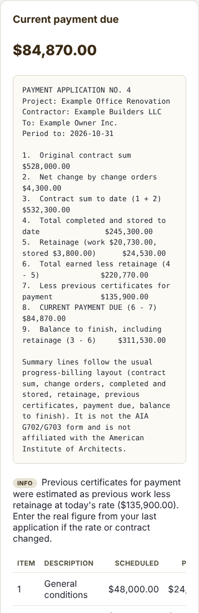
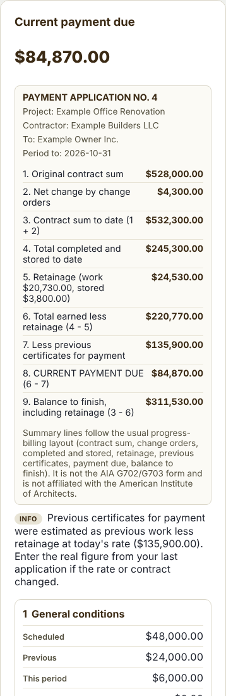

# Polish: the pay application generator's results on a phone (2026-11-26)

Track: polish/0. Surface: `ventures/pay-application-generator/index.html`, the
other free front door for paid bet #1 (pay-app billing,
`portfolio/monetization/bets.md`). Item 2 of the "Still weakest" list in
`polish-2026-11-26-pay-app-phone-entry.md`.

## Measured (served from the folder, Playwright, example loaded and worked out)

This page has no line-entry table (input is a file or a paste), so the phone
problem was the results card:

| at 390 × 844 | before | after |
|---|---|---|
| page `scrollWidth` | 390 | 390 |
| results table width (in a 312 px scroller) | 1,004 px | 312 px |
| amount columns visible without sideways scroll | 1 of 8 | 8 of 8 |
| summary `<pre>` height | 697 px, amounts wrapped under labels | hidden; row view instead |
| input font size | 15 px (iOS zooms on focus) | 16 px |

At 1280 × 900 nothing changed: table 1,004 px, `<pre>` 404.5 px, no page errors.

## What changed

- `sumview.mjs`: copied from `ventures/pay-app-guides/` (ventures do not import
  each other) with two changes. This venture's `summaryText` pads the line
  number to four characters ("5.  Retainage"), which the original regex split
  on, making "5." the label; the pattern now keeps a leading number with its
  label. And "Project: ..." header lines are plain text, not headings.
- `index.html`: results table is `class="stack sov-out"` with a `data-label` on
  each amount cell; page-local CSS under 600 px draws each line as a card
  ("1 General conditions", then one named row per amount). The `<pre>` stays
  the download and print source; print forces it back on.
- `sumview.test.mjs` (4 tests): the nine numbered lines, header lines, the
  pay-app-guides line styles still parse, and the page wiring.

Tests: `run_venture_tests.py pay-application-generator`: 86 pass, plus the
site page checks. No traffic or conversion claim: usage is unmeasured.

## Still weakest, next

1. The phone cards are long (10 lines × 9 rows on the example). A two-column
   amount grid, as in pay-app-guides' entry cards, would halve the height.
2. `sumview.mjs` now exists in two ventures; if a third front door needs it,
   move it to `platform/pages/` as a shared asset rather than a third copy.
3. Carried: `<pre>` summaries in `mechanics-lien-deadline-calculator`,
   `lien-waiver-checker`, `retainage-cashflow-calculator`; the einvoice-preflight
   index FAQ has no `<section id="faq">`.
