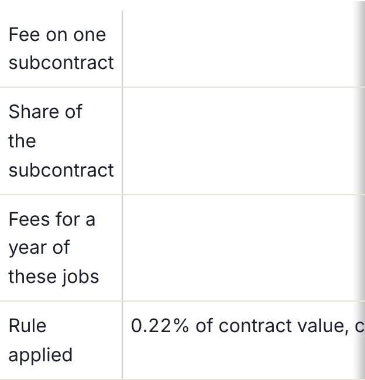
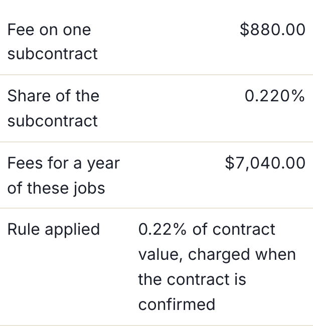
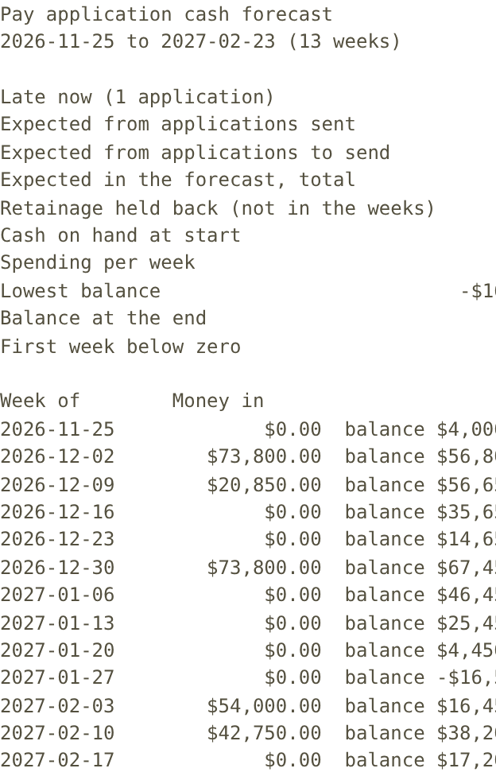
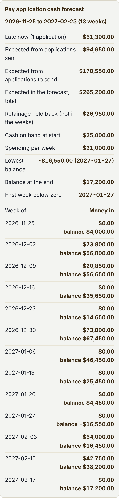

# Polish 2026-11-26: a phone probe over every construction front door

Track: polish/0. Item 1 of "Still weakest" in
`polish-2026-11-26-pay-app-cards-grid.md`, carried through two notes: "a
`platform/pages/` phone probe over every bet front door (scrollWidth at 390 px,
inputs under 16 px, cards taller than the viewport)". The last four polish runs
each measured one page by hand.

## What shipped

- `platform/pages/phone-probe.mjs` (rules, no browser) and
  `phone-probe-check.mjs` (runner), tested by `phone-probe.test.mjs` (8 tests).
  It serves a built `DIST`, loads each page at 390x844 (`--widths` for more),
  measures, then clicks the page's example button and its calculate button if
  it has them and measures again. It fails on: page scrolls sideways; a block
  that needs a sideways swipe (content wider than its `overflow-x:auto` box by 8 px or more,
  skipping `nav` and `[role=tablist]`, opt-out `data-phone-scroll-ok`); form
  fields under 16 px; a stacked table row taller than the screen.
  `--list` prints the slugs for `build.mjs --only`.
- The defect class "a table hiding columns in its scroller" is the one
  `sideways.mjs` cannot see (the scroller contains the overflow), and the one
  every recent pay-app polish run found by hand.
- First run's findings on the bet's own pages, fixed (`ventures/pay-app-guides`):
  - `pay-application-software-compared.html`: the portal fee table's value
    column was `td.n` (nowrap), so the long "Rule applied" sentence made the
    table 612 px in a 312 px box and the fees ($880, $7,040) sat off-screen.
    The rule cell now wraps.
  - `pay-app-cash-forecast.html`: the summary was a `
` with `white-space: pre`,
    12 px monospace, 462 px in 312 px. Now a `<pre class="sum">` with the
    venture's `sumview.mjs` row view on a phone (copy still reads the text).
  - `front-loading-schedule-of-values.html`, `stored-materials-billing.html`
    (and `change-order-log.html` at 320 px): CSV `<pre class="sum">` blocks ran 8 to 78 px
    past their box. `pre.sum` now has `overflow-wrap: anywhere`.

## Measured

| pay-app front doors (4 slugs, 34 pages), 390 px | before | after |
|---|---|---|
| failures | 4 pages (#fee table 612/312, #summary 462/312, two `pre#sov` 318/310 and 388/310) | 0 |
| at 320 px (nav strip excluded) | 7 pages | 2 (retainage guide tables: 348/284 and 237/228 px) |

All construction front doors (131 slugs, 495 pages, `--only` build about 2
min, probe 71 s): **0** pages scroll sideways, **0** fields under 16 px (the
`input-zoom.mjs` floor holds), **0** stacked rows taller than the screen,
**126** blocks need a sideways swipe (overflow 9 to 1,354 px, median 107; 14
of them by 20 px or less). By element: 57 `div.pf-table-scroll`, 9 bare
`table`, 9 `pre`, 2 `span.eq`, 2 `div#chart`. The example ran on 62 page loads.

Venture tests: `run_venture_tests.py pay-app-guides`, 264 pass, plus the site
page checks. No traffic or conversion claim: usage is unmeasured.

## Still weakest, next

1. Work the 126 swipes down, widest first: `certified-payroll-calculator/wh347-report.html`
   (1,354 px; it mirrors the WH-347 form, so it may deserve
   `data-phone-scroll-ok` plus a card view), `fault-current-check/` (1,258),
   `hvac-repair-tier-price-calculator/` (932), `scope-creep-change-order-calculator/`
   `pre.cmd` (575), `contractor-wip-schedule/` `#report` (499),
   `submittal-register/`, `plumber-flat-rate-price-calculator/` (483 each).
   Many are `pf-table-scroll` tables a `class="stack"` (with `stack-labels.mjs`)
   would turn into cards. Rerun the probe for the list.
2. The 14 swipes of 20 px or less are probably one long word or number per
   table: a shared `overflow-wrap:anywhere` on `.pf-table-scroll td` might clear
   them at once; measure before believing it.
3. Run `--industry all` (manufacturing, online sellers, nonprofits, e-invoicing:
   about 75 more slugs) and `--widths 320,390`.
4. Register `phone-probe` in `browser_checks.CHECKS` (control-plane, its own PR).
5. Carried: `sumview.mjs` is in two ventures; a third copy should move it to
   `platform/pages/`. einvoice-preflight index FAQ has no `<section id="faq">`.
