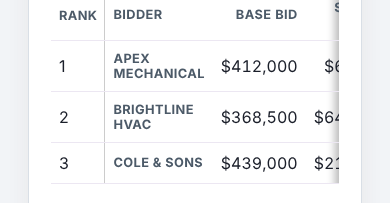
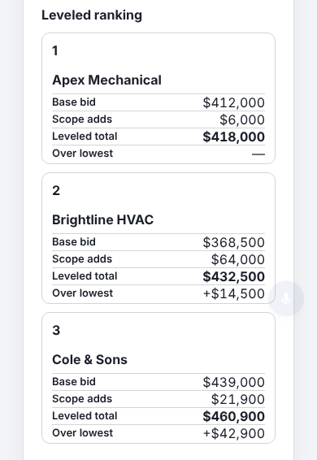
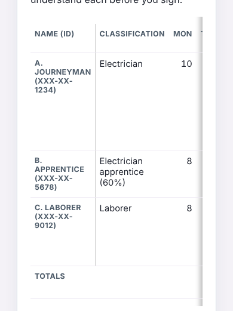
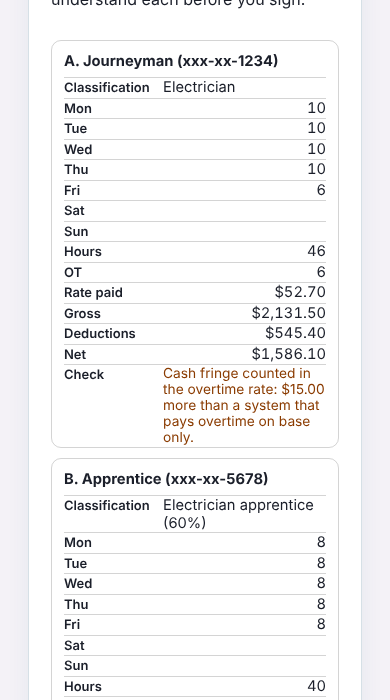

# Polish 2026-11-26: 39 script-written results tables become phone cards

Track: polish/0. Item 1 of "Still weakest" in
`polish-2026-11-26-runtime-stack-labels.md`: the script-written results tables
on the construction front doors (`portfolio/monetization/bets.md`, bet #1) now
need only `class="stack"`, since `STACK_LABELS_JS` labels rows written after
load. (Item 1 of `polish-2026-11-26-unseparated-money.md` was already taken by
open PR #19497, so this run took the swipes.)

## Measured (`phone-probe-check.mjs`, 390 × 844, example worked out)

Full construction set on `origin/main` d4de94898 (131 slugs, 495 pages):
**75** sideways-swipe failures (the runtime-labels note's 84 less its 12
fixes, plus drift). 36 of them were `#report`-style results tables.

On the 22 slugs this run touched (38 pages):

| | before | after |
|---|---|---|
| sideways-swipe failures | 41 | 9 |
| cells labelled after "Load an example" (Playwright: bid-leveling `#ranking`, rebar `#markTable`, psychrometric `#prop-table`, surety `#result table`, WH-347 `#out`) | none | 12/12, 63/63, 42/42, 35/35, 45/45 |

So the construction total is now 75 − 32 = **43**.

| bid leveling, before | after |
|---|---|
|  |  |

| WH-347 report, before (1,160 px in 288) | after |
|---|---|
|  |  |

## What changed

- `class="stack"` on 39 read-only results tables in 22 venture pages:
  bid-leveling-worksheet (2), certified-payroll-calculator `wh347-report.html`
  `#out`, construction-delay-claim-calculator (2), drawing-set-index (2),
  experience-mod-calculator (2), fixed-bid-overrun-forecaster (2, one in a JS
  template), handyman-minimum-job-calculator (2), project-estimate-calibrator
  (3, two in templates), psychrometric-calculator `#prop-table`,
  pv-row-spacing-optimizer, pv-string-sizer (2), rebar-schedule (2),
  roof-snow-load-calculator, scope-creep-change-order-calculator,
  standby-generator-install-price-calculator (2), stormwater-detention-sizer,
  surety-bond-capacity-calculator (the `table()` template, every result
  table), tile-layout-optimizer (3), tile-layout-planner (2),
  voltage-drop-calculator, wall-condensation-check (2),
  window-design-pressure-calculator (3).
- rebar-schedule's `fillTable` wrote the header row into the table body; it now
  writes `<thead>` + `<tbody>` (the labeller needs a thead).
- Tried `stack compact` on the psychrometric property table: at 300 px each
  cell still took its own line, so no shorter; kept plain `stack`.

Tests: all 22 ventures' `node --test *.test.mjs` pass (0 failures).

## Still weakest, next

1. The 9 left on these slugs, by kind: input grids (WH-347 `#workers` 1,642 px,
   tile-layout-optimizer `#cuts`/`#tiles` 535, tile-layout-planner `#obst`
   463), SVG charts (`div#chart` 560 px on psychrometric and
   wall-condensation: give the SVG a `viewBox` and `width:100%`),
   `pre` blocks (scope-creep `pre.cmd` 863, rebar guide `pre` 454), one guide
   table (psychrometric `reading-a-cooling-coil.html`, 396 in 354) and
   rebar `#plans div.scroll` (330 in 320).
2. The other 34 construction swipes not on these slugs: rerun the probe for
   the list (static guide tables can go through `stack-overflowing.mjs`).
3. Carried: a card layout for editable input rows (the runtime-labels note,
   item 2), `--industry all`, and registering `phone-probe` in
   `browser_checks.CHECKS` (control plane, its own PR).
