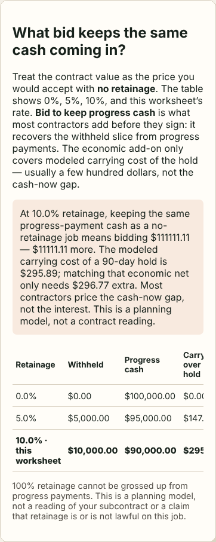
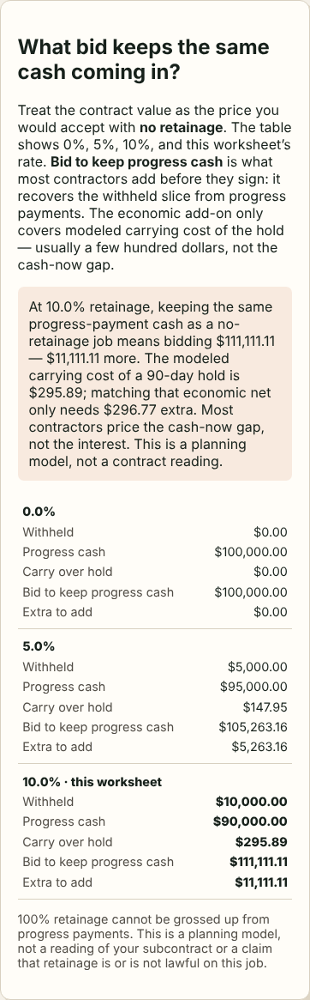
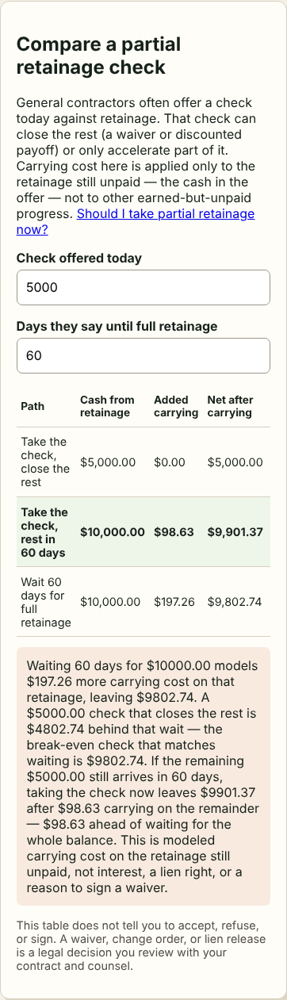
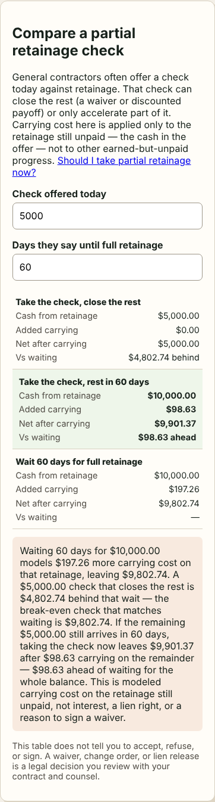
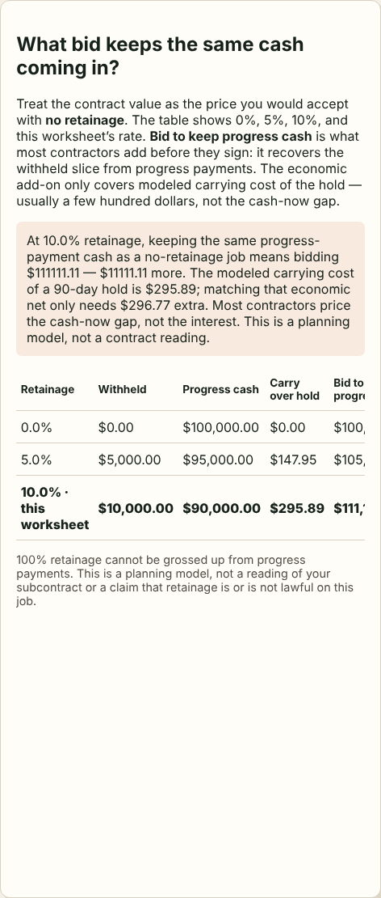
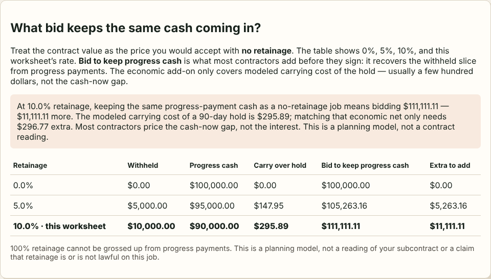

# Polish: retainage calculator's tables as phone cards, money that matches (2026-11-26)

Track: polish/0. Surface: `ventures/retainage-cashflow-calculator/index.html`,
a free front door to the construction pay-app bet
(`portfolio/monetization/bets.md`). Item 1 of "Still weakest" in
`polish-2026-11-26-construction-front-doors-phone.md` (the rate table still
needs a sideways swipe on a phone). Measuring it turned up two more defects.

## Measured (served from the folder, Playwright, form submitted with the defaults)

| | before (`origin/main` 1b4ce3d36) | after |
|---|---|---|
| 390 px: rate table | 527 px in a 321 px scroller; carrying cost, bid and extra columns hidden | 321 px, one card per rate, 5 named rows |
| 390 px: partial-release table | 397 px in 321 px; "Vs waiting" hidden | 321 px, one card per path |
| 1280 px: rate table | 578 px in a 432 px half-width card; **"Bid to keep progress cash", the table's answer, cut off** | 920 px, full width, all 6 columns |
| prose amounts (notes, follow-up draft, downloads) | `$111111.11`, `$2500.00` beside tables showing `$111,111.11` | `$111,111.11`, `$2,500.00` everywhere |
| checkboxes ("Remember", "Count usage") | 100 % wide, box on its own line under the label | inline with the label |
| page `scrollWidth` 390 / 1280 | 390 / 1280 | 390 / 1280 |

No page errors at either width.

## What changed

- `calc.mjs`: new exported `formatMoney(amount, currency)` (en-US separators,
  sign before the symbol, no `-$0.00`); all 43 `toFixed(2)` money sites in
  the notes, follow-up draft, summary, record and milestone schedule use it.
  The downloads change too, which is what a reader pasting them into an email
  wants; the JSON snapshot keeps raw numbers.
- `index.html`: the rate and partial-release tables get `class="stack"`,
  a `data-label` per amount cell and a `card-title` first cell; under 600 px
  each row draws as a card (header row visually hidden, kept for screen
  readers). `#rateSection` spans both grid columns on desktop (it is the 5th
  section, so it starts a row and leaves no gap). Region labels lose
  "(scrolls sideways)", since on a phone they no longer do.
- `test.mjs`: 26 expectations moved to the separated form; one new test for
  `formatMoney` and for no unseparated amount in a note.

Tests: `run_venture_tests.py retainage-cashflow-calculator`: 80 pass, plus the
site page checks. No traffic or conversion claim: usage is unmeasured.

## Still weakest, next

1. The same `$12345.67` prose habit probably exists in other construction
   front doors' notes and drafts: `grep -n '\${currency}\${.*toFixed(2)\|\$\${.*toFixed(2)' ventures/*/calc.mjs`
   on the bet front doors, and a page check that flags an unseparated
   amount of 4+ digits in rendered text would stop it coming back.
2. Carried: a `platform/pages/` phone probe over every bet front door
   (scrollWidth, inputs under 16 px); two-column amount grid for
   pay-application-generator's phone cards; einvoice-preflight index FAQ has
   no `<section id="faq">`.
