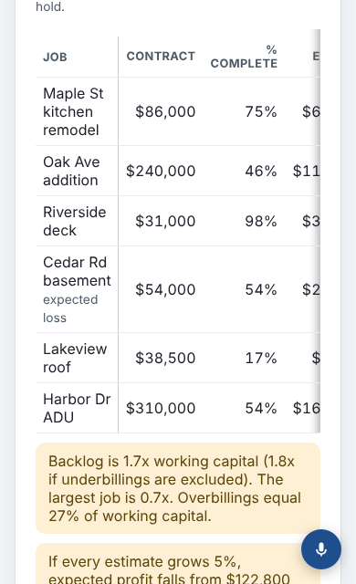
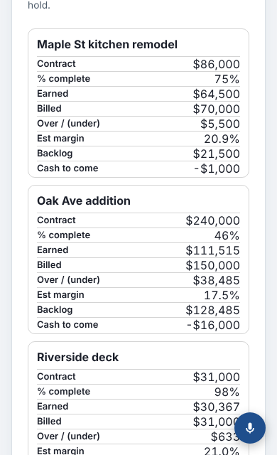

# Polish 2026-11-26: phone cards for results tables a calculator writes after load

Track: polish/0. Item 1 of "Still weakest" in
`polish-2026-11-26-flat-rate-tables-stack.md`: the 47 script-written results
tables on the construction front doors (`portfolio/monetization/bets.md`,
bet #1), which needed "a shared runtime labeller in the chrome for
`table.stack` rows added after load: one fix, many tools".

## What was wrong

`class="stack"` turns a table into phone cards (`STACK_TABLE_CHROME_CSS`) and
the build writes each cell's `data-label` from the `<thead>`
(`stack-labels.mjs`). That build pass reads markup, so a calculator that fills
`<tbody>` from a string after the reader presses "Load an example" got no
labels. Its rows would have stacked as cards with blank labels, so nobody
opted those tables in, and on a 390 px phone they scrolled sideways instead.
The WIP schedule's nine-column table showed the job and two figures; billed,
over/under and cash to come sat off-screen:

| before (390 px) | after |
|---|---|
|  |  |

## What changed

- `STACK_LABELS_JS` in `platform/pages/stack-labels.mjs`: the browser half of
  the build pass, plain ES5, run by `pf-site.js` (`SCROLL_A11Y_SCRIPT` in
  `build.mjs`) on every table at each width check and whenever a watched table's
  rows change (the MutationObserver already there for figure columns). It
  follows the build pass's rules: labels come from the first header row, a
  colspan header labels each column it spans, a cell's own `data-label` or
  `role` is kept, a row header becomes the card title, and nested tables are
  skipped. A row is read once. Its last cell gets an expando mark, not an
  attribute, so the observer does not fire again. A row the calculator
  replaces has unmarked new cells and gets labelled again. A "row count and
  text length" key, as figure columns use, would have missed `$1,200`
  rewritten as `$1,300`. One of the four new tests covers that case.
- The card label is pinned `text-align:left` in `STACK_TABLE_CSS`. A
  venture's `td.n{text-align:right}` passed its alignment to the `::before`,
  which made the labels ragged to the right (seen on the WIP schedule).
- `class="stack"` on 12 read-only results tables in 5 tools:
  contractor-wip-schedule `#acc`; submittal-register's register and
  buried-requirements tables; plumber-flat-rate-price-calculator's slice,
  overrun and T&M tables; hvac-repair-tier-price-calculator's tier, mix,
  decline and slice tables; fault-current-check's `#node-table` and
  `#arc-table`.

## Measured

`phone-probe-check.mjs --slugs` over the 5 slugs (11 pages, 390 × 844, example
worked out), preview builds of `origin/main` 13be512e5 and of this branch:

| | before | after |
|---|---|---|
| sideways-swipe failures | 12 | 4 |
| script-written cells labelled after "Load an example" (Playwright) | n/a (not opted in) | 54/54 WIP, 108/108 submittal, 30/30 plumber T&M, 36/36 fault current |

The 4 failures left are all editable input grids, not results:
plumber-flat-rate's job list (795 px), hvac-repair-tier's job list (1,236 px)
and fault-current-check's feeder editor (1,570 px). A card layout for a row of
inputs is a different design problem (see below).

Tests: `stack-labels.test.mjs` 10 pass (4 new, against a minimal DOM). The 5
ventures' `page.test.mjs` pass. The site-build suite results are in the run
record.

## Still weakest, next

1. The other ~35 script-written results tables from the flat-rate note's list
   now need only `class="stack"` on the static `<table>` (with a `<thead>`).
   Run `phone-probe-check.mjs` over all 131 construction slugs and add the
   class where a "with the example worked out" swipe is a read-only table.
2. Input grids (the 3 left above, plus the pay-app schedule-of-values editors):
   a phone layout for editable rows, where each row becomes a card of labelled
   inputs. The runtime labeller already labels such rows. The open question is
   the inputs' fixed widths (`td input[type=number]{width:5.5em}`).
3. Carried: `certified-payroll-calculator/wh347-report.html` (1,354 px),
   `--industry all`, and registering `phone-probe` in `browser_checks.CHECKS`
   (control plane, its own PR).
