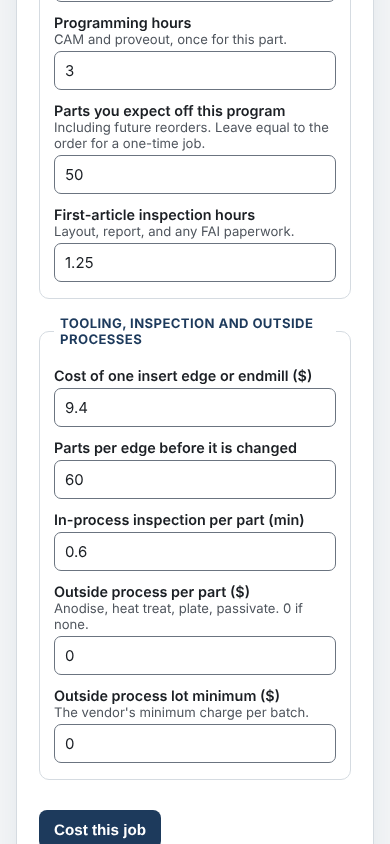
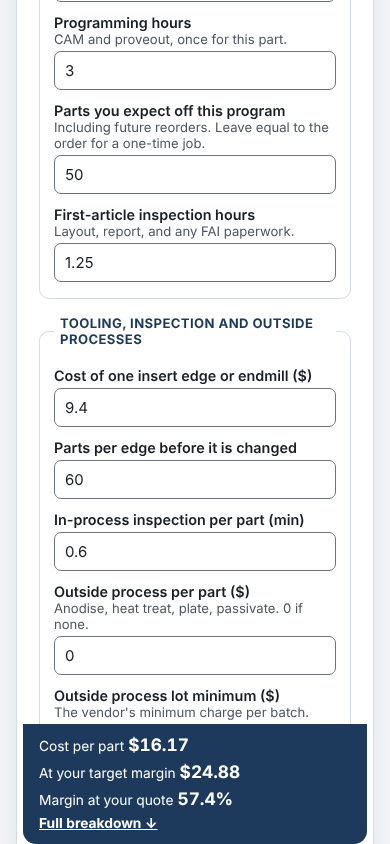

# Polish 2026-11-27: the CNC quote calculator answers before you press anything

Track: polish/0. The last note's open items (BR-FR row heights, stack tables in general) were
small and on bet #3's page; this run chose bet #2's free front door instead,
`ventures/cnc-machining-quote-calculator`, which links to the manufacturing industry page
(`platform/pages/front-doors-map.mjs`) and had three polish notes, none on its first view.

## Measured

Chromium, 390 × 844, page served straight from its folder (before = `HEAD`):

| | before | after |
|---|---|---|
| results on first load | hidden until "Cost this job" | shown, for the prefilled job |
| where the first number appears | after ~3,700 px of form and a button press | in a strip pinned to the bottom of the screen while the form scrolls |
| page height | 9,635 px (results hidden) | 12,652 px (results shown) |
| `scrollWidth` | 390 | 390 |
| "quote" usage events counted on load | 0 | 0 (the preview does not count a use) |
| page errors | 0 | 0 |

The site build (`build.mjs --only=cnc-machining-quote-calculator`) renders the same: the strip
sits above nothing of the site chrome, and the only localStorage key written on load is the
chrome's own `tool_viewed` counter.

## What changed

- `preview()` runs the same `computeMachiningJob` on load (unless a shared link already ran
  `quote()`) and 250 ms after any field changes. It never calls `recordUsage` and never shows
  the form error; a blank or zero quantity keeps the last good answer on screen. The button,
  the worked example and shared links behave as before and still count.
- A strip (`#live`, `position: sticky; bottom: 0`) inside the form card shows cost per part,
  price at the target margin and margin at the quoted price, with a link to the full
  breakdown. It is sticky inside the card only, so it leaves once the form is scrolled past.
  Break-even was left out of the strip: it always equals cost per part here.
- Without JavaScript nothing changes: `#results` and `#live` both stay `hidden` in the HTML.
- +1 test in `page.test.mjs`.

## Still weakest, next

1. The same "results hidden until a button" pattern is on 48 venture `index.html` files
   (`grep -l 'id="results" hidden' ventures/*/index.html`). Front doors to a bet first:
   `pay-application-generator`, `laser-cutting-engraving-job-price-calculator`,
   `powder-coating-job-price-calculator` use other markup; check each by screenshot.
2. This page has no dark mode (`:root` colours are fixed); the hub and chrome do.
3. Carried from `polish-2026-11-27-code-list-details.md`: BR-FR-MV-11/BT-128 row heights, and
   `stack-overflowing.mjs` matching a header whose `th` holds an element with an `id`.
