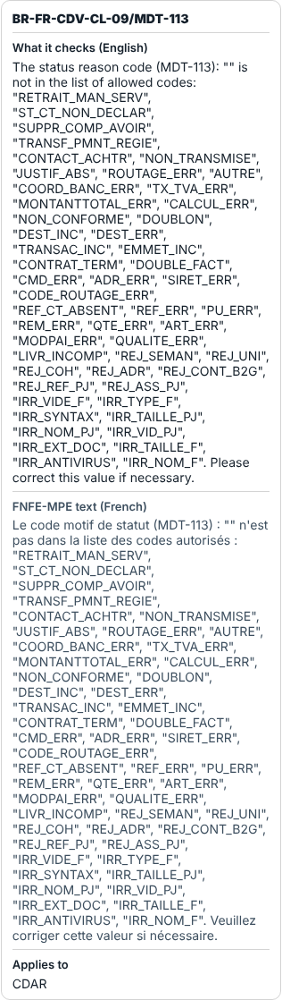
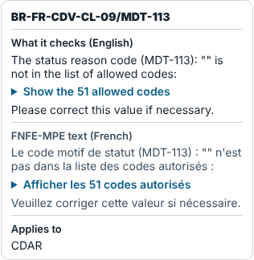

# Polish 2026-11-27: long allowed-code lists fold into `
` on the BR-FR page

Track: polish/0. Item 1 of `polish-2026-11-27-stack-prose.md`'s "Still weakest"
(bet #3's front door, einvoice-preflight).

## Measured

`build.mjs --only=einvoice-preflight` before (stashed) and after, Chromium at 390 × 844,
every `tbody tr` of `br-fr-error-codes.html`:

| | before | after |
|---|---|---|
| rows taller than the screen | 1 | 0 |
| BR-FR-CDV-CL-09/MDT-113 | 1,118 px | 324 px |
| tallest row | 1,118 px | 693 px (BR-FR-MV-11/BT-128) |
| sum of row heights | 125,280 px | 123,389 px |
| document scrollWidth | 390 | 390 |

## What changed

- `ventures/einvoice-preflight/build-br-fr-codes-page.mjs`: `cell()` finds a quoted list of
  12 or more codes in a message and renders it as
  `

Show the N allowed codes
<code>…</code>…
`
  ("Afficher les N codes autorisés" in the French column); text before and after stays.
  Six rows fold (lists of 12 to 51); the 10- and 11-code lists stay inline. Summary has a
  visible focus ring; works without JavaScript.
- Page regenerated; +1 test in `br-fr-codes-page.test.mjs`.
- Post: dated update in `docs/posts/2026-11-19-wide-tables-become-cards-on-a-phone.md`.

## Still weakest, next

1. BR-FR-MV-11/BT-128 and BR-FR-MV-10 (557 to 693 px): long English and French sentences, no
   list to fold. Fine under a screen; a "French original" toggle per row would halve every
   row on this page but hides the reference text, so judge it with a screenshot first.
2. Other `stack` tables whose cells are sentences (previous note's item 2, not taken).
3. `stack-overflowing.mjs`: match a header by its static text when a `th` holds an element
   with an `id` (previous note's item 3, not taken).
