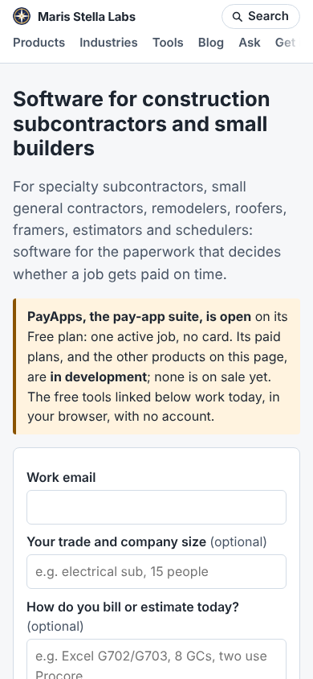
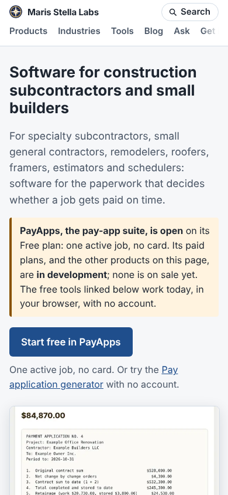

# Polish, 2026-11-27: the construction page's hero leads with the open product

Surface: `industries/construction/` (`platform/pages/industry-construction.mjs`), the catalogue's
front door to bet #1 (PayApps, `portfolio/monetization/bets.md`).

## What looked weak

PayApps opened on its Free plan on 2026-11-27, and the hero's notice said so. But the first thing
under that notice was the **early-access waitlist form** (email, trade, how you bill today, consent,
"Ask for early access"), which by then offered only Residential takeoff. A subcontractor who read
"PayApps is open" met a waitlist form for a different product; the only "Start free in PayApps" link
was an unstyled text link inside the product card, about 4,000 px down on a phone (the phone page is
9,743 px tall). Both status pills (open and in development) were the same amber.

## What changed

- The hero's first action is a button, **Start free in PayApps**, with "One active job, no card. Or
  try the Pay application generator with no account." beside it (the open product and its first
  published free tool, both read from `PRODUCTS`, so the line follows the data).
- The waitlist form moved below the product cards under its own heading, "Early access: Residential
  takeoff", and the takeoff card links to it. While no product is open, the form stays in the hero as
  before.
- The open status pill is green (`#1d6b35` on `#e3f4e8`; dark `#8fdca6` on `#173322`); in development
  and planned stay amber. The in-card sign-up link is now a button with a visible focus ring.
- New test in `industry-construction.test.mjs`: the sign-up button comes before the first `h2`, and the
  form comes after the PayApps card.

No copy claims changed: the honesty note, statuses, prices (none) and the sign-up URL are untouched.

## Measured

Preview build (`build.mjs --only=pay-application-generator`), Playwright at 390 x 844 and 1280 x 900,
light and dark:

| | Before | After |
|---|---|---|
| First screen on a phone (390 x 844) | notice, then the waitlist form's email field | notice, then the **Start free in PayApps** button and the free-tool link |
| Sideways scroll | none (390 = 390) | none (390 = 390) |

Not measured: clicks. Usage is unmeasured, not zero; the sign-up link carries
`from=industries/construction`, so the app's sign-up source can show whether this moves anything.

## Still weakest, next

1. The other industry pages with a paid product (manufacturing for bet #2, EU e-invoicing for bet #3):
   check whether their hero leads with a waitlist or with the thing a visitor can use today.
2. The construction page's lead still (the pay-application generator) is a plain-text summary; a
   screenshot of the PayApps app itself (its pay-app screen with a demo job) would show the product
   the button sells. Needs a capture from the app, not the free tool.
3. The code-list rows from `polish-2026-11-27-code-list-details.md` item 1, still open.
