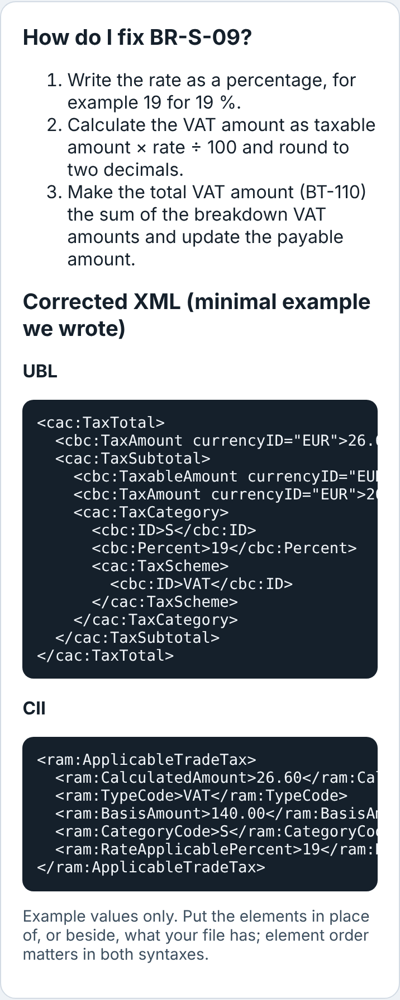
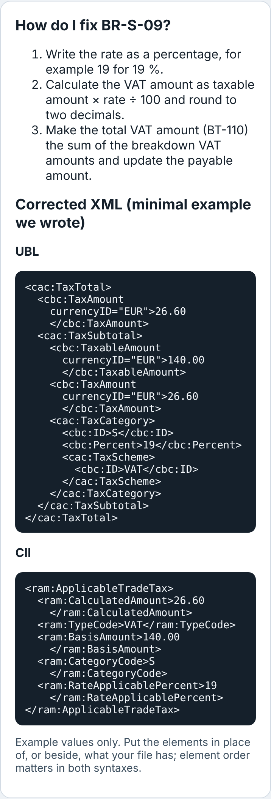

# Polish 2026-11-27: e-invoicing rule pages' XML wraps on a phone; nonprofit and e-invoicing tables stack

Track: polish/0. Items 1 and 3 of "Still weakest" in
`polish-2026-11-27-online-seller-tables-stack.md`: the online-seller `pre.cmd`
blocks, and `phone-probe-check.mjs` on the industries no run had probed
(`eu-e-invoicing`, bet #3's front door, and `nonprofits`). Construction is in
open PR #19542 and manufacturing merged in PR #19549, so neither was touched.

## Measured (`phone-probe-check.mjs`, 390 × 844, built with `build.mjs --only=<slugs>`)

| | before (`origin/main` b74e017ee) | after |
|---|---|---|
| eu-e-invoicing (333 pages): failures | **401** | **2** |
| ... XML snippets on the 390 rule pages (`rules/{en,de,fr}`) | 390 | 0 |
| ... results / reference tables | 8 | 0 |
| ... `create.html` generated-XML preview (`pre#xml`) | 1 | 0 (marked `data-phone-scroll-ok`: a 360 px-tall file preview where indentation is the point) |
| nonprofits (17 pages): failures | **9** | **0** (the last one, grant-deadline-tracker's "three paths" table, was fixed after the probe by hand) |
| online-seller pages with `pre.cmd` / `pre.schema` (6 slugs, 13 pages) | 6 | **0** |

Left: two pre-existing "stacked row taller than the screen" findings,
`br-fr-error-codes.html` (5 rows, worst 1,779 px) and
`what-does-this-e-invoice-error-code-mean.html` (898 px): long rule text in a
card. Not from this change.

Stacked tables checked in the built pages with the example worked out
(donor-retention, grant-deadline, grant-indirect-cost, volunteer-shift,
sdi-error-codes, create): no unlabelled cell; `create.html`'s two invoice line
grids hold inputs, so they are `stack fields` (label-above-field cards).

## What changed

- `ventures/einvoice-preflight/rules/build.mjs`: `xmlLines()` writes each line
  of a fix snippet as a block ``, keeping its
  leading spaces as text, with a hanging indent of depth + 2 ch, and a `<wbr>`
  before each tag that does not start the line. On ≤ 700 px the `pre` wraps
  (`pre-wrap`, `overflow-wrap:anywhere` as a last resort for long URNs), so a
  wrapped line breaks between `26.60` and `</cbc:TaxAmount>` and stays inside
  its element visually. No newline characters between the blocks: checked in
  Chromium that `innerText` and a select-all copy are identical to the plain
  snippet, and desktop height is unchanged. Regenerated 226 pages (130 rule
  pages × 3 languages with snippets).
- `class="stack"` (by `stack-overflowing.mjs --scripted`, then generators
  fixed so the page tests stay green): `build-sdi-codes-page.mjs` (4 tables),
  `auditpack.mjs` (rule table of the audit pack, so the sample pack too),
  `build-peppol-readiness-page.mjs`, the mixed-VAT guide, and the results
  tables of 8 nonprofit tools.
- Online-seller `pre.cmd` (5 pages) and shopify-permission-drift `pre.schema`:
  `white-space: pre-wrap; overflow-wrap: anywhere`. All were one-line commands
  with no aligned columns.

## Verification

- `python3 platform/ci/run_venture_tests.py --changed`: 17 suites, 0 failed
  (the first run failed two einvoice-preflight "committed page is what the
  generator writes" tests until the class moved into the generators).
- Probe before/after as above, from two fresh builds.

No traffic or conversion claim: usage is unmeasured.

## Still weakest, next

1. The two tall stacked rows on the e-invoicing error-code pages: a long
   "rule text" cell wants clamping with a details/summary, or `compact`.
2. 129 of the 240 `pre.cmd` blocks site-wide hold aligned `# comment`
   columns, where wrapping would hurt; the other 111 could take the same
   `pre-wrap`, but they sit on demoted dev tools, so only do it where a page
   is a bet's front door.
3. Run the probe on `--industry all` once PR #19542 lands, to see what is left
   across every front door.
