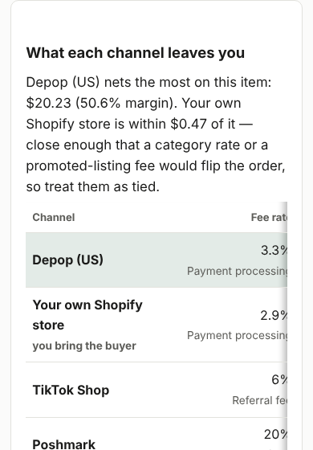
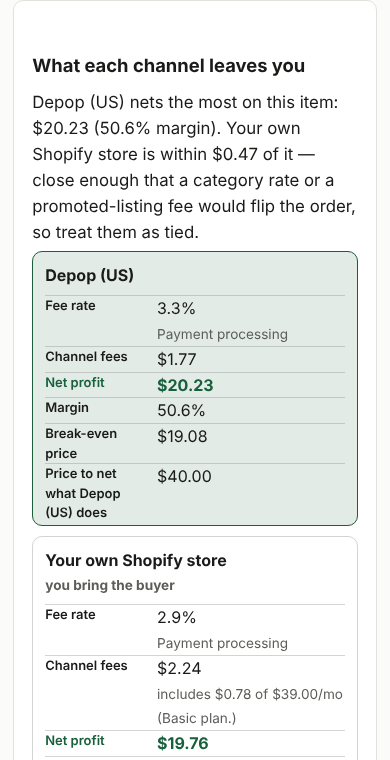

# Polish 2026-11-27: marketplace-fee-compare's results become phone cards

Track: polish/0. Item 2 of "Still weakest" in
`polish-2026-11-27-online-seller-tables-stack.md` (items 1 and 3 were taken by
`polish-2026-11-27-einvoice-xml-wrap.md`). marketplace-fee-compare is the
comparison the online-seller front doors (bet #5, reseller books) lead into.

## Correction to the earlier note

It said the script writes the whole `<table>`. It does not: `index.html` has
the `<thead>` in markup and the script fills `<tbody id="rows">`.
`stack-overflowing.mjs --scripted` probably missed it because the page has
no "example" button: the example is prefilled and results render at load.
Not checked further; the class went on by hand.

## Measured (local `build.mjs --only=marketplace-fee-compare`, Playwright, 390 × 844)

Before = the built page with the `stack` class removed in the browser (the only
other change is phone-only CSS, so this matches `origin/main`'s layout).

| | before | after |
|---|---|---|
| index.html `#resultSection table` | 1,219 px in a 326 px box | 326 in 326 |
| bulk.html results table (5-item example) | 470 px in 316 | 316 in 316 |
| page scrollWidth | 390 | 390 |
| unlabelled body cells (runtime labeller) | 0 | 0 |
| tallest card | n/a | 349 px (index), 164 px (bulk) |

`class="stack compact"` tried: no gain at 390 px (each cell's 9.5em basis is
152 px; two plus the gap need 322 px, the card's inner width is 302).

## What changed

- `ventures/marketplace-fee-compare/index.html`: `class="stack"` on the
  results table; under `max-width: 600px`, `white-space: normal; min-width: 0`
  for its cells (the page's `nowrap` and 11rem first column beat the chrome's
  zero-specificity rules), and the best channel's card takes `--accent` as
  its border.
- `bulk.html`: `class="stack"` and the same `white-space` reset.
- The 2026-11-19 phone-cards post gets a dated update.

Verification: `python3 platform/ci/run_venture_tests.py --changed`: 7 suites,
0 failed (marketplace-fee-compare 183 tests).

## Still weakest, next

1. Item 4 of the online-seller note, still open: `stack fields` on the four
   pre-existing stack tables with cost inputs (amazon-seller-profit-analyzer,
   ebay-transaction-report-analyzer, etsy-statement-profit-analyzer,
   shopify-payout-profit-analyzer).
2. The two tall e-invoicing error-code cards (item 1 of the einvoice note).
3. `stack-overflowing.mjs --scripted` misses tables whose example is
   prefilled (no button to click): measure after load as well, so the next
   such page is found by the script rather than by a note.
