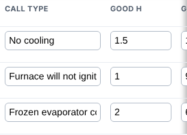
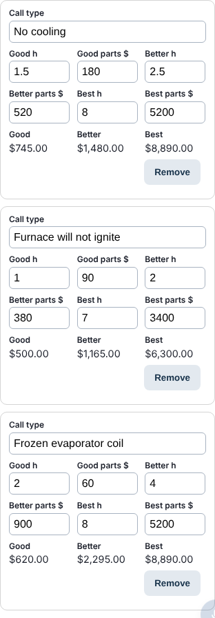
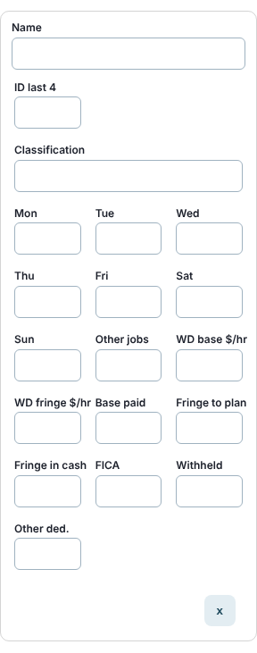

# Polish 2026-11-27: editable rows become cards of labelled fields on a phone

Track: polish/0. Item 1 of "Still weakest" in
`polish-2026-11-26-results-tables-stack.md` (input grids) and item 2 of
`polish-2026-11-26-runtime-stack-labels.md` ("a phone layout for editable
rows, where each row becomes a card of labelled inputs"), on the construction
bet's front doors (`portfolio/monetization/bets.md`, bet #1).

## Measured (`phone-probe-check.mjs`, 390 × 844)

Full construction set on `origin/main` a4c378edc (131 slugs, 495 pages):
**43** sideways-swipe failures. The seven widest were all input grids:

| tool, table | before (content / box) | after |
|---|---|---|
| certified-payroll-calculator `wh347-report.html` `#workers` | 1,642 / 288 px | fits; card 706 px tall |
| fault-current-check `#feeders` | 1,570 / 312 | fits; card 663 px |
| hvac-repair-tier-price-calculator price book | 1,244 / 312 | fits; card 288 px |
| plumber-flat-rate-price-calculator price book | 795 / 312 | fits; card 230 px |
| service-load-check `#loads` | 774 / 324 | fits; card 308 px |
| tile-layout-optimizer `#tiles` (+ `#cuts`) | 535 / 312 | fits |
| tile-layout-planner `#obst` | 463 / 312 (example loaded) | fits |

On those 7 slugs (21 pages, example worked out): **7 failures → 0**, and no
stacked row taller than the screen, no field under 16 px. Construction total:
43 → 36 by subtraction (the new rules match only `.fields` tables, so no other page changes; not re-probed in full). At 1280 px the tables are unchanged (plumber fits its 954 px box;
fault-current still scrolls inside its box, as before). No field overflows its
cell (Playwright, all seven). No page errors.

| HVAC price book, before | after |
|---|---|
|  |  |

| WH-347 worker row, before | after |
|---|---|
|  |  |

## What changed

- `STACK_TABLE_CSS` (`platform/pages/site-nav.mjs`): a `table.stack.fields`
  modifier under 600 px. The row is a grid,
  `repeat(auto-fill,minmax(5em,1fr))`, with each cell's label above its field
  (the first cell keeps its label too). Whole-line cells: the first, any with
  a `select`, `textarea` or `input.wide`. A cell holding only a button sits on
  its own line, right-aligned, `nowrap` (first try broke "Remove" into
  "Remov / e"). A checkbox cell is checkbox-then-label on one line. Every field
  gets `max-width:100%`: the ventures set `width`, never `max-width`, so this
  holds even though their CSS beats the `:where()` chrome copy.
- `STACK_TABLE_CHROME_CSS`'s `:where()` wrapping now covers `.fields`.
- `class="stack fields"` on the 8 tables above (7 slugs). Labels come from
  the `<thead>` via the runtime labeller (`STACK_LABELS_JS`); every one of
  these rows is script-written.
- Tests: `stack-table.test.mjs` (+1, the fields rules and their scoping);
  `stack-labels.test.mjs`'s scoping check now splits selector lists on
  top-level commas only (`td:is(:first-child,:has(select))` is one selector).

Tests: `node --test 'platform/pages/*.test.mjs'` (counts in the run record);
`run_venture_tests.py` on the 7 slugs, 7 suites, 0 failed.

## Still weakest, next

1. The 36 construction swipes left, widest first: `pre` blocks
   (scope-creep `pre.cmd` 863, continuous-beam guide `pre` 774/671,
   earthwork guide 715, floor-flatness 654/482, hvac-load-calc how-it-works),
   elevator-traffic `span.eq` (507/502) and its two tables (666, 409),
   psychrometric and wall-condensation `div#chart` (560: SVG `viewBox` +
   `width:100%`). A worked-example `pre` probably wants `white-space:pre-wrap`
   where it is prose-like, scroll-ok where columns matter.
2. Static guide tables still swiping (quote-margin-check ×8 at 361 to 459 px,
   hvac-load-calc/ducts, water-supply-sizing, sprinkler-hydraulic-calc,
   bid-calculator "should-i" pages by 12 to 68 px): run
   `stack-overflowing.mjs` over them.
3. Other input grids not yet failing the probe (pay-app schedule-of-values
   editors, other industries): `--industry all` would list them; the opt-in
   is now one class.
4. Carried: register `phone-probe` in `browser_checks.CHECKS` (control
   plane, its own PR).
