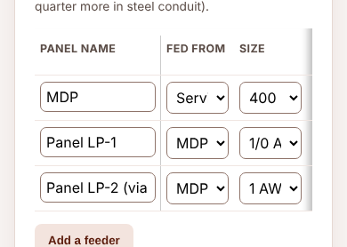
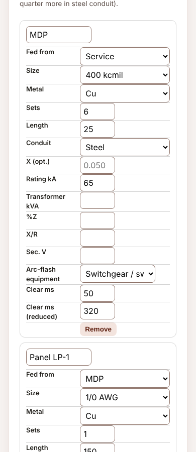
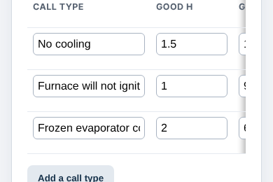
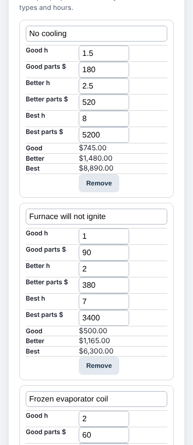
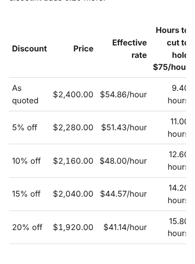
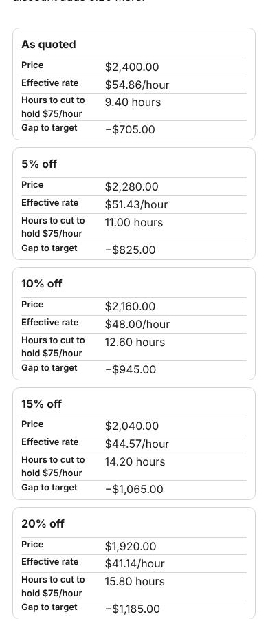

# Polish 2026-11-27: the last 43 phone swipes on the construction front doors

Track: polish/0. Items 1 and 2 of "Still weakest" in
`polish-2026-11-26-results-tables-stack.md` (the 9 left on those slugs, then
the other 34), plus its carried item 3, "a card layout for editable input
rows". These are the free front doors of the construction bet
(`portfolio/monetization/bets.md`, bet #1).

## Measured (`phone-probe-check.mjs`, 390 × 844, example worked out)

| | before (`origin/main` f500f761b) | after |
|---|---|---|
| construction front doors, 131 slugs, 495 pages: failures | **43** (all sideways swipes) | **0** |
| the 24 slugs this run touched, at 320 px | not measured | 21 (list below) |

The 43 by kind, and what each got:

| kind | count | fix |
|---|---|---|
| editable input grids (fault-current feeders 1,570 px in 312; WH-347 workers 1,642 in 288; hvac-repair and plumber flat-rate price books; service-load appliances; tile sizes; water-supply fixture types; tile obstacles; roofing supplement lines) | 9 | `class="stack"`: each row becomes a card of labelled fields |
| read-only results tables a script fills (continuous beam spans, elevator designs and demand sweep, HVAC rooms, duct runs and trunks, sprinkler pipes, rebar cutting plans) | 9 | `class="stack"` (`stack compact` for the 25-row sprinkler pipe list); the runtime labeller in `pf-site.js` labels the rows |
| static guide tables (four quote-margin-check guides and its four scenario tables, walk-in tub ×2, walk-in shower, stair lift, boiler, psychrometric coil guide) | 14 | `class="stack"`; the coil guide's header row moved into a real `<thead>` so it has labels |
| `pre` with formulas or number rows (floor flatness ×2, HVAC how-it-works ×2, rebar guide) and `span.eq` equations (elevator how-it-works ×2) | 7 | wrap: inline `white-space:pre-wrap; overflow-wrap:anywhere`, or a phone media rule for `.eq` |
| `pre` with a CLI command and its output (scope-creep, continuous beam ×2, earthwork) | 4 | `data-phone-scroll-ok`: a command has to stay copyable as one line, the reason `REFLOW_CSS` scrolls `pre` |
| SVG charts drawn with `min-width:560px` (psychrometric, wall condensation) | 2 | `data-phone-scroll-ok`: shrinking a 560-wide chart into 312 px puts its 11 px labels at about 6 px; scrolling keeps them readable |

Two follow-ups the cards needed, found in screenshots rather than by the probe:

- WH-347's worker name field and service-load's appliance name field were
  blank boxes once the header was hidden (the first cell of a card has no
  label). Both now carry a placeholder ("Worker name", "Appliance name").
- service-load's `Kind` select kept `max-width:13em` and sat 40 px past its
  card. A phone rule sets `width:100%; min-width:0` on it.

| fault-current feeders, before | after |
|---|---|
|  |  |

| HVAC repair price book, before | after |
|---|---|
|  |  |

| "If they ask for 10% off" guide, before | after |
|---|---|
|  |  |

Tests: `python3 platform/ci/run_venture_tests.py --changed`, 33 suites, 0 failed.

## Still weakest, next

1. 320 px on the 24 slugs touched here finds 21 swipes, most 10 to 60 px:
   the bid calculators' own index tables (boiler, stair lift, walk-in tub and
   shower: bare `table`, 259 to 301 px in 242), quote-margin-check's
   `#sensitivity` and `#ladder` (280 and 253 in 204), water-supply's fixture
   cards (295 in 250: the inputs' own min-width), tile-layout-planner's
   how-many-tiles guide (354 in 284), and four guide tables. Run
   `phone-probe-check.mjs --widths 320` over all 131 slugs for the full list.
2. Carried: `--industry all` at 390 px for swipes (online-sellers has
   whatnot `#report` at ~800 px in 288, window-design-pressure, walmart
   decision pages), and registering `phone-probe` in `browser_checks.CHECKS`
   (control plane, its own PR).
3. Input-grid cards are long (fault-current: 17 fields a feeder). A
   two-column field grid inside the card (`stack compact` does it for
   read-only tables) would halve the height; it needs the inputs' widths
   reviewed first.
