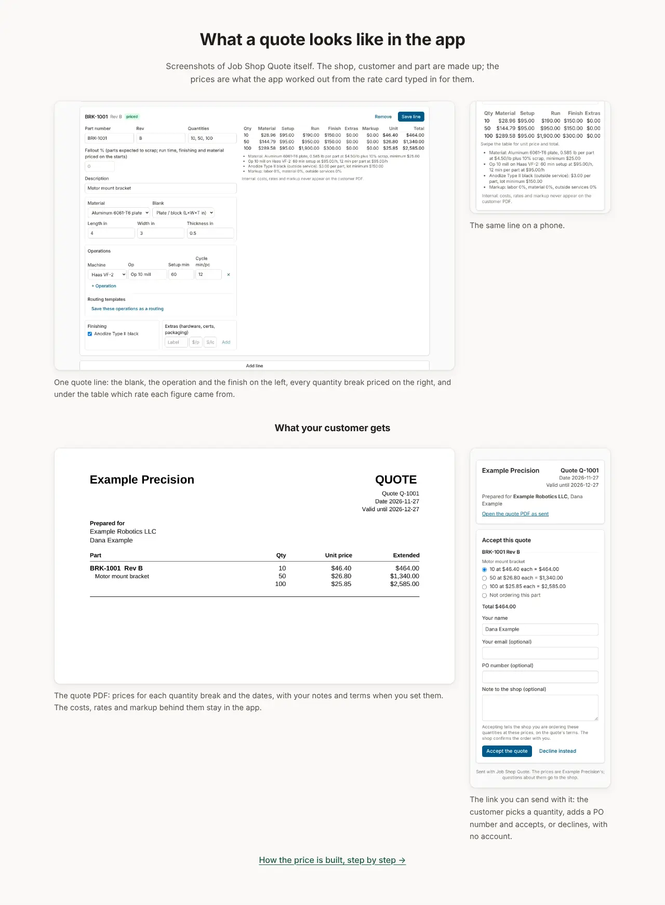
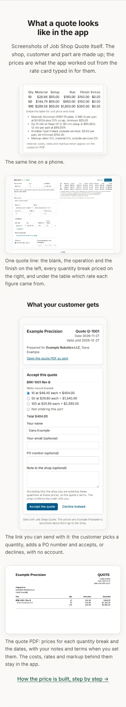
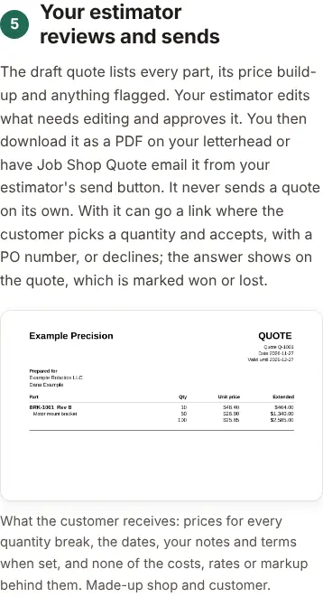

# Polish 2026-11-27: what the customer gets, on the Job Shop Quote site

Track: polish/0. Item 2 of [polish-2026-11-27-jobshop-shots.md](polish-2026-11-27-jobshop-shots.md):
the site for bet #2 (https://marisstella.app/jobshop/) showed the estimator's screens but not what the
shop's customer receives. A shop owner choosing a quoting tool also asks "what will my customer see?",
and the answer was text only. Item 1 (the CAD gap) is product work for a ventures run.

## What changed

- **`pnpm stills`** (`apps/jobshop-quote/test/stills/capture.stills.ts`) goes on past the priced
  line: it clicks **Mark sent**, **Copy a customer link**, opens the link in a fresh context with no
  session at 390 px, and checks the page shows the three unit prices and **not** the $95.00 machine
  rate before the shot. It then downloads the PDF as sent from the link and rasterises page 1 with
  poppler's `pdftoppm` (headless Chromium has no PDF viewer; the script says so if `pdftoppm` is
  missing), keeping the top 5 inches since a one-part quote leaves the rest blank.
  Two new WebP stills: `customer-pdf.webp` (1275x750, 24 KB) and `customer-quote-phone.webp`
  (390x944 CSS at 2x, 80 KB). The three existing stills re-encode byte-identical except the quote line
  (left as committed).
- **Home page:** the "What a quote looks like in the app" band gets a second row, **What your customer
  gets**: the PDF (links to full size) and the customer's accept page on a phone.
- **How it works, step 5** now says a link can go with the quote where the customer picks a quantity
  and accepts with a PO number, or declines, and the quote is marked won or lost
  (`services/quotes/customer-link.ts`), and shows the PDF still.
- `catalogue-export/` regenerated. The existing `test/unit/shots.test.ts` covers the new stills
  (listed, shown, real size, lazy, alt text of 80+ characters).

## Measured

Chromium, `catalogue-export/` served under `/jobshop/`:

| | before | after |
|---|---|---|
| stills of what the customer sees | 0 | 2 (PDF, accept page), 3 placements |
| `scrollWidth` at 390 / 1280, home and how-it-works, light and dark | 390 / 1280 | 390 / 1280 |
| page errors / failed requests | 0 | 0 |
| jobshop-site unit tests | 54 | 56 |
| `tsc --noEmit` (site, app), `biome check` on changed files | pass | pass |
| `node --test platform/pages/jobshop-site*.test.mjs` | 6 pass | 6 pass |

## Still weakest, next

1. The CAD gap (product work, bet #2's core promise): a hand-entered part never gets its STEP/DXF
   measurements. See the earlier note.
2. No still of the quote log / follow-up list (the shop's day-to-day view of open quotes).
3. The PDF still shows a shop with no logo, notes or terms. A run that sets a logo and terms in the
   stills spec would show the "on your letterhead" claim in step 5.
4. The how-it-works page still describes AI reading in steps 2 and 3 with "not switched on" notes.
5. The site has no dark mode (`color-scheme: light`).
