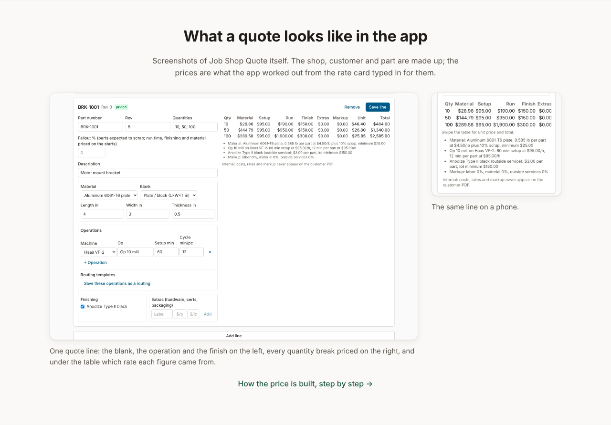
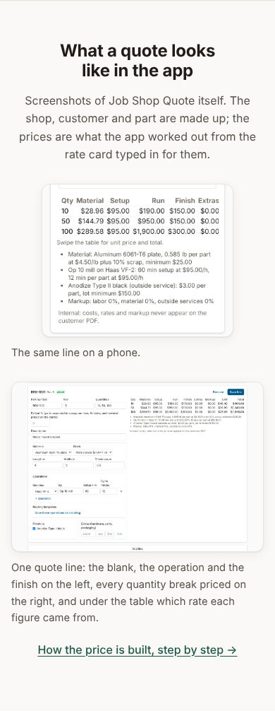

# Polish 2026-11-27: real screenshots of Job Shop Quote on its marketing site

Track: polish/0. Job Shop Quote's site (https://marisstella.app/jobshop/, bet #2's front door) went
live in PR #19780 and showed no picture of the product: the hero has a labelled illustration, and
every other page is text. A machine shop deciding whether to sign up could not see what a quote looks
like. The polish queue's next item (PayApps job-page stills) was already taken by open PR #19807, so
this run did the same job for bet #2.

## What changed

- **`pnpm stills`** in `ventures/jobshop-quote/apps/jobshop-quote` (`test/stills/capture.stills.ts`,
  `playwright.stills.config.ts`). It runs the real app offline on the e2e server (fresh local D1,
  `FAKE_EXTERNALS=true`), signs up a made-up shop, types a rate card (two machines, two materials,
  one anodize), creates an RFQ, **enters the part by hand** and types the blank and operation on the
  quote line. It **asserts the hand check from `test/e2e/01-rfq-to-quote.spec.ts`** ($46.40 /
  $26.80 / $25.85 a part at 10 / 50 / 100) before taking any shot. Chromium re-encodes the stills as
  WebP into `apps/jobshop-site/public/shots/` (52, 56, 52 KB).
- **Only what the hosted app does today is shown.** AI reading is off in the hosted app
  (`LAUNCH.aiReading: false`), so no still shows the RFQ-reading screen. The phone still is clipped
  to the price table so the "Draft with AI" cover-note button below it isn't in the frame.
- **Home page:** a new "What a quote looks like in the app" band right after the hero, with the
  priced quote line at laptop width (links to full size) and the same line on a phone (shown first
  on a phone, where the laptop still is too small to read). The caption says the shop, customer and
  part are made up.
- **How it works:** step 1 shows the rate card and step 4 shows the priced line.
- **Catalogue copy carries the stills:** `catalogueFiles()` adds `shots/*` (binary), and
  `pnpm export:catalogue` regenerated `catalogue-export/`. `platform/pages/jobshop-site.mjs` already
  copies subdirectories and binaries as they are.
- **`test/unit/shots.test.ts`** (site): every committed still is listed in `SHOTS` and shown on a page,
  its `width`/`height` match the WebP header (1x or 2x), it loads lazily, and its alt text reads out
  the figures. `site.test.ts`'s link check now knows the shot paths.

## Measured

Chromium, `catalogue-export/` served locally under `/jobshop/`:

| | before | after |
|---|---|---|
| screenshots of the app on the site | 0 | 3 stills (WebP, 160 KB together, lazy), 4 placements |
| `scrollWidth` at 390 / 1280, all five pages, light and dark | 390 / 1280 | 390 / 1280 |
| page errors / failed requests | 0 | 0 |
| jobshop-site unit tests | 49 | 54 |
| `tsc --noEmit` (site, app), `biome check` on changed files | pass | pass |
| `node --test platform/pages/jobshop-site*.test.mjs` | 6 pass | 6 pass |

## Found on the way (product, not fixed here)

- **A hand-entered part never gets its CAD file's measurements.** A STEP or DXF is linked to a part
  by part number only at extraction or upload (`services/rfq/index.ts`, `extractRfq` and
  `measureFile`), and the RFQ page has no way to attach a file after the RFQ is made. While AI reading
  is off in the hosted app, parts are entered by hand, so the site's "measures STEP and DXF files"
  promise doesn't reach the quote line in the hosted app's main path. Worth a ventures run: link a
  measured file when a hand-entered part's number is saved, or a file picker on the part.
- With `FAKE_EXTERNALS` the offline extractor adds an empty "AI-extracted" part to a one-line RFQ;
  the stills spec removes it.

## Still weakest, next

1. The CAD gap above (product work, bet #2's core promise).
2. No still of the customer PDF or the quote log/follow-up list. The PDF is what the shop's customer
   sees; a rendered first page (Chromium can screenshot the PDF preview) would sell well.
3. The how-it-works page still describes AI reading in steps 2 and 3, with "not switched on" notes.
   When the hosted app switches it on, add a still of the RFQ page and its "From the RFQ" sources.
4. The site has no dark mode (`color-scheme: light`); the stills match it.
