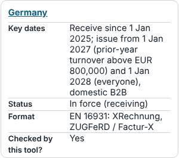
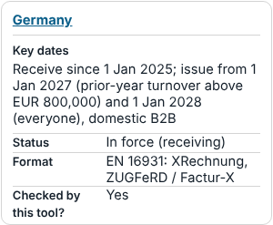

# Polish 2026-11-27: per-cell `prose` on the e-invoicing mandates table, and its country count

Track: polish/0. Items 2 and 3 of `polish-2026-11-27-stack-prose.md`'s "Still weakest"
(item 1 of `polish-2026-11-27-code-list-details.md` was judged and left: see below).
Page: `ventures/einvoice-preflight/e-invoicing-mandates-by-country.html`, bet #3's
widest-reaching SEO page (93 country rows, each linking a country page).

## How the target was found (item 2)

A static scan of every venture page for `class="stack"` tables without `prose` whose body
cells exceed 200 characters (script kept in the run's scratchpad; ~30 lines, regex over
`<table>…</table>`). 14 tables matched:

- 12 are pay-app-guides pages, which style their own `.stack` with the label above already
  (`site-nav.mjs`, STACK_TABLE_CHROME_CSS comment): nothing to do.
- `einvoice-preflight/e-invoicing-mandates-by-country.html`: 53 of 93 rows over 200 characters,
  all in "Key dates". Taken.
- `einvoice-preflight/peppol-bis-3-1-0-readiness.html` (2 of 146 rows, 224 max) and
  `sample-audit-pack.html` (1 of 25, 208): too few long cells to matter.

## Measured (`build.mjs --only=einvoice-preflight`, Chromium, before = origin/main stashed)

| | before | whole-table `prose` (tried) | `td.prose` on Key dates (shipped) |
|---|---|---|---|
| 390 px: sum of 93 card heights | 33,903 | 36,306 | 30,185 |
| 390 px: tallest card | 602 | 546 | 494 |
| 390 px: Germany | 265 | 330 | 246 |
| 390 px: document height | 39,315 | 41,718 | 35,596 |
| 390 px: scrollWidth | 390 | 390 | 390 |
| 1280 px: sum of rows | 12,165 | — | 12,165 |

## What changed

- `platform/pages/site-nav.mjs`: the two `table.stack.prose` rules also select
  `table.stack td.prose`, so one column can be prose while the rest stay label-beside-value.
  Chrome copy becomes `:where(table.stack) td.prose`. Comment and `stack-table.test.mjs`
  updated.
- The mandates page: `class="prose"` on the Key dates `td` of all 93 rows (the build's
  labeller keeps it: `<td data-label="Key dates" role="cell" class="prose">`). +1 test.
- **Count drift fixed.** Lede "Seventy-six countries", meta and og descriptions "88 countries",
  table 93 rows. Now "Ninety-three" and 93; a new test fails when any "N countries" on the
  page or the lede's word differs from the row count (it asks the next editor to add the
  number in words when the row count moves).
- Item 3: `platform/pages/stack-overflowing.mjs` matches a header by its static text
  (`staticHeadKey`: content of `id`'d elements left out, in source and DOM) when the full
  text matches no source table. `overflowingHeads` now returns `{ html, static }`;
  `stackTables` still accepts plain strings. +1 test. Not exercised on a live page: the one
  known case (marketplace-fee-compare) was stacked by hand in PR #19587, so it no longer
  overflows.

## Judged, not done

- Item 1 of the code-list note (BR-FR-MV-11/BT-128 at 693 px): under one screen, and a
  "French original" toggle hides reference text an accountant searches for. Left.

## Still weakest, next

1. The "Key dates" sentences themselves: 53 rows over 200 characters. A `<time>`-led list
   ("1 Jan 2027 — issue, turnover above EUR 800k") would scan faster than prose and give
   answer engines dated facts; the generator-free page makes this a hand edit of 93 cells,
   so script it.
2. Other count claims that can drift: `llms.txt` line 59 ("87 across 48 countries on
   2026-11-02") is dated, so fine; grep other ventures for "N countries/tools/states" in a
   lede next to a table and pin them the same way (a shared check in `platform/pages/`
   would be the "software for the routine" version).
3. `peppol-bis-3-1-0-readiness.html` (146 rows): screenshot at 390 px; two 224-character
   cells may want `td.prose`.
