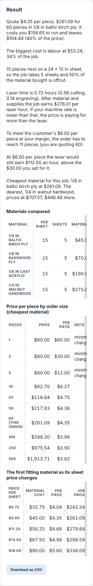
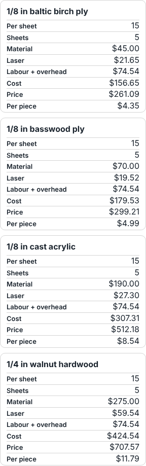
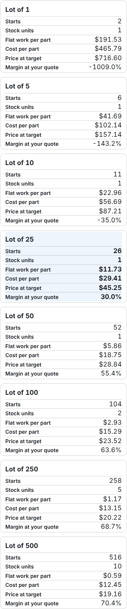
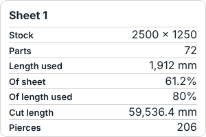

# Polish 2026-11-27: the manufacturing front doors' results tables on a phone

Track: polish/0. The newest notes' item 1 (sideways swipes) was already taken
for construction (open PRs #19540, #19542) and online sellers (#19543), so this
run took the industry none of them covers: **manufacturing**, the front doors
of bet #2 (RFQ-to-quote for job shops) and bet #4 (`portfolio/monetization/bets.md`).

## Measured (`phone-probe-check.mjs --industry manufacturing`, 9 slugs, 16 pages, example worked out)

| | before (`origin/main` 20f686cf1) | after |
|---|---|---|
| failures at 390 px | **9** (5 tools) | **0** |
| failures at 320 px (`--widths 320,390`) | not run before | 5, listed below |
| page `scrollWidth` at 390 / 1280 | 390 / 1280 | 390 / 1280 |
| desktop tables (1280 px) | unchanged | unchanged (scroll width = box) |

Per tool, before: cnc-machining-quote-calculator 347 and 522 px in 312;
dxf-nesting 394 and 535 in 300; laser-cutting 710 and 321 in 288;
powder-coating 728 and 331 in 288; spc-control-charts 358 in 324.

| laser calculator, before (390 px) | after |
|---|---|
|  |  |

| CNC lot-size table, after | DXF sheet card, after |
|---|---|
|  |  |

## What changed

- `class="stack"` (or `stack compact`) on 10 results tables in 4 tools: CNC
  breakdown and lot table, DXF parts and sheets, laser and powder-coating
  materials, price breaks and sensitivity tables. Labels come from the
  runtime labeller (`STACK_LABELS_JS`), since these tables are script-filled.
- CNC: the breakdown's `<caption>` became a `p.note` above the table
  (`aria-describedby`): a caption in a block-display table shrank to ~50 px.
  Lot cards are titled "Lot of N" (a phone-only `::before`).
- DXF: sheet cards are titled "Sheet N"; the parts card's inner "Qty" label is
  screen-reader-only on a phone, since the card already says "Quantity".
- SPC: not stacked. Its signals list is 34 px too wide and ~60 rows long;
  cards made the page 60 % longer (5,260 to 8,373 px). Tighter cell padding
  under 600 px keeps all five columns on screen (4,972 px).

## Verified

- `run_venture_tests.py` on the 5 slugs: 254 tests, 0 failed, plus site page checks.
- Probe at 390 px: 0 failures; Playwright 1280 px: every table fits its box.
- `node --test 'platform/pages/*.test.mjs'`: see the run record's notes.

## Still weakest, next

1. At 320 px the manufacturing set still has 5: spc-control-charts signals
   (318 in 254: needs `stack compact` below ~360 px only, or fewer columns),
   job-shop-scheduler's input grid (262 in 250), and two static guide tables in
   cnc-machining-quote-calculator (`setup-fee-or-in-the-part-price.html`,
   `vs-quoting-in-a-spreadsheet.html`; `stack-overflowing.mjs --width 320`).
2. machine-shop-guides is mapped as a front door in `front-doors-map.mjs`
   but `phone-probe-check.mjs --list --industry manufacturing` does not list
   it; check why and probe its 15 pages.
3. Carried: change-order-margin-calculator has no "load example" button.
