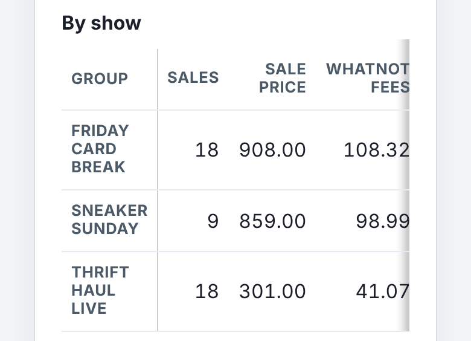
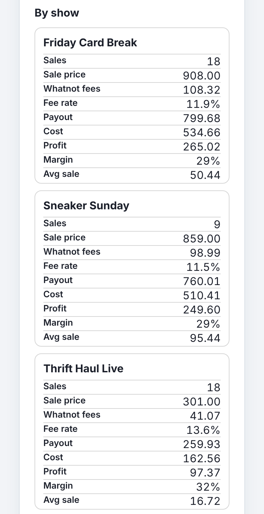

# Polish 2026-11-27: online-seller front doors' wide tables become phone cards

Track: polish/0. Item 1 of "Still weakest" in
`polish-2026-11-26-raw-money-formatters-static.md` (the sideways swipes; it
named whatnot-sales-report-analyzer's `#report` tables and the walmart
decision pages). The construction half is in open PR #19540 (input grids),
so this run took the **online-sellers** front doors, which lead to bet #5,
reseller profit and Schedule C books (`portfolio/monetization/bets.md`).

## Measured (`phone-probe-check.mjs --industry online-sellers`, 390 × 844)

57 slugs, 235 pages, example worked out on 48 page loads. Built with
`build.mjs --only=<the 57>`.

| | before (`origin/main` 9db53ee58) | after |
|---|---|---|
| blocks needing a sideways swipe | **195** | **9** |
| ... script-written `#report` tables | 62 | 0 |
| ... bare tables on guide/decision pages at load | 65 | 2 |
| pages scrolling sideways / fields under 16 px / rows taller than screen / raw amounts | 0 / 0 / 0 / 0 | 0 / 0 / 0 / 0 |
| whatnot "By show" table | 714 px in a 288 px box | fits; 713 px of three cards |

Left after: `pre.cmd` / `pre.schema` command blocks on six pages
(shopify-permission-drift 715, returns-policy-cost-analyzer 702,
free-shipping-threshold-optimizer 677, ticket-resale 583, card-grading 566,
thrift-haul 550); marketplace-fee-compare `#resultSection` (1,223 px: the
script writes the whole `<table>`, so there is no source table to mark);
discogs `table#crateTable` (421 in 312, headless: no `<thead>` to label
from); ebay `should-i-accept-this-ebay-offer.html` (321 in 312).

Cards checked in the built pages (Playwright, all 104 flagged pages, example
worked out): no card taller than 760 px; no unlabelled cell in a table this
run stacked. Two pre-existing findings, not from this change:
1099k-reconciliation-worksheet `#results-table` has 2 cells without a label,
and four existing `stack` tables (amazon-seller-profit-analyzer,
ebay-transaction-report-analyzer, etsy-statement-profit-analyzer,
shopify-payout-profit-analyzer) hold cost inputs: candidates for
`stack fields` once PR #19540 lands.

## What changed

- `platform/pages/stack-overflowing.mjs`:
  - `--scripted`: allows tables a script fills when they have a `<thead>`
    (the chrome's runtime labeller, `STACK_LABELS_JS`, labels rows written
    after load), and loads the page's example and submits it
    (`EXAMPLE_RE`, `SUBMIT_RE` from phone-probe.mjs) before measuring again.
  - A table that is itself the scroll box counts (the probe's "table needs a
    sideways swipe" lines were invisible to it before).
  - Tables sharing one header are stacked when every one of them overflowed
    (whatnot and poshmark write one per grouping); each table is counted
    once even inside nested scrollers.
  - +2 tests (8 total).
- `class="stack"` on 190 tables in 101 pages (29 slugs), written by
  `DIST=… node platform/pages/stack-overflowing.mjs pages.txt --scripted`.
- 10 page-test regexes in amazon-fba-calculator and tiktok-shop-fee-calculator
  that matched `<table id="x">` exactly now accept the class.

## Verification

- `python3 platform/ci/run_venture_tests.py --changed`: all suites pass after
  the regex fix (amazon-fba 326, tiktok-shop 113; the first run failed those
  two on the exact-tag regexes).
- `node --test platform/pages/stack-overflowing.test.mjs`: 8/8.
- Probe before/after as above, from two fresh builds.

No traffic or conversion claim: usage is unmeasured.

## Still weakest, next

1. The six `pre.cmd` blocks on online-seller tools (550 to 715 px): a
   command line wants `white-space: pre-wrap` with `overflow-wrap: anywhere`,
   or `data-phone-scroll-ok` where columns matter.
2. marketplace-fee-compare's results table (1,223 px): the script builds
   the whole table, so add `class="stack"` in that template string by hand.
3. Run `stack-overflowing.mjs --scripted` on the other industries
   (`--industry eu-e-invoicing`, `manufacturing`, `nonprofits`) and on the
   construction script-written tables PR #19540 did not touch.
4. After PR #19540: `stack fields` on the four pre-existing stack tables
   with cost inputs listed above.
