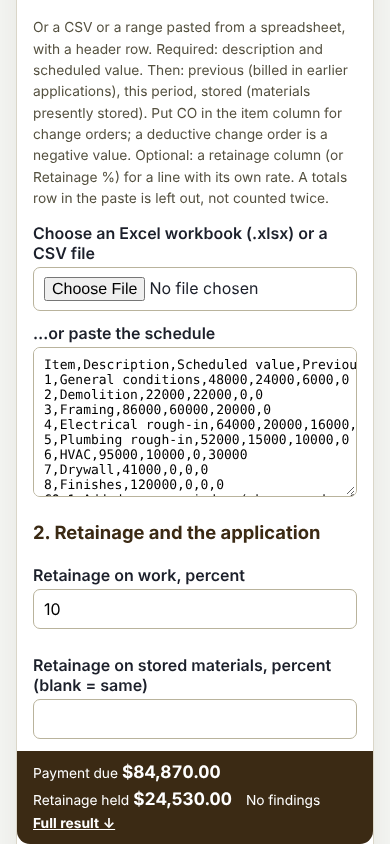
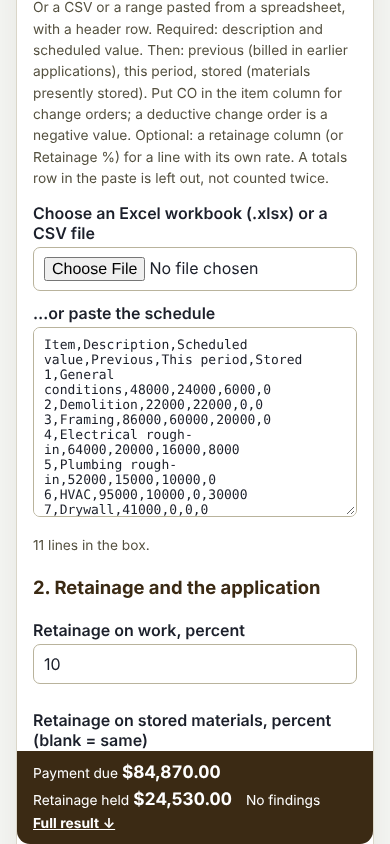
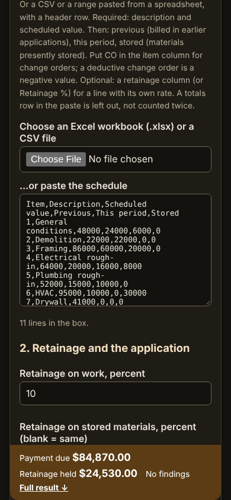
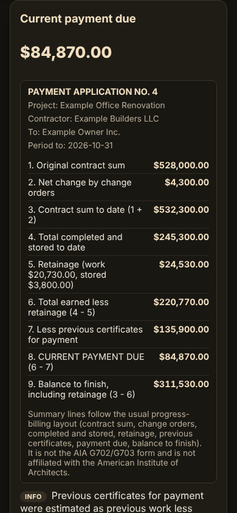

# Polish 2026-11-27: pay application page in dark mode, and a paste box that reads on a phone

Track: polish/0. Items 1 and 2 of `polish-2026-11-27-payapp-live.md`, on `pay-application-generator`
(bet #1 front door): the paste box scrolled sideways inside itself at 390 px, and neither the
generator nor `pay-application-template.html` had a dark mode.

## Measured

Chromium, 390 × 844, pages served straight from `ventures/pay-application-generator`
(before = `HEAD` before the change), worked example loaded:

| | before | after |
|---|---|---|
| paste box `scrollWidth` / `clientWidth` (phone) | 542 / 322 | 322 / 322 |
| paste box `white-space` (phone; desktop stays `pre`) | pre | pre-wrap |
| line count under the box | none | "11 lines in the box." |
| page background, dark scheme (generator / template) | #f3f4f1 / #f3f4f1 | #15130f / #15130f |
| page `scrollWidth` | 390 | 390 |
| `contrast.mjs` (both pages, phone + desktop, light + dark) | clean | clean |
| axe WCAG A/AA with the result shown, 4 runs | `scrollable-region-focusable` at 1280 px (both schemes) | clean |
| page errors | 0 | 0 |
| venture suite | 91 | 93 (+2 in `page.test.mjs`) |

`contrast.mjs` only sees each page as loaded, with the report hidden, so the result card, pills and
sticky strip were checked separately: axe after clicking "Load an example", at 390 and 1280 px in
both schemes. That run found the results table's sideways scroller (`div.scroll`) could not be
reached by keyboard at desktop width. This was already true before the change, so it is fixed here:
the scroller now has `tabindex="0"`, `role="region"`, a label, and a focus ring.

## What changed

- Both pages: every colour is a custom property on `:root`; the dark set sits under
  `@media screen and (prefers-color-scheme: dark)`, so print keeps the light palette, plus
  `color-scheme: light dark` so form controls and scrollbars follow. The only literal colour left in
  the rules is `#fff` (the sticky strip's text, print paper). In dark mode the primary button is light
  amber with dark text (white text on an amber dark enough to keep contrast looked muddy), and the
  strip is a lighter brown so it stands out from the card.
- Phone (≤ 600 px): `textarea#paste` wraps (`pre-wrap`, `overflow-wrap: anywhere`). The
  `wrap="off"` attribute stays, so columns still line up on a desktop. `#paste-count` under the box,
  linked by `aria-describedby`, is updated on typing, load example, workbook import, clear and next month.
- A wrapped CSV line can split mid-field ("Scheduled / value"), which is why the count is there:
  the box shows the text, and the count tells you how many lines it holds.

## Still weakest, next

1. The template guide's `div.scroll` (the formula table) has no `tabindex`/label either. axe did not
   flag it at 390 or 1280 px because it does not overflow at those widths. Worth the same fix if the
   table grows.
2. Carried: the CNC / laser / powder-coat shop calculators have no dark mode. The token block here
   (`index.html`, top of `<style>`) can be copied across as is, with each page's accent swapped in.
3. Carried from the shop note: the `id="report" aria-live="polite" hidden` template on 454 venture
   pages (front doors to a bet only); BR-FR-MV-11/BT-128 row heights; `stack-overflowing.mjs` and
   `th` holding an element with an `id`.
4. `contrast.mjs` checks pages only as they load. An option to click a named button first (here
   `#load-ok`) would let it see result panels. That is where colour bugs on tool pages tend to be.
