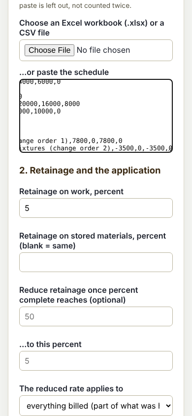
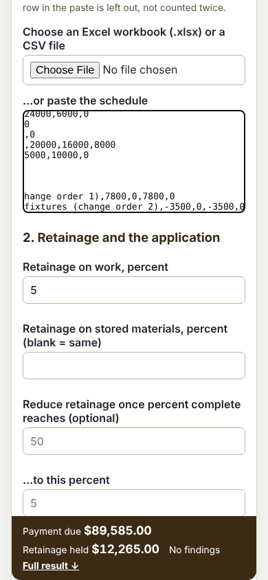

# Polish 2026-11-27: the pay application page works the schedule out as you edit

Track: polish/0. Item 1 of `polish-2026-11-27-shop-price-live.md`: `pay-application-generator`
(bet #1 front door) was the one page left from the CNC note's "results hidden until a button" list.

Unlike the shop price calculators, this page has no defaults to answer on load: the input is the
user's own schedule of values. So it does not answer on load. Instead, once the paste box holds a
schedule, any edit to it or to a setting works the application out again after 300 ms, and a sticky
strip at the bottom of the form card shows payment due, retainage held and the finding count.

## Measured

Chromium, 390 × 844, page served straight from `ventures/pay-application-generator`
(before = `HEAD` before the change), worked-example schedule pasted, retainage left at 10%:

| | before | after |
|---|---|---|
| result on load | hidden | hidden (no schedule yet) |
| result after paste, no click | hidden | shown |
| strip after paste | none | Payment due $84,870.00 · Retainage held $24,530.00 · No findings |
| strip after retainage → 5 | none | $89,585.00 · $12,265.00 |
| unreadable paste (`Item,Foo`) | nothing | strip shows the parser's error, report hidden |
| report `aria-live` while typing / after the button | polite / polite | off / polite |
| localStorage keys before / after the button | 0 / 1 | 0 / 1 |
| `scrollWidth` | 390 | 390 |
| page errors | 0 | 0 |

## What changed

- `run(text, quiet)`: quiet (the preview) skips the scroll and sets the report's `aria-live` to `off`;
  the button runs it as before and turns announcing back on.
- A chosen file is not previewed (an .xlsx is read asynchronously and the button already handles it).
  After an .xlsx import the CSV is in the box, so changing the retainage afterwards previews too, with
  the workbook's own checks kept.
- Only the buttons call `record()`. Clear and "Start next month's application" hide the strip.
- Form status text now says the payment due updates as you type.
- +1 test in `page.test.mjs` (12/12; venture suite 91/91).

## Still weakest, next

1. The paste box (`wrap="off"`) scrolls sideways inside itself at 390 px, so a pasted CSV shows
   the middle of each line (see the after shot). A wrapped view on phones, or a "N lines pasted"
   caption, would read better.
2. Pay-application page has no dark mode (fixed colours), like the shop calculators.
3. Carried from the shop note: the `id="report" aria-live="polite" hidden` template on 454 venture
   pages (front doors to a bet only, per the free-tool demotion); CNC/laser/powder dark mode;
   BR-FR-MV-11/BT-128 row heights; `stack-overflowing.mjs` and `th` holding an element with an `id`.
