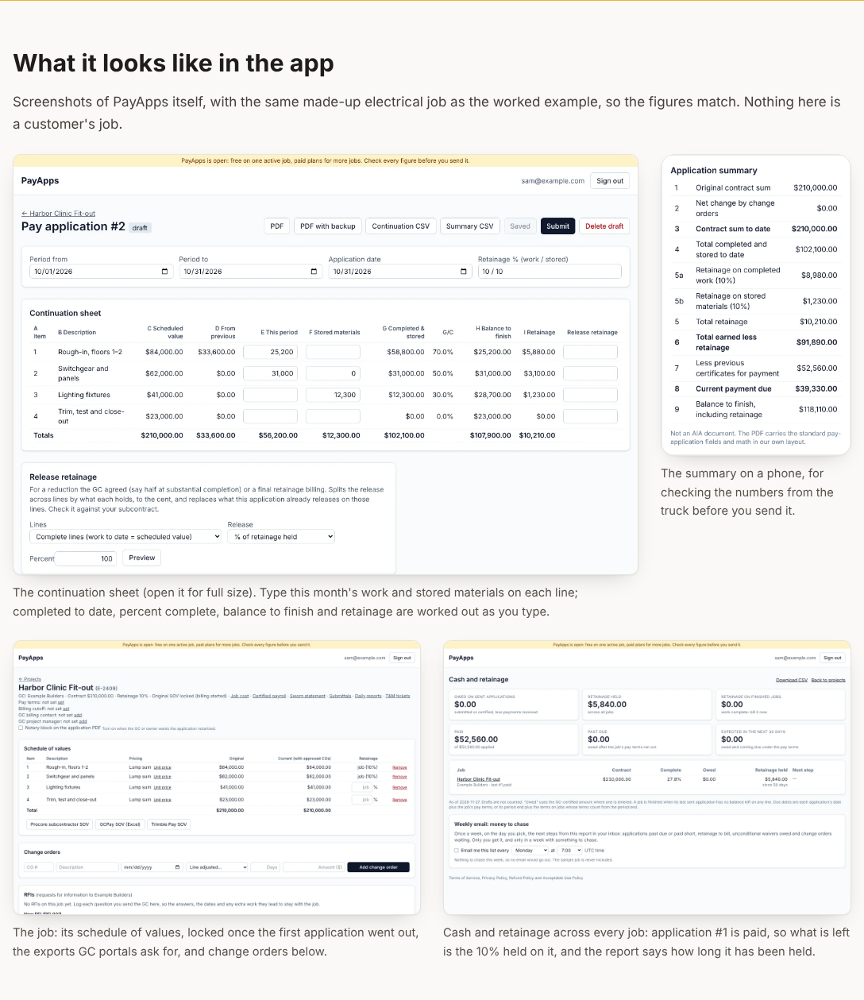
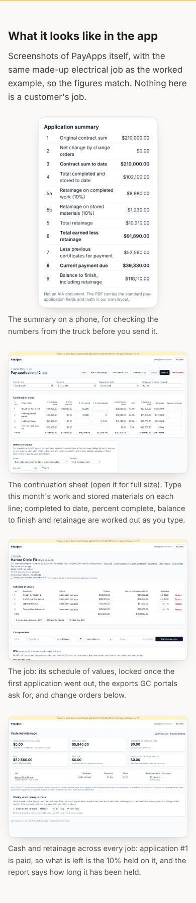
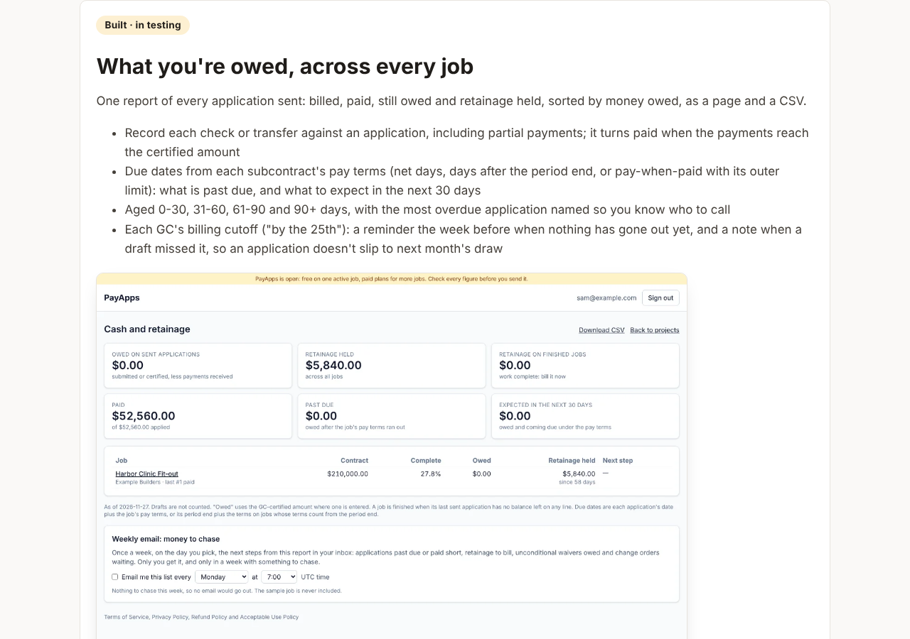

# Polish 2026-11-27: the job page and the cash report on the PayApps site

Track: polish/0. Item 1 of `polish-2026-11-27-payapps-shots.md`: the PayApps site
(https://marisstella.app/payapps/, bet #1's front door) showed only the pay-application screen,
and the features page had no screenshots at all.

## What changed

- **`pnpm stills` captures two more screens** (`apps/payapps/test/stills/capture.stills.ts`),
  using the same made-up electrical job and the same signed-in run:
  - the **job page**: the schedule of values (locked once billing started), the Procore, GCPay
    and Trimble Pay SOV exports, and the change-order form;
  - the **Cash and retainage report**: $52,560.00 paid and $5,840.00 retainage held (10% of
    application #1's $58,400.00), which is what the worked example implies.
  The job page was already being shot but never copied to the site. Re-running the capture
  reproduced the two existing WebPs byte for byte, so the stills are deterministic.
- **Home page**: below the continuation sheet and the phone summary, a two-up row of the job page
  and the cash report, each linking to its full size, with alt text that reads out the figures
  and captions that say what to look at. On a phone they stack.
- **Features page**: the "Schedule of values per job", "The monthly pay app" and "What you're
  owed, across every job" sections each show their still under the bullets (an optional
  `shot` on `Feature`; one `wideShot()` helper renders both pages' figures).
- **Tests**: `example.test.ts` still checks that every committed still is on the home page at its
  real size, and a new test checks that the three features sections carry theirs. Also fixed a
  `tsc` error in `legal.test.ts` (`terms.match` on `string | Buffer`), left over from the last
  PR's binary catalogue files: `pnpm typecheck` failed on main before this.

## Measured

Chromium, catalogue copy served locally under `/payapps/`:

| | before | after |
|---|---|---|
| app screenshots on the home page | 2 | 4 (WebP, 148 KB + 137 KB, lazy) |
| app screenshots on the features page | 0 | 3 |
| `scrollWidth` at 390 / 1280, home and features, light and dark | 390 / 1280 | 390 / 1280 |
| page errors / failed requests | 0 | 0 |
| payapps-site tests (unit + worker) | 49 + 11 | 50 + 11 |
| `tsc --noEmit` (site) | 1 error (legal.test.ts) | pass |
| `biome check` on payapps-site and the stills folder | — | pass, no warnings |

Before: `img/polish-2026-11-27-payapps-shots-section-1280-light.png` (the last note's "after").

## Still weakest, next

1. The hero still has no "see it in the app" anchor; on a phone the screenshots sit about two
   screens down (open since two notes ago).
2. In the home page's two-up row, the job and cash stills are small at 1280 px (about 510 px
   wide each), so the text in them can't be read until you open one. Cropped captures (the SOV
   card only, the tiles and table only) would read at that size: `locator.screenshot()` on the
   card, as the phone summary already does.
3. No change order shows in any still. Adding an approved CO would change the worked example's
   contract sum, so it needs the example (`apps/payapps-site/src/site/example.ts`) and its hand
   check updated together.
4. The cash still says "since 58 days" and "As of 2026-11-27": both move with the capture date.
   Harmless, but a re-capture changes the bytes. Pinning the browser clock (`page.clock`) would
   make it fully reproducible.
5. The lien-waiver and QuickBooks features sections still have no stills.
