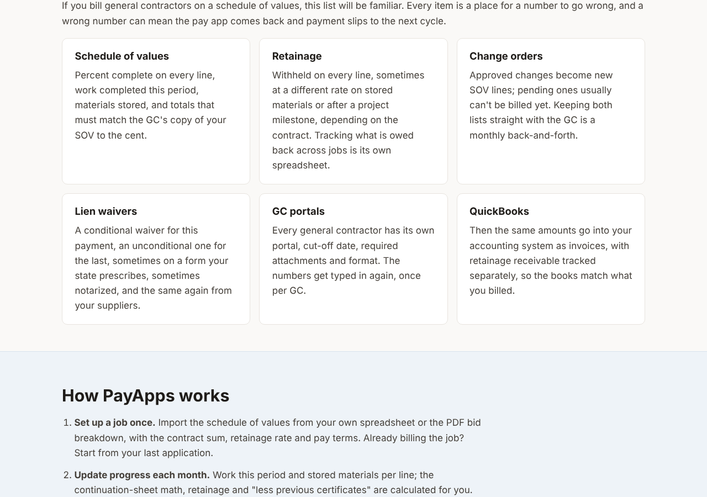
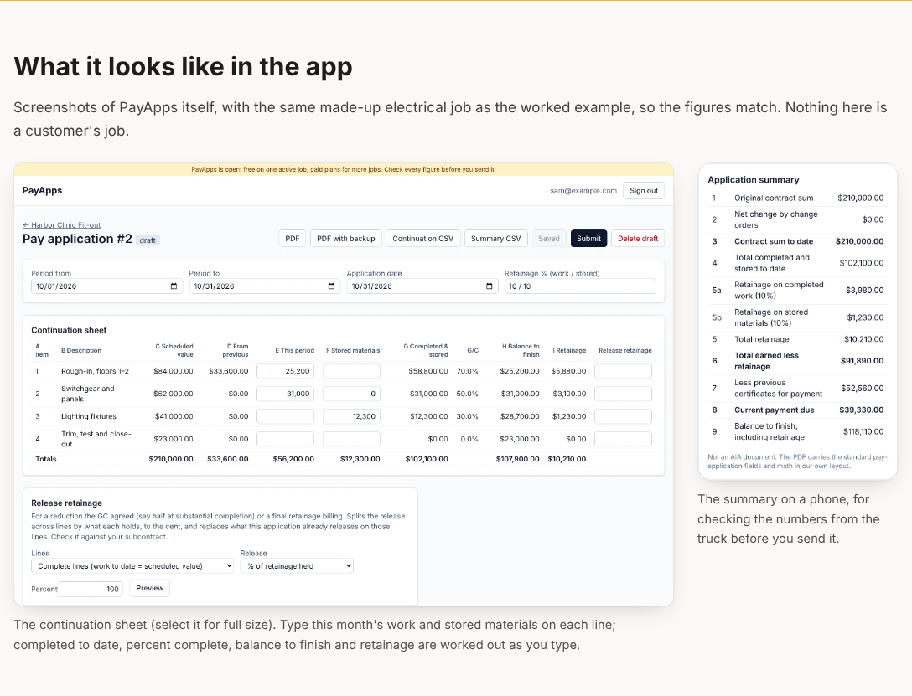
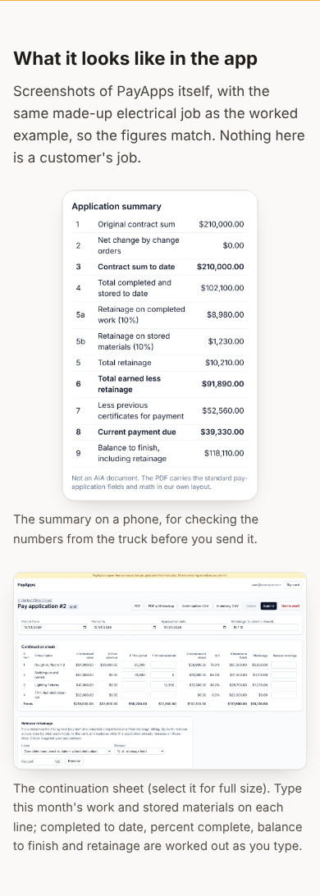

# Polish 2026-11-27: real screenshots of PayApps on its marketing site

Track: polish/0. Item 2 of `polish-2026-11-27-payapps-site.md`: the PayApps site
(https://marisstella.app/payapps/, bet #1's front door) showed the product's math but never the
product. A visitor deciding whether to sign up could not see what the app looks like.

## What changed

- **`pnpm stills`** in `ventures/payapps/apps/payapps` (`test/stills/capture.stills.ts`,
  `playwright.stills.config.ts`). It runs the real app offline on the e2e server (fresh local D1,
  `FAKE_EXTERNALS=true`), signs up, enters the home page's worked example (a made-up electrical
  job: four SOV lines, application #1 submitted and paid, application #2 drafted), **asserts the
  app shows $102,100.00 to date and $39,330.00 due, the panel's hand check**, then screenshots it.
  Chromium itself re-encodes the two stills the site uses as WebP (no image library) into
  `apps/payapps-site/public/shots/` (75 KB and 73 KB). A later run re-captures them after a UI
  change with one command, then `pnpm export:catalogue`.
- **"What it looks like in the app"** section on the home page, right after the hero: the
  continuation sheet at laptop width (links to full size) and the application summary on a phone.
  Real `width`/`height`, `loading="lazy"`, alt text that reads out the figures, a caption saying the
  job is made up. On a phone the phone still comes first, since the laptop one is too small to read
  until opened.
- **Build and catalogue copy carry binary files**: `scripts/build.ts` copies `public/` recursively;
  `catalogueFiles()` returns `string | Buffer` and adds `shots/*`; the drift test compares bytes.
  `test/unit/example.test.ts` checks every committed still is shown, at its real size (read from
  the WebP header), with alt text.
- **App fix found by the capture**: on a 390 px phone the app header ran the "PayApps" logo into the
  account email ("PayAppse2e-…") and wrapped "Sign out" over two lines. `layout.tsx` now has a gap
  and keeps the logo and button from shrinking.

## Measured

Chromium, catalogue copy served locally under `/payapps/`:

| | before | after |
|---|---|---|
| screenshots of the app on the site | 0 | 2 (WebP, 148 KB together, lazy) |
| `scrollWidth` at 390 / 1280, home, light and dark | 390 / 1280 | 390 / 1280 |
| page errors / failed requests | 0 | 0 |
| payapps-site unit tests | 34 | 35 |
| payapps unit tests | 1398 pass | 1398 pass |
| `tsc --noEmit` (site, app); `biome check` on changed files | pass | pass |

Run locally from `ventures/payapps`, `biome ci .` reports 1 error both before and after this change,
in a file this PR doesn't touch (`apps/payapps/src/shared/heif.test.ts`). payapps-ci's own lint job
passed on this PR, so the error comes from the local invocation, not from the code CI checks.

## Still weakest, next

1. Only the pay-application screen is shown. The job page (SOV, change orders, the portal export
   buttons) and the cash and retainage report are the next stills worth adding: extend
   `capture.stills.ts` and add a figure. The features page has no stills at all.
2. The hero still has no "see it in the app" anchor; on a phone the screenshots sit about two
   screens down (item 1 of the last note, still open).
3. A local `biome ci .` from `ventures/payapps` reports an error in `heif.test.ts` that payapps-ci's
   lint job does not. Running the same command CI runs would save the next run from the
   false alarm.
4. The stills are light-mode only. Dark-mode visitors see a light screenshot on a dark page, which
   reads fine (a white card) but a dark capture would only make sense if the app gets a dark mode.
