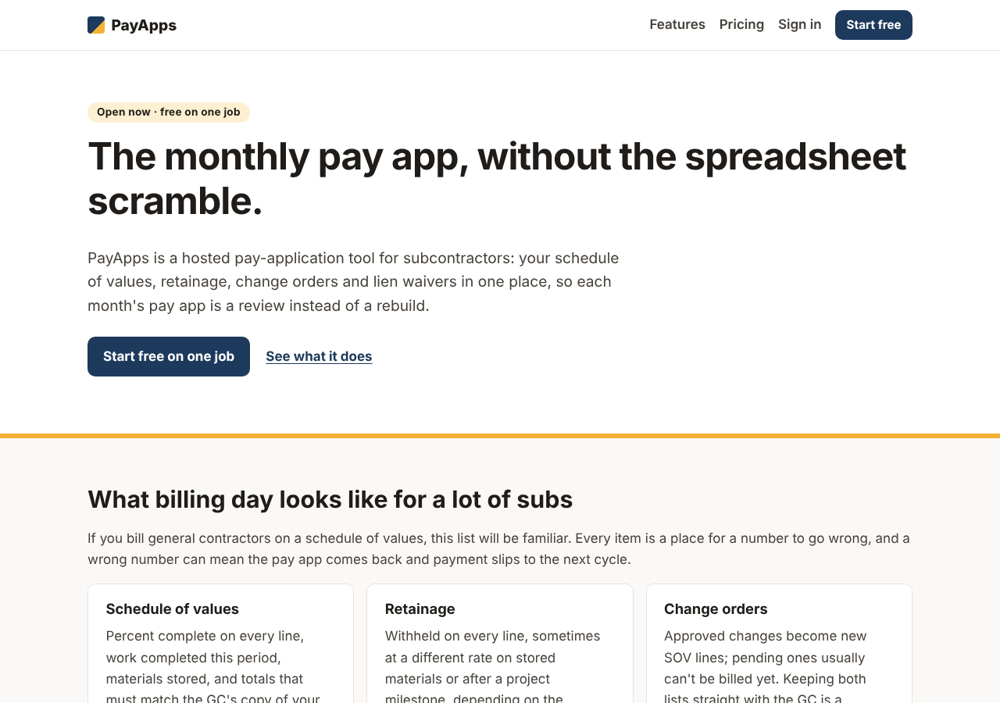
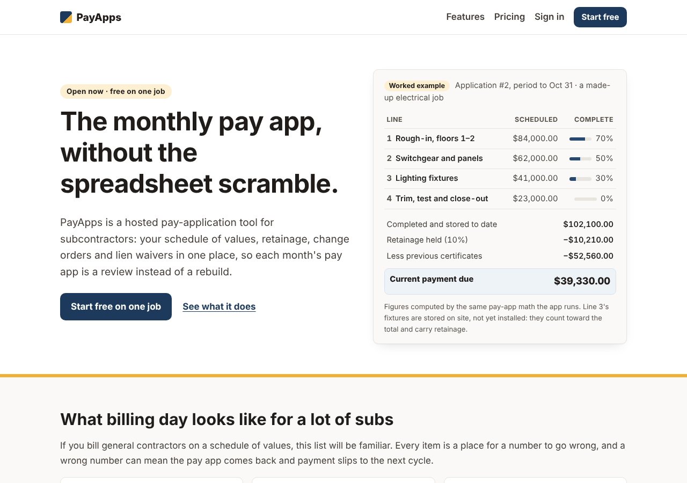
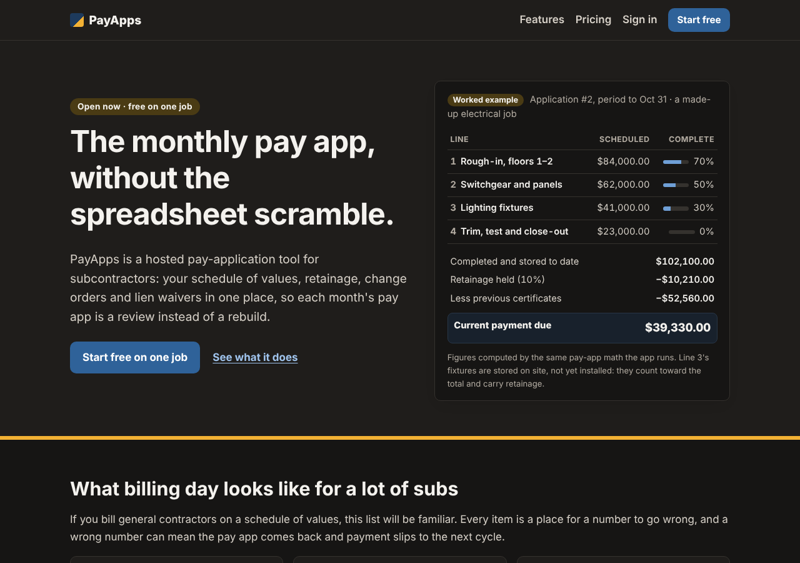
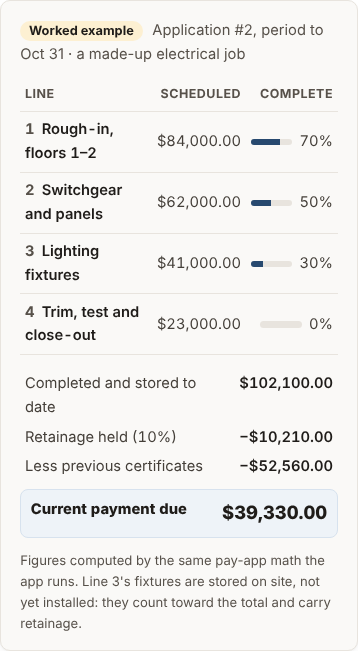

# Polish 2026-11-27: PayApps marketing site gets a worked example in the hero, and dark mode

Track: polish/0. The polish note before this one (`polish-2026-11-27-payapp-live.md`) listed the
pay-application generator's paste box and dark mode next, but open PR #19758 already covers both.
So this run took the most visible surface of bet #1 instead: the PayApps marketing site at
https://marisstella.app/payapps/ (`ventures/payapps/apps/payapps-site`), which started being served
earlier today (PR #19733).

## What looked weak

- At desktop width the hero was a headline and a paragraph, with the right 40% of the screen empty.
  Nothing on the home page showed what the product actually works out.
- Fixed light colours only: no `prefers-color-scheme` rule on any page.
- `catalogue-export/` was out of date with the source: PR #19750 added the Texas notices of claim
  feature (`features.html`, `llms.txt`, `llms-full.txt`) without running `pnpm export:catalogue`, so
  the served site and its `llms.txt` were missing it. Running the export here fixes that too.

## What changed

- **Worked example panel** (`src/site/example.ts`): a made-up electrical job's application #2, with
  four schedule-of-values lines, percent complete, then completed and stored to date, 10% retainage,
  less previous certificates and current payment due. The figures are **computed at build time by the
  app's own `computeApplications`** (`apps/payapps/src/shared/payapp-math.ts`), so the page can't show
  a number the product wouldn't produce. The build fails if the example raises a warning. The panel
  is labelled "Worked example … a made-up electrical job". It uses no inline styles (the CSP blocks
  them); the progress bars are width classes in steps of 10%.
- **Dark mode**: role tokens (`--link`, `--btn`, `--on-btn`, `--focus`) so links and buttons can
  split in dark mode, plus a `prefers-color-scheme: dark` block with warm near-black surfaces.
- `test/unit/example.test.ts` checks the figures you can work out by hand and that the home page
  carries the labelled panel.

## Measured

Chromium, catalogue copy served locally under `/payapps/`:

| | before | after |
|---|---|---|
| hero right column at 1280 px | empty | worked example |
| `scrollWidth` at 390 / 1280, home, pricing, features, light and dark | 390 / 1280 | 390 / 1280 |
| dark mode | none | all pages |
| page errors / failed requests | 0 | 0 |
| unit / worker tests | 32 / 11 | 34 / 11 |
| `biome ci .`, `tsc --noEmit`, `pnpm build` | pass | pass |

Hand check of the example: line 1 $33,600 + $25,200 = $58,800 of $84,000 (70%); line 2 $31,000 of
$62,000 (50%; application #1's stored switchgear is installed); line 3 $12,300 stored (30%). Total
$102,100, less 10% retainage $10,210, less previous certificates $52,560 ($58,400 less 10%), gives
$39,330 due.

Dark contrast (WCAG ratios, computed): on the card surface #1f1d1b, headings 15.0:1, body 11.0:1,
fine print 7.5:1, links 9.2:1; white on the button 6.3:1 (5.0:1 on hover); the eyebrow 9.7:1.

## Still weakest, next

1. On a phone the panel sits below both CTAs, about one and a half screens down. That's fine for
   reading order, but a "see a worked example" anchor link next to the CTA would bring it into view.
2. The site has no real screenshot of the app itself (the sign-up screen, a job page). Showcase
   stills of `apps/payapps` from a local `wrangler dev` with seeded demo data would show the product,
   not just its math.
3. The drift check exists: `catalogue-export.test.ts` runs in payapps-ci's `site` job on every
   `ventures/payapps/**` change. So PR #19750 merged with that job red, or with no runner for it.
   Whoever picks up the Texas notices work next should run `pnpm export:catalogue` along with the
   feature, as the README says. The verify docs could also name this job as one to read before a
   payapps merge.
4. Carried: the pay-application generator's paste box and dark mode (PR #19758, open), and the rest
   of `polish-2026-11-27-payapp-live.md` item 3.
