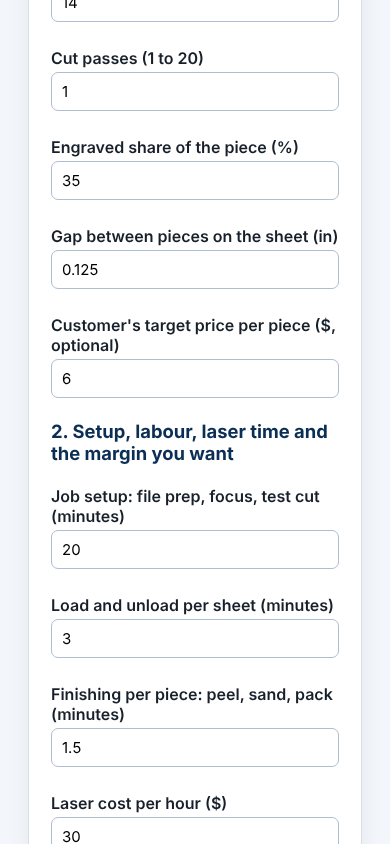
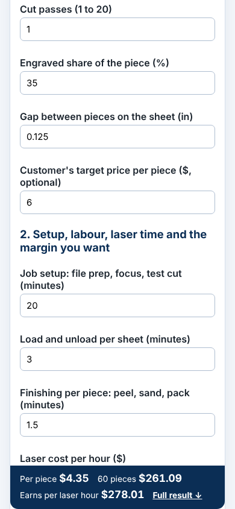
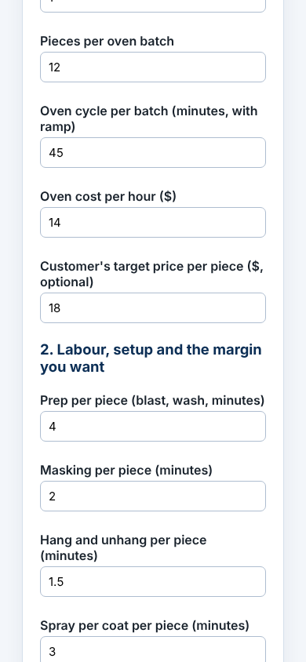
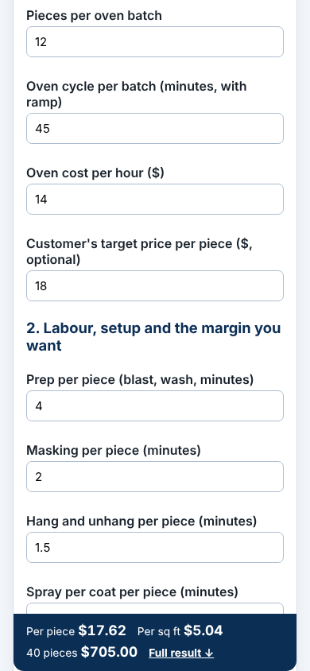

# Polish 2026-11-27: laser and powder coating price calculators answer on load

Track: polish/0. Item 1 of `polish-2026-11-27-cnc-live-answer.md` ("results hidden until a
button", front doors to a bet first). Took the two bet #2 front doors it named,
`ventures/laser-cutting-engraving-job-price-calculator` and
`ventures/powder-coating-job-price-calculator` (both in the manufacturing entry of
`platform/pages/front-doors-map.mjs`). They share one page template, so one change fits both.

## Measured

Chromium, 390 × 844, each page served straight from `ventures/` (before = `HEAD` via stash):

| | laser before | laser after | powder before | powder after |
|---|---|---|---|---|
| result on first load | hidden | shown | hidden | shown |
| strip on load | none | $4.35/piece · 60 pieces $261.09 · $278.01/laser h | none | $17.62/piece · $5.04/sq ft · 40 pieces $705.00 |
| strip after qty → 200 | none | $3.89/piece · $777.15 | none | $16.76/piece · $3,351.14 |
| page height | 6,129 px | 7,615 px | 6,499 px | 7,858 px |
| `scrollWidth` | 390 | 390 | 390 | 390 |
| localStorage keys after load | 0 | 0 | 0 | 0 |
| page errors | 0 | 0 | 0 | 0 |

An invalid materials or powder line shows the parser's error in the strip and hides the
report (no stale price on screen); "Load an example" restores it and turns aria-live back on.

## What changed

- `run(scroll, announce)`: the existing render, now also filling a sticky `#live` strip in the
  form card. It runs with `announce = false` on load (unless a shared link ran it) and 250 ms
  after any input in the form card; that sets the report's `aria-live` to `off`, so a screen
  reader is not read the whole result on every keystroke. The buttons still announce.
- Only the buttons call `record()`; the preview counts no use.
- Phone padding tightened at ≤ 560 px (body 20/16 px, cards 18/16 px), as on the CNC page.
- Without JavaScript nothing changes: `#report` and `#live` stay `hidden`.
- +1 test each in `page.test.mjs` (29/29 pass in both).

## Still weakest, next

1. This `id="report" aria-live="polite" hidden` template is on **454** venture pages
   (`grep -l 'id="report" aria-live="polite" hidden' ventures/*/index.html`), plus 48 with
   `id="results" hidden`. Front doors to a bet first; `pay-application-generator` (bet #1) is
   the one left from the CNC note's list. A shared step that applies this edit across the
   template (each page's `r.best` fields differ, so the strip contents need a per-page line)
   would be the "one fix, many pages" version; check the free-tool demotion in `goals.md`
   before spending effort on non-front-door pages.
2. Neither page has dark mode (fixed `:root` colours).
3. Carried: CNC page dark mode; BR-FR-MV-11/BT-128 row heights; `stack-overflowing.mjs`
   matching a header whose `th` holds an element with an `id`.
