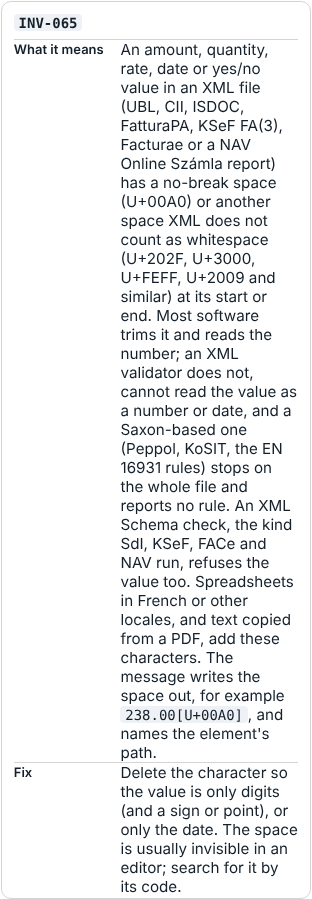
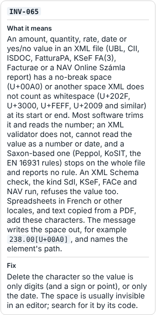

# Polish 2026-11-27: `stack prose` cards for sentences; fee comparison's "best" marker

Track: polish/0. From `polish-2026-11-27-fee-compare-stack.md`'s "Still weakest":
item 2 (the tall e-invoicing error-code cards, bet #3's front door) and item 1
(`stack fields` on four online-seller tables), plus a bug found on the way.

This run first redid item 2 of the online-seller note (marketplace-fee-compare's
results as cards) and found PR #19587 had landed the same change minutes
earlier; that work was dropped, keeping only the bug below.

## Measured (`phone-probe-check.mjs --slugs einvoice-preflight,marketplace-fee-compare`, 390 × 844)

Built with `build.mjs --only=einvoice-preflight,marketplace-fee-compare` from
`origin/main` 9eda0eadf + 5 commits, before and after.

| | before | after |
|---|---|---|
| probe failures (338 pages) | **2** | **1** |
| `br-fr-error-codes.html`: rows taller than the screen | 5 (worst 1,779 px) | 1 (1,118 px) |
| `what-does-this-e-invoice-error-code-mean.html`: rows taller than the screen | 1 (898 px) | 0 (worst 627 px) |
| total height of those pages' stacked rows | 127,025 / 14,959 px | 125,280 / 15,048 px |

The totals barely move: short cells ("Applies to: UBL") now take a label line
of their own, long ones lose most of their lines. The gain is in the worst
rows, which is what a reader scrolling one code hits.

## What changed

- `platform/pages/site-nav.mjs`: `table.stack.prose` (label above value, full
  card width), carried into the venture chrome's `:where()` copy. +1 test in
  `stack-table.test.mjs`.
- `ventures/einvoice-preflight/build-br-fr-codes-page.mjs` writes
  `class="stack prose"`; `br-fr-error-codes.html` regenerated;
  `what-does-this-e-invoice-error-code-mean.html` takes the class by hand.
- `ventures/marketplace-fee-compare/index.html`: the best channel's " — best"
  marker was on `td:first-child::after`, but the first cell of each row is a
  `th scope="row"`, so it never showed on any width. Now
  `th[scope=row]::after`; checked in Chromium at 390 and 1280 px.
- Post: dated update in `docs/posts/2026-11-19-wide-tables-become-cards-on-a-phone.md`.

## Item 1 judged, not done

`stack fields` on the four online-seller SKU tables (amazon-seller-profit-analyzer,
ebay, etsy, shopify): screenshot of amazon's at 390 px with the example loaded
shows 241 px cards, every value labelled, the one Unit cost input right-aligned
with its label. `fields` puts every value in a label-above grid, built for rows
that are mostly inputs; these rows are eight read-only figures and one input,
which read better as they are. Left as is.

## Correction to the fee-compare note's item 3

`stack-overflowing.mjs --scripted` skipped marketplace-fee-compare because the
header text did not match: the last `th` holds ``, which
the script rewrites after load ("Price to net what Depop (US) does"), so the
rendered header key matched no source table. Its output said so:
`0 source tables with header "channelfeerate…" for 1 overflowing: skipped`.
Not because the example was prefilled.

## Verification

- `python3 platform/ci/run_venture_tests.py --changed` and
  `node --test 'platform/pages/*.test.mjs'`: see the run record's notes.
- Probe before/after as above.

No traffic or conversion claim: usage is unmeasured.

## Still weakest, next

1. `br-fr-error-codes.html` BR-FR-CDV-CL-09/MDT-113: a 51-code allowed list in
   English and French in one row (1,118 px). Collapse the code list in the
   generator (`
` after the first sentence) for both languages.
2. Other `stack` tables whose cells are sentences: grep the built site for
   stacked rows whose tallest cell is over ~300 characters and try `prose`
   (the probe flags only rows taller than the screen, not ones that read badly).
3. `stack-overflowing.mjs`: match a header by its static text when a `th`
   holds an element with an `id` (a script-written label), so pages like
   marketplace-fee-compare's are found by the script.
