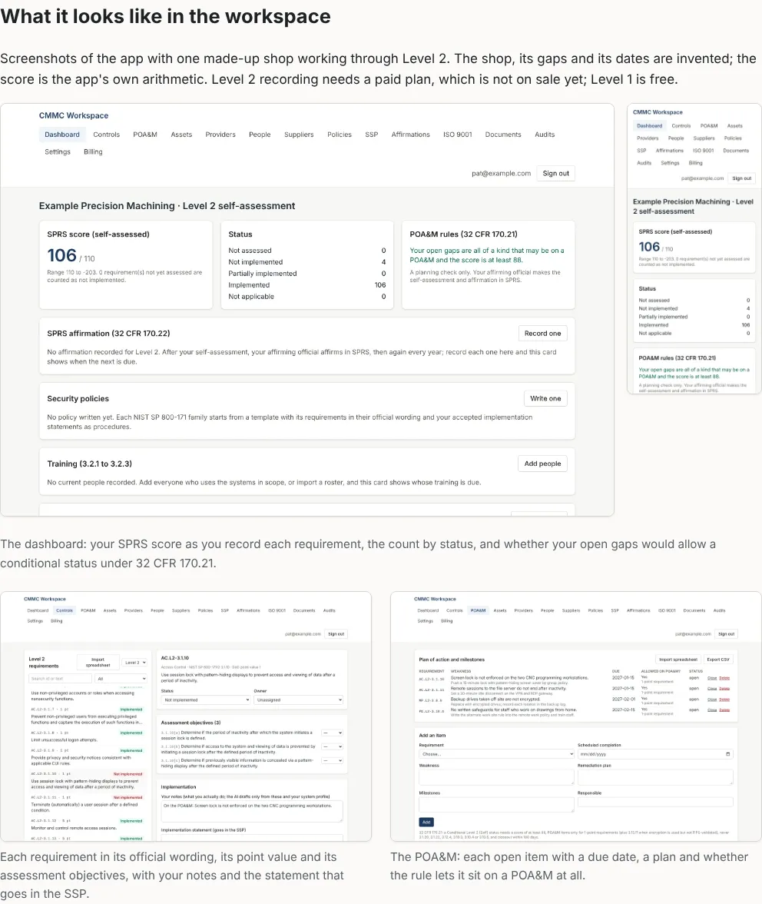
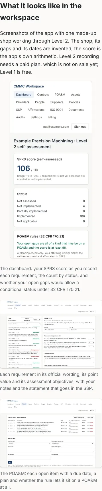

# Polish 2026-11-28: real screenshots of CMMC Workspace, and a 500 on full-workbook import

Track: polish/0. This was item 1 of polish-2026-11-28-seller-books-plurals-stock-phone.md: CMMC
Workspace's site (bet #4, https://marisstella.app/cmmc/) had **no picture of the product**. The
note said to take the stills "from its e2e specs", but `apps/cmmc` has no Playwright e2e suite.
So this run drove the real app (`pnpm dev`, fresh local D1, `FAKE_EXTERNALS=true`) from a plain
Node script instead.

## A product bug found on the way

Recording the invented shop's assessment through the app's own **spreadsheet import** (Controls,
"Import spreadsheet") returned **500** for the whole 110-row Level 2 workbook: `D1_ERROR: too many
SQL variables`. `services/controls/import.ts` inserted missing control records 30 rows a statement
on the belief that a row binds three values. Drizzle binds seven (the three given plus the
`status`, `notes` and `statement` defaults and `updated_at`; read from `toSQL()`), so any import
creating more than 14 new records went over D1's 100. That is every shop moving in with its
existing self-assessment spreadsheet, the import's main use. The other five imports (assets,
suppliers, personnel, POA&M, CRM) already counted their columns right.

- Fix: `INSERT_ROWS = 14` (98 values), exported, with the count explained.
- Test: `test/worker/control-import.test.ts`, "imports all 110 Level 2 requirements into an empty
  workspace": imports every requirement (one gap), expects 200, 110 changes, 109 implemented and
  score 109. With the old chunk of 30 it fails with `expected 500 to be 200`; with the fix it passes.

## What changed on the site

- **`apps/cmmc/scripts/stills.mjs`** (README, "Commands"): signs up, accepts the legal documents,
  creates "Example Precision Machining" (invented) at Level 2, grants the Level 2 plan with a local
  `comp` row in D1 (checkout is dark), fills the system profile, imports a 110-row CSV (106
  implemented, four 1-point gaps), adds a POA&M item for each gap, and photographs the dashboard
  (desktop and phone), the Controls page with AC.L2-3.1.10 open, and the POA&M. The gaps are
  checked against the site's own weights and `POAM_EXCLUDED` before anything runs, and the page
  must show **106** before the dashboard shots. Chromium re-encodes them as WebP into
  `apps/cmmc-site/assets/` (4 files, 239 KB together).
- **Home page, "What it looks like in the workspace"** right after the hero and status box (open
  build only): the dashboard at laptop width next to the phone view, then Controls and POA&M. The
  intro says the shop, gaps and dates are invented, the score is the app's arithmetic, and Level 2
  recording needs a paid plan that is not on sale yet.
- `build.mjs` copies the stills flat beside the pages (the catalogue copies one directory) and
  `withBase` now prefixes `src="/…"` as well as `href`/`action`.
- **`test/site.test.mjs`, "app stills"**: shipped only in the open build; each WebP's header size
  (VP8X or VP8) equals `SHOTS`; under 150 KB; alt text present; on the home page with the
  `/cmmc/` base path; every file in `assets/` listed in `SHOTS`; the "invented" and "not on sale"
  lines present.

## Measured

Catalogue copy (`platform/pages/cmmc-site.mjs`) served locally, Chromium:

| | before | after |
|---|---|---|
| screenshots of the app on the site | 0 | 4 stills (WebP, lazy) |
| `scrollWidth` at 390 / 1280 | 390 / 1280 | 390 / 1280 |
| cmmc-site tests (`node --test test/*.test.mjs`) | 91 | 93, all pass |
| `node --test platform/pages/cmmc-site.test.mjs` | 5 pass | 5 pass |
| Level 2 import of 110 rows into a new org | 500 | 200 |

After, the new band at 1280 px and 390 px:

## Still weakest, next

1. On a phone the Controls and POA&M stills are tiny thumbnails (they open full size on tap).
   Phone crops (one requirement card; the POA&M table's first two rows) through `<picture>`, as
   Seller Books does, would read at 390 px.
2. The app's own tab bar wraps to two rows at 1280 px and four on a phone (15 tabs); grouping
   them (Assess / Records / ISO 9001 / Account) would make the product look calmer in every still.
3. The stock report and the deposit check (Seller Books) still have no guide page: item 2 of
   polish-2026-11-28-seller-books-plurals-stock-phone.md.
4. Seller Books' other wide tables (Sales, Inventory items, 1099-K): item 3 of the same note.
