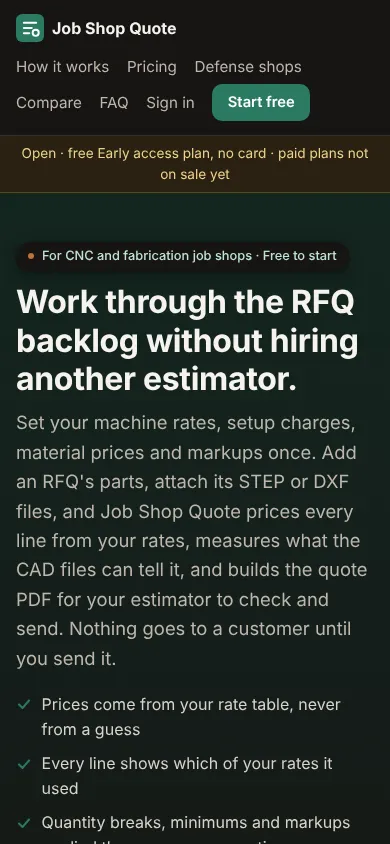
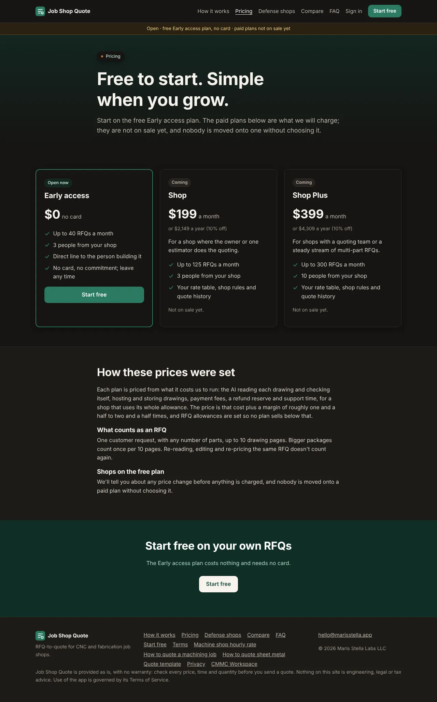

# Polish 2026-11-28: dark mode on the Job Shop Quote site

Track: polish/0. Item 3 of
[polish-2026-11-28-jobshop-quote-log-letterhead.md](polish-2026-11-28-jobshop-quote-log-letterhead.md).
Item 1 (the CAD gap) is product work for a ventures run; item 2 (AI steps on How it works) is copy that
depends on whether AI reading ships, so it was left.

The site for bet #2 (https://marisstella.app/jobshop/) declared `color-scheme: light`, so a shop owner
with a dark phone or desktop got a white page between dark apps. Every colour in `styles.css` was already a
token on `:root`, so the change is one token block, not a rewrite.

## What changed

- **`apps/jobshop-site/public/styles.css`:**
  - `color-scheme: light dark`, and a `@media (prefers-color-scheme: dark)` block that redefines the same
    neutral, brand, accent, warn and danger tokens on warm near-black neutrals (#161412 page).
  - Six role tokens for the places where a scale token was used against its grain (white text written as
    `--n-0`, the CTA band painted with `--brand-800`, the button hover with `--brand-700`): `--on-brand`,
    `--btn-bg`, `--btn-bg-hover`, `--cta-bg`, `--cta-fg`, `--cta-btn-*`. In light mode they resolve to the
    old values, so the light site is pixel-identical (below).
  - App stills stay light: they are screenshots of a light app, framed with the same border and shadow.
- **`src/site/layout.ts`:** `theme-color` per scheme (#226955 light, #161412 dark), so the phone's browser
  bar matches.
- **`test/unit/dark-mode.test.ts`** (the check that keeps it fixed): parses both token blocks, resolves
  `var()` chains and asserts WCAG contrast for the 24 text and non-text pairs the stylesheet sets, in both
  schemes; fails if any rule outside `:root` paints a raw hex colour (which the dark block could not reach);
  checks both `theme-color` tags.
- `catalogue-export/` regenerated.

## Measured

Chromium, `catalogue-export/` served under `/jobshop/`, home, how-it-works and pricing:

| | before | after |
|---|---|---|
| page background with `prefers-color-scheme: dark` | #ffffff | #161412 |
| light-mode screenshots (home, pricing; 390 and 1280) vs before | n/a | byte-identical PNGs |
| lowest text contrast, dark (fineprint on footer) | n/a | 6.3:1 |
| white on the primary button, dark | n/a | 5.2:1 |
| `scrollWidth` at 390 / 1280, light and dark | 390 / 1280 | 390 / 1280 |
| page errors / failed requests | 0 | 0 |
| jobshop-site unit tests | 83 | 134 (51 new in dark-mode.test.ts), all pass |
| `tsc --noEmit`, `biome check` on changed files | pass | pass |

## Still weakest, next

1. The CAD gap (product work, bet #2's core promise): a hand-entered part never gets its STEP/DXF
   measurements. See [polish-2026-11-27-jobshop-shots.md](polish-2026-11-27-jobshop-shots.md).
2. The how-it-works page still describes AI reading in steps 2 and 3 with "not switched on" notes.
3. The home band is long at 1280 px now that the customer-page phone still is 1082 px tall: crop it at the
   accept button, or show the terms card on the PDF only.
4. No still of win/loss by customer or shop load (both are in the app, both claimed in the feature list).
5. The app (`apps/jobshop-quote`) has no dark mode either; the stills would need a dark set to match a
   dark site, which is only worth it once the app has one.
