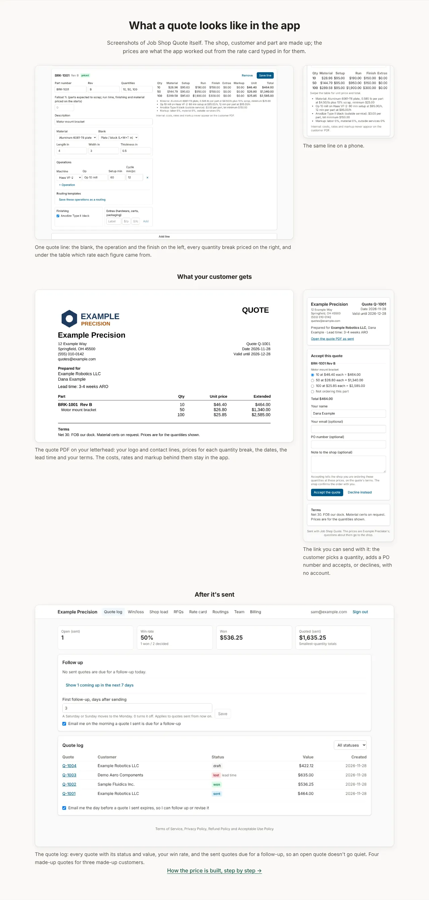
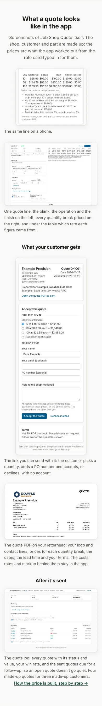

# Polish 2026-11-28: the quote log and a quote on letterhead, on the Job Shop Quote site

Track: polish/0. Items 2 and 3 of
[polish-2026-11-27-jobshop-customer-shots.md](polish-2026-11-27-jobshop-customer-shots.md). Item 1 (the CAD
gap) is product work for a ventures run and is left for one.

The site for bet #2 (https://marisstella.app/jobshop/) showed one quote being built and what the customer
receives, but not the shop's day-to-day view (which quotes are open, won, lost, due a follow-up), and the
PDF still printed a bare shop name, which undercut the "PDF on your letterhead" line in How it works.

## What changed

- **`pnpm stills`** (`apps/jobshop-quote/test/stills/capture.stills.ts`):
  - after the rate-card shot, fills the shop's phone, email, address, default lead time and terms in
    **Shop and pricing rules** and uploads a logo drawn on a canvas in the test (a hexagon and the made-up
    shop's name; nothing taken from anyone). The rate-card, quote-line and quote-phone stills re-encode
    byte-identical, so the hand-checked prices are untouched.
  - after the customer stills, quotes three more made-up RFQs through the same UI path (hand-entered part,
    plate blank, one mill operation), marks one sent and won (PO), one sent and lost ("lead time") and leaves
    one a draft, asserts the log has the 4 rows, and shoots the quote log at 1280x860
    (`quote-log-desktop.webp`, 45 KB).
  - `customer-pdf.webp` now shows logo, contact lines, lead time and terms (same 1275x750 crop: the terms
    fit in the top 5 inches); `customer-quote-phone.webp` shows the contact lines and terms card (390x1082
    CSS, was 944).
- **Site (`apps/jobshop-site/src/site/pages.ts`):** a third row in the home page's app band, **After it's
  sent**, with the quote log; alt text and captions for the PDF and customer page updated to what they now
  show; How it works step 5's caption names the letterhead; the quote template page shows the app's PDF
  under "Doing it in Job Shop Quote", so the template and the product sit side by side.
- `catalogue-export/` regenerated.

## Measured

Chromium, `catalogue-export/` served under `/jobshop/`:

| | before | after |
|---|---|---|
| stills of the shop's quote list / win rate / follow-ups | 0 | 1 (home) |
| PDF still shows logo, contact lines, terms | no | yes (home, how it works, template page) |
| `scrollWidth` at 390 / 1280, home, how-it-works, template, light and dark | 390 / 1280 | 390 / 1280 |
| page errors / failed requests | 0 | 0 |
| jobshop-site unit tests (`shots.test.ts` covers the new still: listed, shown, real size, lazy, alt 80+) | 82 | 83 |
| `tsc --noEmit` (site, app), `biome check` on changed files | pass | pass |
| `node --test platform/pages/jobshop-site*.test.mjs` | 6 pass | 6 pass |

## Still weakest, next

1. The CAD gap (product work, bet #2's core promise): a hand-entered part never gets its STEP/DXF
   measurements. See [polish-2026-11-27-jobshop-shots.md](polish-2026-11-27-jobshop-shots.md).
2. The how-it-works page still describes AI reading in steps 2 and 3 with "not switched on" notes.
3. The site has no dark mode (`color-scheme: light`).
4. The home band is long at 1280 px now that the customer-page phone still is 1082 px tall: crop it at the
   accept button, or show the terms card on the PDF only.
5. No still of win/loss by customer or shop load (both are in the app, both claimed in the feature list).
