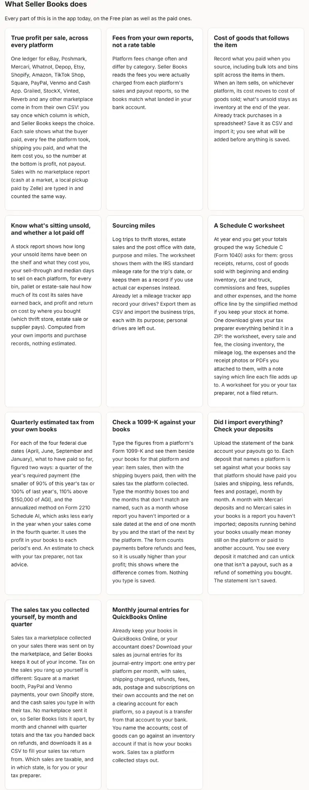
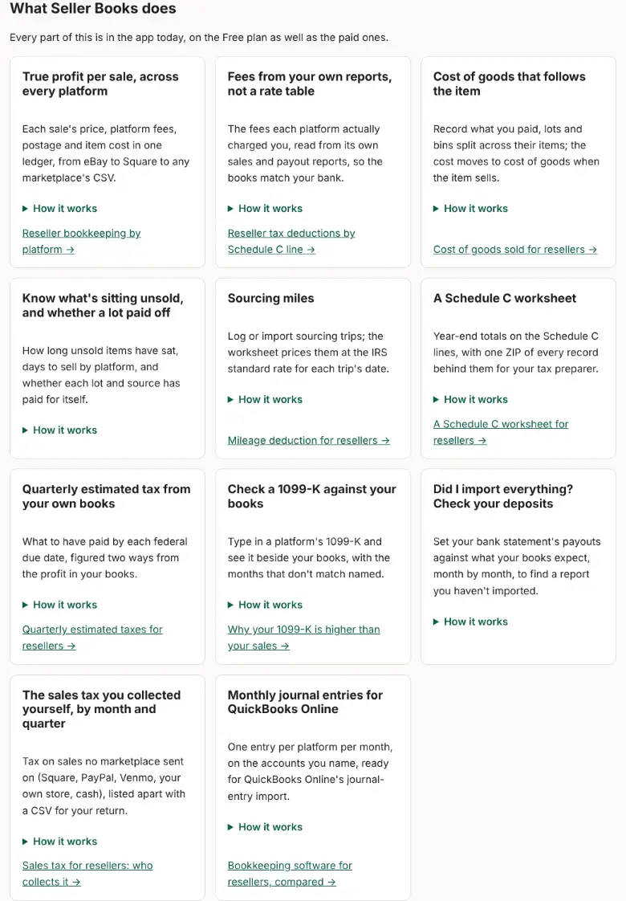

# Polish 2026-11-28: Seller Books' feature cards cut to summaries that link to their guides

Track: polish/0. Item 1 of `polish-2026-11-28-seller-books-shots.md`: now that the home page shows
the app's stills, the eleven "What Seller Books does" cards (100+ words each) were the page's
longest stretch of text, and none of them linked to the guide pages that explain the same thing.

## What changed

- `FEATURES` in `ventures/seller-books/apps/seller-books-site/src/content.mjs` gains `short` (one
  sentence, at most 130 characters) and, where a guide page covers the feature, `guide` (a path).
- Each home-page card is now: the title, the short summary, the full text behind a
  `

How it works
` disclosure (still in the HTML, readable without
  JavaScript, and still in `llms-full.txt` in full), and a link to its guide titled with that
  page's own title (so the link text says where it goes). The guide link sits at the card's foot,
  so the links line up across a row.
- Guides: platforms index, reseller tax deductions (fees on line 10), cost of goods sold, mileage,
  Schedule C worksheet, quarterly estimated tax, 1099-K, reseller sales tax, compare (QuickBooks
  journal entries). The stock report and the deposit check have no guide page yet, so no link.
- `test/site.test.mjs`, "feature cards on the home page": every summary is at most 130 characters
  and shorter than its body, every guide is a built page, every card has its disclosure and its
  guide link, and `llms-full.txt` still carries the full text.

## Measured

Chromium, the site built locally (`node build.mjs`, open mode), served from `dist/`:

| | before | after |
|---|---|---|
| "What it does" section height at 1280 / 390 px | 2,651 / 5,735 px | 1,496 / 3,740 px |
| words visible in that section | 1,059 | 399 |
| home page height at 1280 / 390 px | 6,966 / 13,550 px | 5,811 / 11,555 px |
| links from the cards to guide pages | 0 | 9 |
| `scrollWidth` at 390 / 1280, light and dark | 390 / 1280 | 390 / 1280 |
| page errors / failed requests | 0 | 0 |
| seller-books-site tests | 102 | 104, all pass |
| `platform/pages/seller-books-site.test.mjs` | 5 pass | 5 pass |

Before and after, the section at 1280 px:

## Still weakest, next

1. The "1 orders" plural and the phone lot table in the Seller Books app (item 2 of the stills note;
   app fixes, then rerun `pnpm stills`).
2. CMMC Workspace's site (bet #4, https://marisstella.app/cmmc/) has no screenshot of the app:
   the same `pnpm stills` treatment, from its e2e specs.
3. The stock report and the deposit check have no guide page to link from their cards: a
   "reseller stock report / sell-through" page and a "did I import everything" page would each
   answer a search resellers make, and give those cards a link.
4. Job Shop Quote items 1, 3 to 5 of polish-2026-11-28-jobshop-dark-mode.md.
