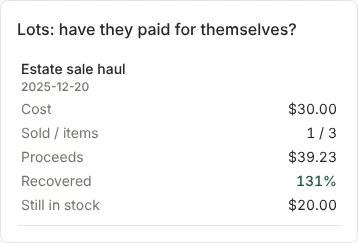

# Polish 2026-11-28: Seller Books says "1 order", and its stock report stacks on a phone

Track: polish/0. Item 1 of `polish-2026-11-28-seller-books-cards.md` (item 2 of the stills note):
the P&L warning read "1 orders have no inventory item linked", visible in the site's hero still, and
the stock report's lot table scrolled sideways inside its card on a phone, so the site left that
still out under 720 px.

## What changed

- **Counts read right.** `src/client/lib/count.ts` (`count(1, "order")` → "1 order", with a unit
  test) replaces the bare `{n} orders` in eight places a reseller sees after their first import:
  the P&L's missing-cost warning ("1 order has ..."), the import summaries on the Imports page and
  in the mapped import ("1 sale and 1 other charge imported; 1 row skipped; 1 sale matched"), the
  sourcing-sheet import, the mileage and card-statement imports ("1 row left out") and the mileage
  log heading ("2026: 1 trip"). E2E regexes that matched the plural now accept both.
- **`.table-stack`** in `src/client/styles.css`: under 480 px a table of figures becomes one block
  per row, the row's name first and each figure on its own line beside its column name (each `<td>`
  after the first carries `data-label`). The header row stays for screen readers (visually hidden,
  not `display: none`). Above 480 px the tables are unchanged (the desktop still is byte-identical).
  Applied to the stock report's three wide tables: days to sell (6 columns), lots (6) and profit by
  source (8). Other tables can take it by adding the class and labels.
- **E2E check that keeps it fixed**: `test/e2e/04-phone-width.spec.ts`, "the stock report's tables
  stack on a phone instead of scrolling": at iPhone 13 width, with a lot added, no card holding a
  `.table-stack` scrolls inside itself, and the lot's "Sold / items" cell reads 0 / 3.
- **Stills**: `pnpm stills` rerun. The profit stills now show "1 order has ..."; a new phone crop
  `shot-stock-phone.webp` (358×243, 7.8 KB) of the lot table, asserted against the same figures as
  the desktop still. The site's stock figure is now a `<picture>` like the Schedule C one, so phones
  see it instead of nothing.

## Measured

| | before | after |
|---|---|---|
| stock lot card sideways overflow at 390 px (app) | scrolls (5 figure columns in 358 px) | 0 px (e2e) |
| site home, stills shown at 390 px | profit phone, Schedule C phone | + stock phone |
| site `scrollWidth` at 390 px | 390 | 390 |
| failed requests on the site home | 0 | 0 |
| seller-books e2e touched specs (01, 02, 03, 04, 05, 07, 08, 11, 16) | | 11 pass |
| seller-books-site `node --test` | 108 pass | 108 pass |

## Still weakest, next

1. CMMC Workspace's site (bet #4, https://marisstella.app/cmmc/) has no screenshot of the app:
   the same `pnpm stills` treatment, from its e2e specs.
2. The stock report and the deposit check have no guide page to link from their home-page cards: a
   "reseller stock report / sell-through" page and a "did I import everything" page.
3. Other wide Seller Books tables (Sales, Inventory items, 1099-K) still scroll inside their cards on
   a phone; `.table-stack` plus `data-label` fixes each, and the 04 spec's check can be widened to
   every page once they do.
4. Job Shop Quote items 1, 3 to 5 of polish-2026-11-28-jobshop-dark-mode.md.
