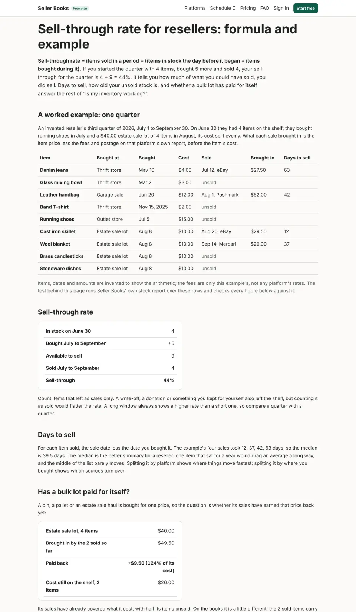
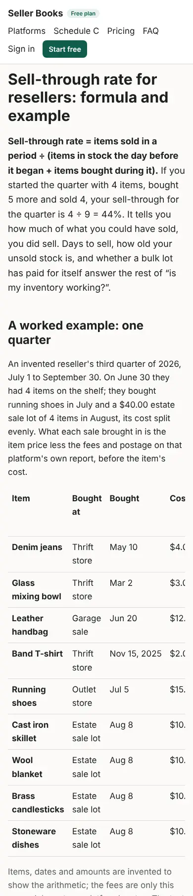

# Polish 2026-11-28: a sell-through rate guide for Seller Books, checked against the app

Track: polish/0. The polish queue's first item (cut Seller Books' feature cards to summaries) was
taken by PR #20015 while this run built the same change, so this run dropped its copy and took
that PR's item 3 instead: the stock report card (sell-through, days to sell, lot payback, stock
age) had no guide page to link to, and "sell-through rate" is a phrase resellers search for.

## What changed

- **New page `/reseller-sell-through-rate`** (bet #5, https://marisstella.app/seller-books/):
  "Sell-through rate for resellers: formula and example". Answer first: the lead states the
  formula and works it on the example. Then one invented quarter of nine items (four on the
  shelf at the start, five bought including a $40 estate sale lot of four) with dates, costs,
  what each sale brought in after the fees and postage on its report, and days to sell. From
  that: sell-through 4 ÷ 9 = 44%, median days to sell 39.5, the lot paid back +$9.50 (124%) with
  $20 of its cost still on the shelf, and stock age (two items over six months). A section on
  how unsold stock sits at cost in closing inventory (Schedule C line 41, linked to the COGS
  page), a section on the stock report in the app, four FAQs with `FAQPage` JSON-LD, the
  not-tax-advice note and the sign-up block. In `llms.txt`, `llms-full.txt` and the sitemap.
- **The example is the app's own arithmetic.** `STOCK_EXAMPLE` is in the stock report's input
  shape; `test/site.test.mjs`, "the sell-through page", runs the app's `buildStockReport`
  (`apps/seller-books/src/worker/services/books/stock.ts`, loaded by Node's type stripping) over
  it and checks every figure the page prints: sell-through and its parts, median days, total
  proceeds, stock count and cost, days held per item, and the lot's proceeds, payback, percent,
  cost on the shelf and sold count, with no warnings. Another test pins the prose ("two items
  over six months", "half the lot unsold", "covered what it cost") to the data.
- **Honest framing:** "There is no one standard" for a good sell-through rate; no platform fee
  rates are claimed (the example says its fees are only the example's); write-off advice is left
  to the tax preparer.
- **Internal link** from the cost of goods sold page's lot paragraph. The home page's stock
  card links here once PR #20015 lands its `guide` field (see next).

## Measured

Chromium, `node build.mjs --out` from this branch, served locally:

| | |
|---|---|
| page height at 1280 / 390 px | 4,503 / 8,103 px |
| `scrollWidth` at 390 / 1280, light and dark | 390 / 1280 (the item table scrolls inside its wrapper on a phone) |
| `h1` count, page errors, failed requests | 1, 0, 0 |
| description length | 156 characters (the site's test caps it at 160) |
| seller-books-site tests | 102 → 106, all pass |
| `node --test platform/pages/seller-books-site.test.mjs` | 5 pass |
| `biome check apps/seller-books-site` | clean |

## Still weakest, next

1. Once PR #20015 merges, set the home page stock card's `guide` to `/reseller-sell-through-rate`
   (one line in `FEATURES`; its test then checks the link).
2. The deposit check ("Did I import everything?") still has no guide page: "did I report all my
   eBay sales" / "1099-K vs bank deposits" is the search.
3. The "1 orders" plural and the phone lot table in the Seller Books app (app fixes, then rerun
   `pnpm stills`).
4. CMMC Workspace's site (bet #4) has no screenshot of the app: the `pnpm stills` treatment.
