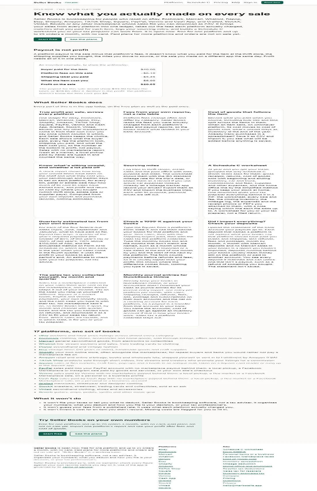
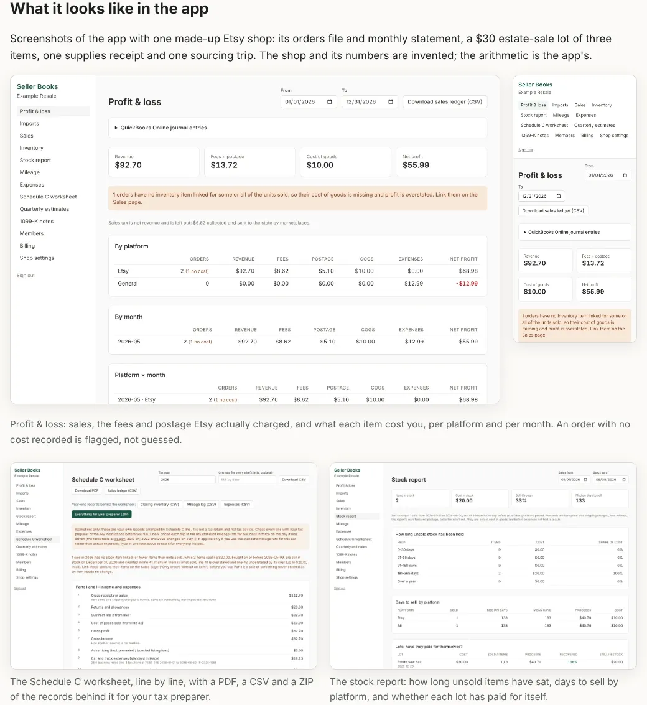
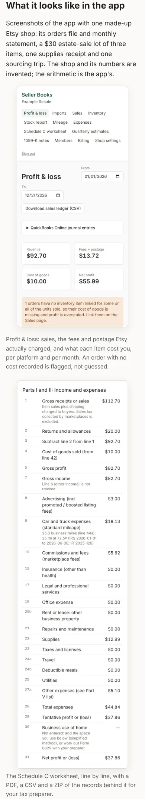

# Polish 2026-11-28: real screenshots of Seller Books on its marketing site

Track: polish/0. The polish queue (polish-2026-11-28-jobshop-dark-mode.md) had Job Shop Quote items
left: the CAD gap is product work; the how-it-works AI copy already describes the rule reader that
PR #19897 shipped; the rest are small crops on a site that has had seven polish passes in two days.
Seller Books (bet #5, https://marisstella.app/seller-books/) had none. Its home page had
**no picture of the product**: a hero, an invented arithmetic table, then eleven dense text cards
(5,786 px of text at 1280 px). Someone deciding whether to sign up could not see what the books look like.

## What changed

- **`pnpm stills`** in `ventures/seller-books/apps/seller-books` (`test/stills/capture.stills.ts`,
  `playwright.stills.config.ts`, the pattern Job Shop Quote uses). It runs the real app offline on the
  e2e server (fresh local D1, `FAKE_EXTERNALS=true`), signs up a made-up shop and builds **exactly the
  books `test/e2e/01-books-to-schedule-c.spec.ts` builds**: one Etsy shop (so the Free plan), a $30
  estate-sale lot of three items, the Etsy orders file and monthly statement, one supplies receipt, one
  trip. Before each shot it **asserts the figures that spec asserts** (revenue $92.70, net profit $55.99,
  Etsy $68.98, Schedule C lines 1/2/4/9, the lot's 136%), plus the extra lines the alt text reads out
  (lines 10, 22, 28, 31; sell-through 33%). Date fields are pinned and blurred, so a rerun gives the same
  stills. Chromium re-encodes them as WebP into `apps/seller-books-site/assets/shot-*.webp` (5 files,
  274 KB together).
- **Home page, "What it looks like in the app"** band right after the hero (open build only): the
  Profit & loss page at laptop width next to the same page on a phone, then the Schedule C worksheet and
  the stock report. The intro says the shop and numbers are invented and the arithmetic is the app's.
  On a phone only readable stills load: the phone P&L, and the worksheet as a phone crop of Parts I and II
  through `<picture>` (one file fetched). The stock still is left out under 720 px: its lot table scrolls
  sideways in the app at that width, so a crop would cut a column off.
- Stills stay light in dark mode (the app is light), framed with the site's border token.
- **`test/site.test.mjs`, "app stills on the home page"** (the check that keeps it right): every
  `assets/shot-*` file is listed in `SHOTS` and vice versa; each WebP's header size matches the
  `width`/`height` written in the page, each is under 120 KB; each is on the home page, lazy, with alt
  text that names figures; the "invented" caption is present.
- `LAST_UPDATED` (sitemap `lastmod`) to 2026-11-28.

## Measured

Chromium, the catalogue copy (`platform/pages/seller-books-site.mjs`) served locally:

| | before | after |
|---|---|---|
| screenshots of the app on the site | 0 | 5 stills (WebP, lazy), 4 placements |
| stills fetched at 390 px / 1280 px | 0 / 0 | 2 (76 KB) / 4 (226 KB) |
| home page height at 1280 / 390 | 5,786 / 11,365 px | 6,966 / 13,550 px |
| `scrollWidth` at 390 / 1280, light and dark | 390 / 1280 | 390 / 1280 |
| page errors / failed requests | 0 | 0 |
| seller-books-site tests | 99 | 102, all pass |
| `node --test platform/pages/seller-books-site.test.mjs` | 5 pass | 5 pass |
| `tsc --noEmit` (app), `biome check` on changed files | pass | pass |

Before (top of the home page, 1280 px):

After, the new band at 1280 px and 390 px:

## Found on the way (product, not fixed here)

- The P&L warning reads "1 orders have no inventory item linked": a plural bug in the app
  (`src/client`), visible in the stills. A one-line fix for a ventures run (the e2e spec matches
  `/orders have no inventory item linked/`, so it needs updating too).
- The stock report's lot table needs sideways scrolling on a phone (five columns of numbers in
  358 px). A stacked row layout under 480 px would fix it, and the site could then show it on phones.

## Still weakest, next

1. Seller Books' home page is still long: the eleven feature cards are 100+ words each. Now the stills
   carry the "what it does" job, cut each card to a two-line summary linking to its guide page.
2. The "1 orders" plural and the phone lot table above (app fixes; then rerun `pnpm stills`).
3. CMMC Workspace's site (bet #4, https://marisstella.app/cmmc/) has no screenshot of the app either:
   the same `pnpm stills` treatment, from its e2e specs.
4. Job Shop Quote items 1, 3 to 5 of polish-2026-11-28-jobshop-dark-mode.md.
