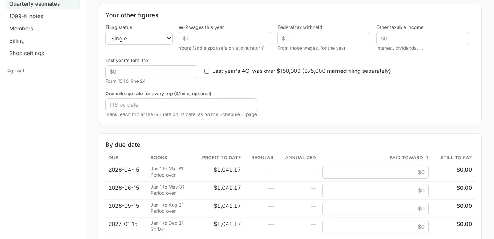
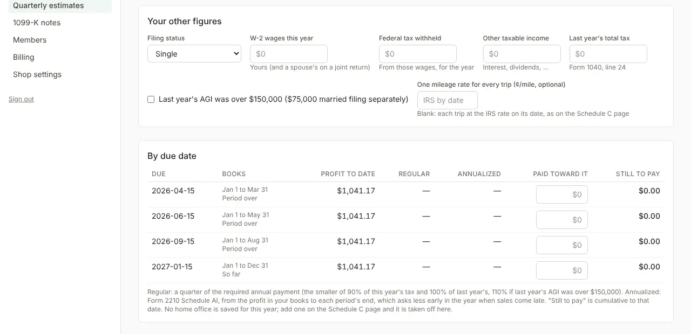

# Polish 2026-11-28: Seller Books' short fields are short again

Track: polish/0. Item 1 of `polish-2026-11-28-seller-books-tables-stack-phone.md`: the Quarterly
estimates page's "Paid toward it" field dropped under its label on a phone. Seller Books is bet #5.

## Measured first

The note blamed `.input` (w-full) and `w-24` both applying in one cell. The cause was wider than
that cell: `src/client/styles.css` declared `.btn`, `.input`, `.label`, `.card`, `.table` and `.num`
as plain, unlayered CSS. Tailwind v4 puts its utilities in `@layer utilities`, and unlayered rules
beat every layer, so **no `w-*` utility on any `.input` ever applied**, anywhere, at any width.
20 call sites ask for a size (`w-20` to `w-36`); every one rendered full width.

A new Playwright spec (`test/e2e/21-input-widths.spec.ts`) reads every visible `.input` with a
`w-<n>` class on the Quarterly estimates, 1099-K, Stock report and Mileage pages and compares its
width with `n × 4 px`. Before the fix, on a laptop:

| page | fields off | example |
|---|---|---|
| Quarterly estimates | 10 | "Paid toward it": 316 px, class asks 96 px; tax year 240 px vs 96 |
| 1099-K | 3 | 240 px vs 96, 144, 112 |
| Stock report | 3 | 240 px vs 112 (the price-an-item fields) |

On the laptop the four "Paid toward it" boxes were 316 px wide in a column of $0 figures, and the
tax-year picker ran the width of a card. On a phone each stacked row spent two lines on the field.

## What changed

- **The component classes moved into `@layer components`**, Tailwind's intended home for them, so a
  utility on the same element wins. The stacked-table rules (`.table-stack`) stay unlayered, so they
  still override `.table td` on a phone, as before.
- **The check that keeps it fixed**: the new spec fails on any sized field more than 1 px off its
  class's width, at laptop and phone widths, and asserts the stacked "Paid toward it" cell is one
  line tall. It went red with 16 findings before the fix and green after.

## Verified

| | before | after |
|---|---|---|
| sized fields off their class width (4 pages, laptop) | 16 | 0 |
| "Paid toward it" on a phone | 2 lines | 1 line |
| full e2e suite (24 specs, 26 tests) | | 26 pass |
| typecheck, biome on changed files | | clean |

## Still weakest, next

1. The 1099-K page's comparison tables (`tax.tsx`, "Books total" and the per-month table) have not
   been measured with form figures entered (item 2 of the previous note).
2. The stock report and the deposit check have no guide page to link from their home-page cards.
3. Checked this run, nothing to do: payapps already keeps its component classes in
   `@layer components`; cmmc and jobshop-quote define none at the top level. A new venture that
   copies Seller Books' old `styles.css` would bring the bug back; copy the new one.
4. Job Shop Quote items 1, 3 to 5 of polish-2026-11-28-jobshop-dark-mode.md.
