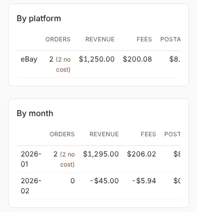
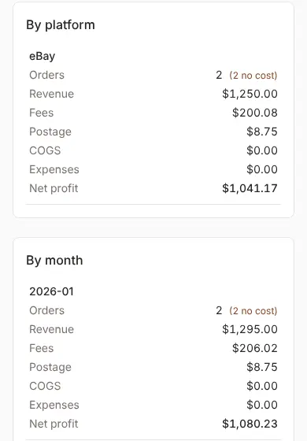

# Polish 2026-11-28: every wide Seller Books table stacks on a phone

Track: polish/0. Item 3 of `polish-2026-11-28-seller-books-plurals-stock-phone.md` (item 1, CMMC
stills, is open as PR #20043). Seller Books is bet #5; resellers keep their books from a phone.

## Measured first

A throwaway Playwright probe at iPhone 13 width (390 px), with an eBay transaction report imported
and one lot of three items added, listed every element in `main` that scrolls sideways inside
itself. Ten tables on seven pages did, by 44 to 297 px:

| page | table | hidden width |
|---|---|---|
| Profit & loss (the home page) | By platform, By month, Platform × month | 250, 258, 258 px |
| Imports | Past imports | 225 px |
| Sales | the sales list | 297 px |
| Inventory | Lots, Items | 51, 44 px |
| Stock report | Price an item, from your own fees | 240 px |
| Expenses | the expense list | 123 px |
| Quarterly estimates | By due date | 215 px |

On the P&L a reseller saw Orders, Revenue and Fees and had to swipe inside each card to reach
Net profit, the one figure they came for.

## What changed

- **`.table-stack` on all ten tables**, with `data-label` on each cell after the first. Above
  480 px nothing changes.
- **`.table-stack` itself** (`src/client/styles.css`): the label now takes `margin-right: auto` and
  the cell's content sits together at the right, so a cell with a figure plus a note ("2 (2 no
  cost)"), a select or a button keeps its parts together instead of being spread across the row;
  `overflow-wrap: anywhere` keeps a long file name or item title from pushing the card wide. Cells
  holding several block lines (Sales fees, price-an-item fees, estimated-tax "Books" and "Profit to
  date") wrap them in one `
` so they stack right-aligned.
- **The check that keeps it fixed**: `test/e2e/04-phone-width.spec.ts`, "every shop page fits a
  phone's width", now also adds a lot and fails if any element in `main` on any of the 13 shop pages
  scrolls sideways inside itself, and asserts the P&L's Revenue cell carries its label. The probe
  that found the ten tables would now be a red test.

## Verified

| | before | after |
|---|---|---|
| tables scrolling inside their card at 390 px (13 pages) | 10 | 0 |
| page `scrollWidth` overflow at 390 px | 0 | 0 |
| seller-books unit tests | | 433 pass |
| typecheck | | clean |
| biome on changed files | | clean (6 pre-existing lint findings elsewhere unchanged) |
| full e2e suite (22 specs) | | 22 pass |

## Still weakest, next

1. The Quarterly estimates page's "Paid toward it" input drops under its label on a phone because
   `.input` (w-full) and `w-24` both apply; give the stacked cell's input a fixed width.
2. The 1099-K page was measured empty (no form figures entered); its comparison tables
   (`tax.tsx`, "Books total" and the per-month table) have not been measured with data.
3. The stock report and the deposit check have no guide page to link from their home-page cards
   (item 2 of the previous note, still open).
4. Job Shop Quote items 1, 3 to 5 of polish-2026-11-28-jobshop-dark-mode.md.
