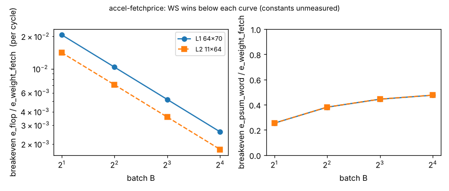

# accel-fetchprice

Sixth step of track 8 (task-specific AI accelerators) in `PROJECTS.md`, and the "price the fetches" next step of `accel-planebatch`. That project measured, in RTL, that weight-stationary (WS) scheduling saves weight fetches (4,480 once instead of 4,480 x B on the 64x70 layer) but costs flops when its partial sums stay in a register file (about 192 extra flops per batch element). Whether that is a good trade depends on the relative price of an SRAM weight fetch and of idle flops, which nobody here has measured. This project does not guess those prices. It solves for the **breakeven price ratio** at each batch size from the RTL-measured counts, so a reader can check their own technology against it. The question: how cheap must an extra flop-cycle be, relative to a weight fetch, for register-file WS to beat output-stationary (OS), and could WS with partial sums in SRAM (the `accel-dataflow` model, not built) ever win?

**Builds on.** `research/accel-planebatch` (all counts come from its `results.json`, copied to `data/` with a test that it still equals the original), `research/accel-dataflow` (the partial-sum SRAM counts `model_p_wr`, `model_p_rd`). No lab in `prompt.md` works on this, so no lab tag is claimed. Dataflow vocabulary follows Chen, Emer and Sze (2016), Eyeriss, ISCA; Horowitz (2014), ISSCC, is the usual source of per-operation energy ratios, but **no figure from it is used or checked here**.

## Method
For one layer and batch, with OS and WS rows from the RTL runs:
- WS register file (built): saves `w_saved = w_fetch(OS) - w_fetch(WS)` weight fetches; pays `extra_flops x cycles x e_flop`, where `e_flop` is the energy of one extra flop per cycle (ungated clock load plus leakage, lumped). Breakeven `e_flop*/e_weight = w_saved / (extra_flops x cycles)`. Below it WS wins; above it OS wins. With perfect clock gating of idle accumulators, `e_flop` is ~0 and WS always wins on energy, paying only area.
- WS with partial sums in SRAM (the model's WS, not built): saves the same weight fetches; pays `(p_wr + p_rd)(WS) - (p_wr + p_rd)(OS)` extra SRAM word accesses. Breakeven `e_psum/e_weight = w_saved / extra_words`.
- MAC energy and activation fetches are equal across designs in these RTL runs and drop out. Cycles are RTL cycles.

## Reproduce
```bash
cd research/accel-fetchprice
python3 -m pytest tests -q          # 6 tests, <1 s
python3 experiments/run.py          # stdlib only; writes results.json and results.txt
python3 experiments/figure.py       # needs matplotlib; writes experiments/fetchprice.png
```

## Results (from `experiments/results.txt`; P = 8 lanes; B = 1 has no saving and no crossover)
| shape | B | weight fetches saved | extra flops | e_flop*/e_weight | r_psum* |
|---|---|---|---|---|---|
| 64x70 | 2 | 4,480 | 193 | 2.1e-2 | 0.254 |
| 64x70 | 4 | 13,440 | 578 | 1.0e-2 | 0.380 |
| 64x70 | 8 | 31,360 | 1,347 | 5.2e-3 | 0.444 |
| 64x70 | 16 | 67,200 | 2,884 | 2.6e-3 | 0.476 |
| 11x64 | 4 | 2,112 | 578 | 7.1e-3 | 0.381 |
| 11x64 | 16 | 10,560 | 2,884 | 1.8e-3 | 0.476 |

- **Register-file WS needs idle flops to be cheap.** At B = 4 on the 64x70 layer, WS beats OS only if one extra flop costs under about 1% of a weight fetch per cycle; at B = 16 under about 0.26%. The threshold falls roughly as 1/B because the saving and the extra flops both grow about linearly in B - 1, while the cycles over which idle flops are charged grow as B. So large batches need clock gating to pay on energy. Whether real flops meet these thresholds is **not established here**: no measured or sourced flop or SRAM energy is used.
- **WS with partial sums in SRAM cannot win at these counts unless a partial-sum word is cheaper than about 0.25 to 0.48 of a weight fetch.** A partial sum is 24 bits against a 4-bit weight, so a word access costing less than half a weight fetch looks implausible, which agrees with `accel-dataflow` ranking WS worst. This is an argument from the ratio, not a measurement of any memory. A packing effect (several 4-bit weights per SRAM word) would lower `e_weight` per weight and make the bar harder for WS still.
- The two layer shapes give nearly the same `r_psum*` (0.254 to 0.476), as the counts scale together; the flop breakeven differs only by the cycle count.



## Limitations
- No energy constant is measured or sourced; results are breakeven ratios, not energies. Whether a given technology sits above or below a breakeven is left open.
- `e_flop` lumps clock and leakage and ignores the register-file read mux; area is not priced (see `accel-planebatch` for cells). A small SRAM for partial sums (cheaper than flops, more expensive than idle flops) is the obvious middle design and is not modelled.
- Counts are from P = 8, two layer shapes, batch 1 to 16, one engine style.

## Next steps
Source flop clock energy and SRAM read energy from an open PDK characterisation (for example SKY130 liberty files) and place the breakevens against them; add a WS variant with partial sums in a small SRAM macro estimate; sweep P.

## Owner steps
None. Analysis of simulation output only.

## Outside dependencies (vitamins)
Python standard library for the model and tests; matplotlib for the figure (optional); the `accel-planebatch` RTL results (Icarus Verilog and Yosys produced them, not re-run here).
