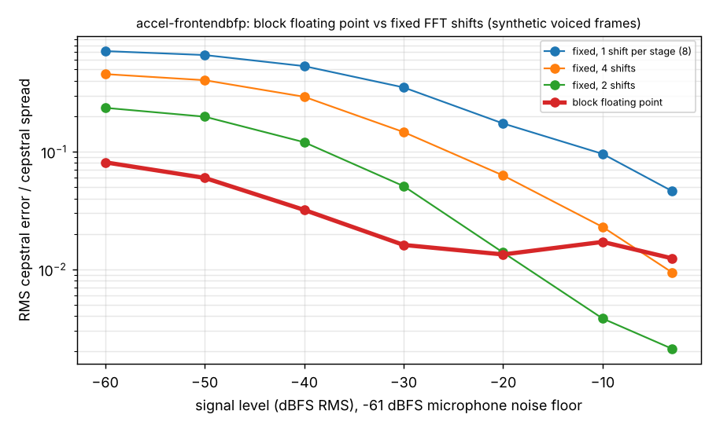

# accel-frontendbfp: does block floating point fix the 16-bit FFT scaling problem in an always-on MFCC front end? (preliminary, synthetic audio)

Track 8 (task-specific AI accelerators) in `PROJECTS.md`, follow-up to `accel-frontend`, whose "Next steps" asked for block floating point. `accel-frontend` showed that a fixed per-stage FFT shift schedule in a 16-bit word either floors quiet speech (one shift per stage: cepstral error 0.68 of the cepstral spread at -50 dBFS) or overflows loud speech (fewer shifts need 17 to 19 bits). **Headline:** one data-chosen exponent shared by the whole 256-point FFT, kept in 16-bit stored words, gives a cepstral error of 0.016 to 0.081 of the spread from -60 to -30 dBFS, against 0.35 to 0.72 for one shift per stage, at +4,608 adds per frame (+42%) on the front end's adds and about +0.5% of its modelled energy. From -20 dBFS up it is no better than fixed schedules that spend 18 to 20 bits (0.012 to 0.017 against 0.002 to 0.014): a 16-bit word costs about 0.01 of the spread in rounding error. Synthetic frames only; no keyword accuracy is measured.

**Live page:** https://duncan-haywood.github.io/oss-monorepo/research/accel-frontendbfp/

**Builds on.** `research/accel-frontend` (the Q15 front end, its counters and its float reference, imported, not copied, apart from the post-FFT code in `bfp.py`, which is copied with one change), and through it `research/accel-kws` and `research/ambient-wearable`. Block floating point in FFTs is textbook fixed-point DSP (Oppenheim and Schafer, *Discrete-Time Signal Processing*, the chapter on finite word-length effects); I did not look up an exact edition or page and cite it only as the idea. No group in `prompt.md` works on this; I do not claim a lab connection.

## Method
- **Exponent rule** (`src/accel_frontendbfp/bfp.py`). Radix-2 butterflies can grow a component to at most (1 + sqrt 2) times the largest input component, so a 16-bit signed word is safe while the block's largest component is at most 13,573. Before stage 0 the whole block is shifted left until its peak is as large as that allows; after each stage it is shifted right by 1 only if the stage's stored peak exceeds 13,573. The net shift (negative for quiet frames) is the shared exponent and is undone in the log step. A test checks no stored word exceeds 32,767 and that the output equals NumPy's FFT times 2^net within 0.2% of the peak.
- **Cost.** A running peak costs 4 compares per butterfly (counted as adds) and 512 for the input peak detect. Shifters are not counted, as in `accel-frontend`.
- **Fidelity.** Same synthetic voiced frames, same -61 dBFS noise floor and same metric as `accel-frontend` (RMS error over cepstra 1 to 9, divided by the float cepstra's spread), 40 frames per point instead of 20, seven levels from -60 to -3 dBFS. The spread (9.83) is the same.

## Reproduce
```bash
pip install numpy matplotlib
cd research/accel-frontendbfp
python3 experiments/run.py      # about 5 s; writes results.json and results.txt
python3 experiments/figure.py   # redraws bfp.png
python3 -m unittest discover -s tests -v   # 5 tests
```

## Results (from `experiments/results.txt`)
Error as a share of cepstral spread (lower is better); the bracket is the widest word the scheme's adders produce before the shift.

| level (dBFS) | 1 shift/stage | 4 shifts | 2 shifts | block floating point |
|---|---|---|---|---|
| -60 | 0.715 (9 b) | 0.456 (9 b) | 0.236 (11 b) | **0.081** (17 b adder, 16 b stored) |
| -50 | 0.662 | 0.405 | 0.198 | **0.060** |
| -40 | 0.533 | 0.292 | 0.120 | **0.032** |
| -30 | 0.351 | 0.147 | 0.051 | **0.016** |
| -20 | 0.173 | 0.063 | 0.014 (18 b) | 0.013 |
| -10 | 0.096 | 0.023 (17 b) | 0.004 (19 b) | 0.017 |
| -3 | 0.046 | 0.009 | 0.002 (20 b) | 0.012 |



- **Block floating point removes the quiet-input floor.** At -50 dBFS it is 11 times better than one shift per stage and 3 times better than the 2-shift schedule that already needs 13-bit adders, with the stored data 16 bits throughout (largest stored word 27,770).
- **It does not beat wider words when the signal is loud.** At -10 and -3 dBFS the 2-shift schedule (19 to 20 bits) is 4 to 6 times more accurate. The floor of the 16-bit scheme is about 0.01 of the spread, from rounding in every stage. BFP is the choice if the memory word is fixed at 16 bits; a 20-bit FFT is the choice if area allows.
- **Cost is small.** Multiplies and memory words are unchanged (7,532 and 15,620). Adds go from 11,009 to 15,617 per frame. At `accel-frontend`'s 0.05 pJ per 16-bit add that is 0.23 nJ against its 46.8 nJ per frame, about 0.5%, so the conclusion that the front end is about 54 times the classifier's power does not move.
- **The adder is 17 bits.** The pre-shift sum can reach about 2.4 times the 16-bit limit, so the butterfly needs a 17-bit adder (or a shift fused into the add) even though memory stays 16 bits.

## Limitations
- **Synthetic audio, error not accuracy.** Speech Commands is unreachable from the container. The metric is cepstral distortion, not keyword accuracy; retraining the `accel-kws` classifier on these features is still open.
- **Energy constants are `accel-frontend`'s**, 45 nm, typed from memory of Horowitz (2014) and not re-checked here. The +0.5% is an estimate of an estimate.
- One exponent per frame. Per-stage-per-band or per-butterfly-group exponents could do better on frames with one loud tone; not tried.
- Compare-and-shift hardware (barrel shifter, exponent register, the peak detector's latency) is not counted beyond compares; no RTL.
- The rule is conservative (shifts if the stored peak exceeds 13,573, which allows for the worst case); a tighter rule would keep more bits on average but risk overflow, and I did not sweep it.

## Next steps
Retrain `accel-kws` on integer features from these two front ends and measure accuracy against level; write the BFP FFT in RTL and check it bit for bit against `bfp.py`; try an overflow-detect-and-redo rule instead of the conservative bound; re-check the Horowitz constants.

## Owner steps
None.

## Outside dependencies
NumPy for the float reference and tests; `accel-frontend`. Nothing was bought or fabricated.
