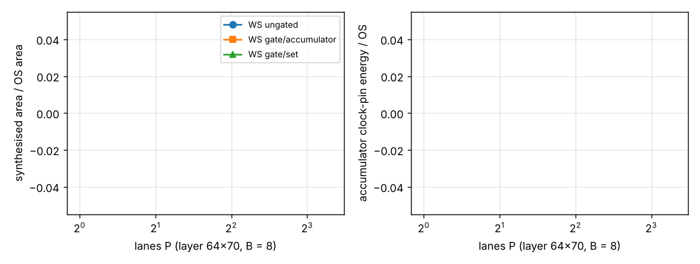

# accel-gatedlanes: does the gated weight-stationary engine's verdict depend on how many lanes it has? (stylised)

> Update: `accel-gatedmux` found the cause of the P = 32 memory failure (a variable-index read of the accumulator bus), fixed it, and re-measured P up to 64. The WS-over-OS area ratios below are overstated; gated WS is about 1.5x OS at B = 4 and 2.2x at B = 8.

**Live page:** https://duncan-haywood.github.io/monorepo-projects/research/accel-gatedlanes/

Tenth step of track 8 (task-specific AI accelerators) in `PROJECTS.md`. `accel-gatedrtl` built and synthesised the clock-gated weight-stationary (WS) engine at one lane count (P = 8) and listed "sweep P" as a next step. This does that. It seemed worth doing because its headline numbers (gated WS 1.8x the output-stationary (OS) area at B = 4, clock-pin energy 1.0 to 1.07x OS with a gate per set) were measured at a single P, and a result that moves with P would not transfer to other engine sizes.

**Builds on.** `research/accel-gatedrtl` (the RTL, the four modes, the simulation and synthesis wrapper in `rtl.py` and the clock-pin energy model are used unchanged, imported from its `src`), `research/accel-gatedprice` (liberty reader and flop / gate clock-pin energies), `research/accel-kws` (the 64x70 layer, int4 weights, int8 inputs, 24-bit accumulators). No lab in `prompt.md` works on this; no lab tag is claimed.

## Method
- Same four modes as `accel-gatedrtl`: **OS**, **WS ungated** (hold mux per flop), **WS gate/acc** (one clock gate per 24-bit accumulator) and **WS gate/set** (one gate per set of P accumulators). Layer 64x70; P in {2, 4, 8, 16, 32}; B = 4 for all P, B = 8 for P up to 8 (P = 16 at B = 8 was left out).
- Per point: Icarus simulation of two random problems, outputs compared with NumPy `einsum`, with fetch counts and accumulator bits written; Yosys 0.33 `synth -flatten`, `dfflibmap`, `abc` against SKY130 HD `tt_025C_1v80`, then `stat -liberty`. Clock-pin energy per cycle is the liberty-based model of `accel-gatedrtl` (`dfxtp_1` and `dlclkp_1` clock-pin energies).
- Yosys is run under a 7 GB address-space limit so that a point that needs more fails alone and is reported as failed, not hidden. The points left out are listed under Limitations.

## Reproduce
```bash
sudo apt-get install -y iverilog yosys            # plus numpy and matplotlib in a Python environment
sh ../accel-pdkprice/fetch_pdk.sh ../accel-pdkprice/pdk   # from research/accel-gatedlanes; needs network
python3 -m unittest discover -s tests             # 3 tests, ~2 s (the results test reads results.json)
python3 experiments/run.py                        # ~10 min with 2 workers; writes results.json and results.txt
python3 experiments/figure.py                     # writes experiments/gatedlanes.png
```

## Results (from `experiments/results.txt`; 29 points)
- **Correctness holds at every P.** All 29 points are bit-exact against NumPy, and all four modes write the same accumulator bits at each (P, B), so the gating assumption of `accel-gatedprice` survives from 2 to 16 lanes. Cycles fall in proportion to P (8,962 at P = 2 to 1,122 at P = 16 for B = 4), and WS fetches each weight once (4,480) against B times that for OS.
- **The clock-energy verdict does not move with P.** Accumulator clock-pin energy relative to OS: ungated WS is exactly B times OS at every P (4.00 and 8.00); a gate per set is 1.07x at P = 2 falling to 1.01x at P = 16 (B = 4), because it has B gates whatever P is while the flops grow with P; a gate per accumulator sits at 1.14x for B = 4 and 1.28 to 1.29x for B = 8, at every P.
- **The area ratios move a little.** Gated WS (gate per set) against OS is 1.57x at P = 2, 1.83x at P = 4, 1.81x at P = 8, 1.87x at P = 16 (B = 4); at B = 8 it is 2.89x, 2.97x and 3.03x for P = 2, 4, 8. The fixed counters and weight-read logic weigh more at small P, so WS looks relatively cheaper there; from P = 4 up the ratio is flat to within 0.1. Gating saves 12 to 13 % of area against ungated WS at B = 4 (9 to 12 % for a gate per accumulator) and 15 to 17 % at B = 8, again nearly independent of P.
- **Takeaway.** The `accel-gatedrtl` conclusion (gating makes register-file WS cheap to clock but not small) is a property of B, not of the lane count, over 4 to 16 lanes. Sizing the engine does not rescue WS against OS on area.



## Limitations
- **Wider points failed.** At P = 32 (B = 4) Yosys exceeded the 7 GB limit for the three WS modes (OS synthesised); P = 16 at B = 8 and P = 32 at B = 8 were not attempted after two earlier runs had Yosys killed for memory on them. So the sweep stops at P = 16 for B = 4 and P = 8 for B = 8, and says nothing about wider engines. The memory growth itself is a property of this RTL as flattened, and was not investigated.
- Everything in `accel-gatedrtl`'s limitations applies: synthesis only (no place and route, clock tree, timing or gate glitch check), a clock-pin-only energy model with no data-path switching or leakage, behavioural gate in simulation, one layer shape, random data, 4-bit weights. SKY130 only.
- Ratios are of synthesised cell area; absolute areas are not predictions for a chip.

## Next steps
Find why Yosys memory grows so fast with P x B in `gated_engine.v` (likely the accumulator read mux) and restructure it to reach P = 32; put the gated engine through OpenROAD for a clock tree and timing; swap the accumulator register file for an SRAM macro estimate and compare with `accel-pdkprice`.

## Owner steps
None. Simulation and synthesis only; no hardware was specified, bought or measured.

## Outside dependencies (vitamins)
The SKY130 HD liberty file from OpenROAD-flow-scripts (fetched at a pinned commit by `accel-pdkprice/fetch_pdk.sh`; Apache-2.0); Icarus Verilog and Yosys (apt); NumPy and matplotlib; `accel-gatedrtl`'s RTL and wrapper and `accel-gatedprice`'s `lib.py`.
