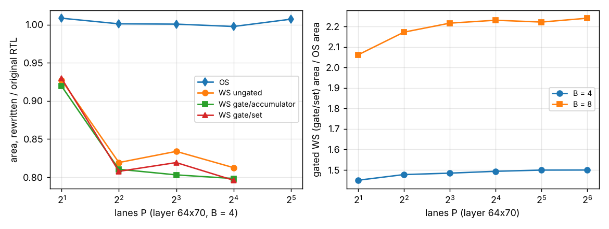

# accel-gatedmux: why did the gated weight-stationary engine need so much synthesis memory, and does fixing it change its area verdict? (stylised)

Eleventh step of track 8 (task-specific AI accelerators) in `PROJECTS.md`. `accel-gatedlanes` stopped at P = 16 lanes because Yosys ran out of memory at P = 32, and listed "find why Yosys memory grows so fast with P x B" as its next step. This does that. It seemed worth doing because the cause turned out to be one line of RTL that also inflated the area of every weight-stationary (WS) engine measured so far, so the "WS stays much larger than OS" verdict of `accel-gatedrtl` and `accel-gatedlanes` needed re-measuring.

**Headline.** The accumulator read in `gated_engine.v` indexed the whole accumulator bus with a variable `slot*P + j`, which Yosys builds as one wide shifter per lane. Replacing it with an AND-OR over the B sets (constant part-selects) gives the same cycles, fetches, accumulator writes and flop count, and bit-exact outputs, but **WS engines are 17 to 28 % smaller** (OS is unchanged, within 1 %). Gated WS (gate per set) is now **1.45 to 1.50x** the OS area at B = 4 (was 1.57 to 1.87x) and **2.1 to 2.2x** at B = 8 (was 2.9 to 3.0x), flat in P out to 64 lanes. Yosys at P = 8, B = 4, ungated WS went from 703 MB and 24.5 s to 53 MB and 4.0 s, and every point up to P = 64 now synthesises under the 7 GB cap.

**Builds on.** `research/accel-gatedrtl` (the engine, testbench, ICG cell, and `rtl.py` simulate / synthesise wrapper; `rtl/gated_engine.v` here is a copy with the read mux replaced, `tb_gated.v` and `icg.v` are unchanged copies), `research/accel-gatedlanes` (its `results.json` is the "original RTL" column: same layer, same flow, same 7 GB cap), `research/accel-kws` (64x70 layer, int4 weights, int8 inputs, 24-bit accumulators). No lab in `prompt.md` works on this; no lab tag is claimed.

## Method
- The one change: in `always @*`, `accq[(slot*P + j)*ACCW +: ACCW]` becomes `cur[j*ACCW +: ACCW]`, where `cur` is built per lane by `for k in 0..NS-1: if (slot == k) sel |= accq[(k*P+p)*ACCW +: ACCW]`. Nothing else differs from `accel-gatedrtl`'s file (see the diff).
- Same four modes (OS, WS ungated, WS gate per accumulator, WS gate per set), same flow: Icarus simulation of two random problems per point compared with NumPy `einsum`, Yosys 0.33 `synth -flatten`, `dfflibmap`, `abc` against SKY130 HD `tt_025C_1v80`, `stat -liberty`; clock-pin energy from the liberty model of `accel-gatedrtl`. P in {2, 4, 8, 16, 32, 64}, B in {4, 8}: 48 points. The 7 GB address-space cap is kept.
- `tests/` checks, for P in {2, 8, 32} and all modes, that the rewritten RTL gives the same outputs as NumPy and the **same cycle, fetch and written-bit counts** as the original RTL.

## Reproduce
```bash
sudo apt-get install -y iverilog yosys            # plus numpy and matplotlib in a Python environment
sh ../accel-pdkprice/fetch_pdk.sh ../accel-pdkprice/pdk   # from research/accel-gatedmux; needs network
python3 -m unittest discover -s tests             # 4 tests, ~4 s (two compare old and new RTL in simulation)
python3 experiments/run.py                        # ~15 min on 4 cores; writes results.json and results.txt
python3 experiments/figure.py                     # writes experiments/gatedmux.png
```

## Results (from `experiments/results.txt`; 48 points, no synthesis failures)
- **Same design, fewer cells.** All 48 points are bit-exact against NumPy, flop and gate counts equal the original RTL's at every point where both exist, and all four modes write the same accumulator bits. Only combinational cells change. Area, rewritten over original: WS ungated 0.93 at P = 2 and 0.81 to 0.83 from P = 4 (B = 4), 0.74 to 0.78 at B = 8; gate per accumulator and per set 0.92 at P = 2 and 0.71 to 0.82 from P = 4. OS is 1.00 to 1.01.
- **The WS-over-OS area penalty is smaller than reported.** Gated WS (gate per set) over OS: 1.45 (P = 2), 1.48, 1.48, 1.49, 1.50, 1.50 (P = 64) at B = 4; 2.06, 2.17, 2.22, 2.23, 2.22, 2.24 at B = 8. The old figures were 1.57 to 1.87 and 2.89 to 3.03. The penalty is now close to the bare cost of the extra accumulator flops; it still grows with B and is still flat in P.
- **Gating saves about the same share.** Against ungated WS, gate per set is 0.85 to 0.88 at B = 4 and 0.78 to 0.81 at B = 8. The clock-pin energy ratios are unchanged because they depend only on flop and gate counts: gate per set 1.00 to 1.07x OS.
- **Synthesis cost.** Yosys time at P = 64, B = 8, ungated WS is 53 s on this machine (about 4 s at P = 8 and B = 4); the original RTL needed 24.5 s and 703 MB (peak child RSS) at the latter point against 4.0 s and 53 MB here, and failed under 7 GB at P = 32, B = 4.
- **Takeaway.** `accel-gatedrtl`'s and `accel-gatedlanes`' conclusions that gating cuts the clock cost and that WS grows with B survive; the size of the area penalty does not. Their absolute WS areas were inflated by 17 to 28 % by an artefact of how the accumulator was read. Any WS area comparison against `accel-pdkprice`'s SRAM macros that used those areas should be redone with these.



## Limitations
- The cause is established by the effect of the change (memory, time and area before and after at one point, area at eleven more), not by reading Yosys's internal passes. The wide shifters are the likely mechanism: it was not inspected.
- The original-RTL columns are `accel-gatedlanes`' results, not re-synthesised here, and exist only for P up to 16 (B = 4) and 8 (B = 8). Peak memory is a single measurement (child maximum RSS of one Yosys run); it was not recorded for the sweep.
- `accel-gatedrtl`'s B = 16 points (5.3x OS in the old RTL) were not rerun; expect a smaller ratio but this project does not say how much.
- Everything else in `accel-gatedrtl`'s limitations applies: synthesis only (no place and route, clock tree, timing, or gate glitch check), clock-pin-only energy model, behavioural gate in simulation, one layer shape, random data, 4-bit weights, SKY130 only. Synthesis was the only optimisation flow tried; a different `abc` script might narrow the old-versus-new gap.

## Next steps
Redo `accel-gatedrtl`'s B = 16 points and the `accel-pdkprice` SRAM-macro comparison with the rewritten engine; put the engine through OpenROAD for a clock tree and timing; record Yosys peak memory per point; look for the same indexing pattern in the other `accel-*` and `chip-*` engines.

## Owner steps
None. Simulation and synthesis only; no hardware was specified, bought or measured.

## Outside dependencies (vitamins)
The SKY130 HD liberty file from OpenROAD-flow-scripts (fetched at a pinned commit; Apache-2.0); Icarus Verilog and Yosys (apt); NumPy; matplotlib; `accel-gatedrtl`'s `rtl.py` and `accel-gatedprice`'s `lib.py`.
